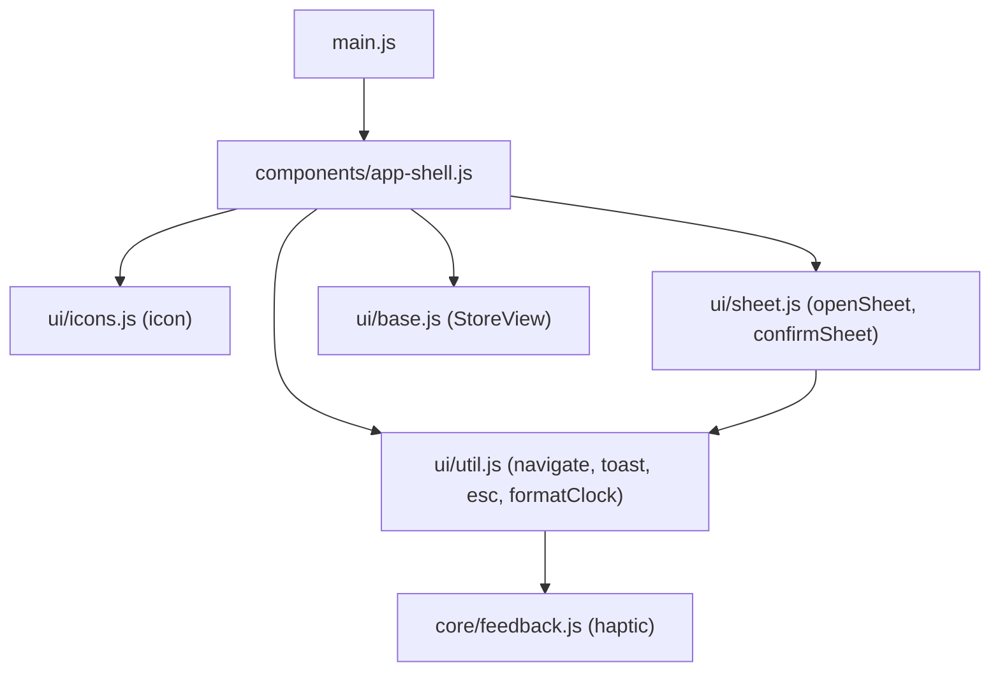
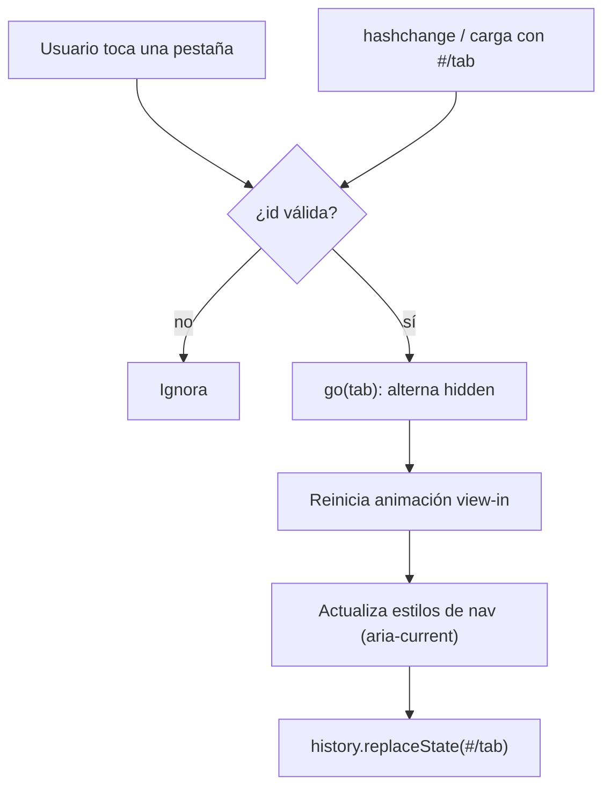
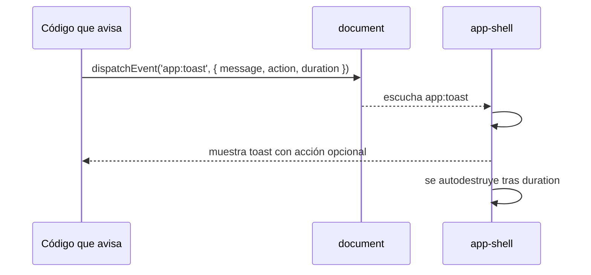

# Diseño: Base y shell

## Árbol de archivos

```
index.html                     (nuevo)
src/main.js                    (nuevo)
src/core/feedback.js           (nuevo: solo haptic() por ahora)
src/ui/base.js                 (nuevo: StoreView, esqueleto; se completa en la spec 02)
src/ui/icons.js                (nuevo: icon(name, cls) + PATHS)
src/ui/sheet.js                (nuevo: openSheet, confirmSheet)
src/ui/util.js                 (nuevo: esc, navigate, toast, formatClock)
src/components/app-shell.js    (nuevo: <app-shell>)
```

## Diagrama de componentes

Respeta la dirección de dependencias `components → ui → core`. En esta spec `core` solo aporta `feedback.js`.



## Flujo de navegación por pestañas y URL



## Flujo de un toast



## index.html

- `<meta viewport content="width=device-width, initial-scale=1, viewport-fit=cover">`, `theme-color #fbf6ea`, `lang="es"`.
- Tailwind: `<script src="https://cdn.tailwindcss.com">` y `tailwind.config` con `theme.extend.colors` (tokens de `design-system.md`).
- Estilos globales en `<style>`: variables `--safe-t`/`--safe-b`, `html, body` a 100 % con `overflow: hidden` y `overscroll-behavior: none`, `touch-action: manipulation`, `input` a 16 px, `[hidden]` con `display: none !important`.
- Layout del shell: `app-shell { position: fixed; inset: 0; display: grid; grid-template-rows: minmax(0,1fr) auto }`. Media query de 768 px a rejilla de dos columnas con la `nav` como riel.
- Clases utilitarias: `.view`, `.scroll`, `.pad-top`, `.press`, `.page`, `.view-in`, `.pop`, `.fab`, `.chip`, `.switch`, `.sheet-*`, `.toast` y los `@keyframes`.
- `<app-shell>` en el body y `<script type="module" src="./src/main.js">`.

## `<app-shell>`

- `TABS = [{ id, label, icon }]`. En esta spec solo `tasks` (con un `<div>` temporal "Próximamente"); cada spec posterior agrega su pestaña.
- `connectedCallback` crea `<main>` (una vista por pestaña, `hidden` las inactivas), `<nav>` (botones con ícono y etiqueta), `#toasts` (`aria-live="polite"`) y `#sheet-host`.
- `go(tab)`: valida, alterna `hidden`, reinicia animación `view-in`, actualiza estilos de la barra e invoca `history.replaceState(null, '', '#/tab')`.
- Escucha `app:navigate`, `app:toast` y `hashchange`.
- `#toast({ message, action, duration })`: máximo 2, `role="status"`, botón de acción opcional.

## ui

- `icon(name, cls)` devuelve un SVG de trazo (24×24, `stroke-width 2`, redondeado, `currentColor`, `aria-hidden`). Íconos iniciales: `plus`, `check`, `x`, `play`, `pause`, `reset`, `trash`, `chevron`, `list`, `timer`, `leaf`, `chart`.
- `openSheet({ title, render(body, close), onClose })` devuelve `close`. Arrastre con `pointer events` y `setPointerCapture`.
- `confirmSheet({ title, message, confirmLabel, danger })` → `Promise<boolean>`.
- `navigate(tab)` y `toast(message, options)` disparan `CustomEvent` en `document`.
- `formatClock(ms)` → `MM:SS` con `Math.ceil`.

## Decisiones

- **Light DOM** para que Tailwind funcione sin Shadow DOM.
- **Rejilla y `fixed` en vez de `vh`** para evitar el desfase con las barras del navegador (skill `responsive-mobile-first`).
- Comunicación por eventos en `document`, no imports entre vistas.
