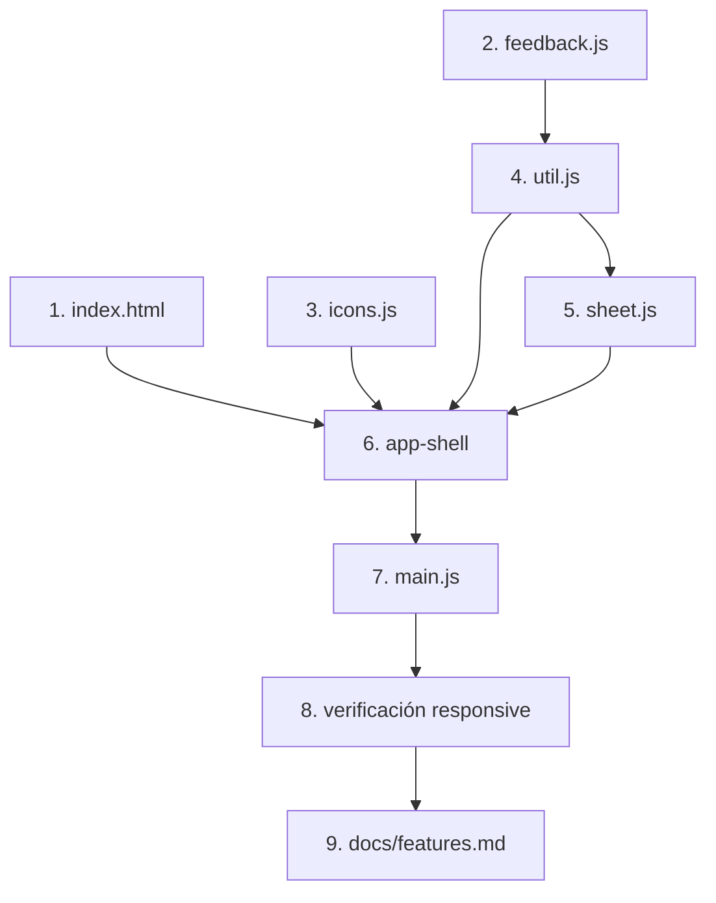

# Tareas: Base y shell

## Overview

Levanta el esqueleto de la app (página, estilos, navegación responsive y utilidades de interfaz) con Web Components en light DOM y sin datos todavía. El enfoque es construir primero las utilidades de `ui` y `core`, luego el `app-shell` que las orquesta y por último el arranque en `main.js`.

## Tasks

- [ ] 1. Crear `index.html` con metas, Tailwind por CDN, tokens de color y estilos globales (ver diseño).
  _Requirements: 1, 2, 3, 10_
- [ ] 2. Crear `src/core/feedback.js` con `haptic(pattern)` protegido con try/catch.
  _Requirements: 6_
- [ ] 3. Crear `src/ui/icons.js` con `icon()` y los íconos iniciales.
  _Requirements: 4_
- [ ] 4. Crear `src/ui/util.js` con `esc`, `navigate`, `toast`, `formatClock`.
  _Requirements: 6, 9_
- [ ] 5. Crear `src/ui/sheet.js` con `openSheet` y `confirmSheet` (cierre por fondo, Escape y arrastre).
  _Requirements: 7, 8_
- [ ] 6. Crear `src/components/app-shell.js` con pestañas, navegación por hash, toasts y host de hojas.
  _Requirements: 1, 2, 3, 4, 5, 6_
- [ ] 7. Crear `src/main.js` que importa el shell.
  _Requirements: 4_
- [ ] 8. Verificar a 390 px y 1280 px: barra inferior vs. riel lateral; toast y hoja de prueba desde la consola (`document.dispatchEvent(new CustomEvent('app:toast', { detail: { message: 'Hola' } }))`).
  _Requirements: 2, 3, 6, 7, 11_
- [ ] 9. Confirmar que existe `docs/features.md` y que la sección "Transversales" refleja la navegación por pestañas y por URL.
  _Requirements: 4, 5_

## Notes

- `src/ui/base.js` se crea aquí solo como esqueleto; `StoreView` se completa en la spec 02 cuando exista el store.
- La pestaña `tasks` muestra un placeholder "Próximamente"; cada spec posterior reemplaza o agrega su vista.
- Verificación manual de responsive y de toasts/hojas: no hay pruebas automatizadas en esta spec. Revisar que no haya errores en consola (criterio 11).
- Usar `position: fixed` + rejilla en lugar de `vh`/`dvh` para evitar el desfase con las barras del navegador (skill `responsive-mobile-first`).

## Task Dependency Graph

