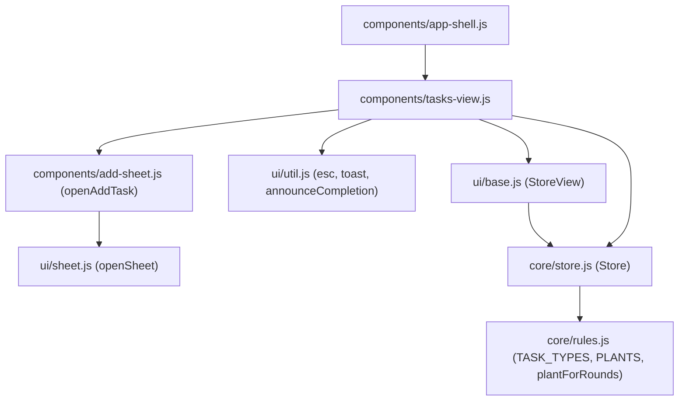
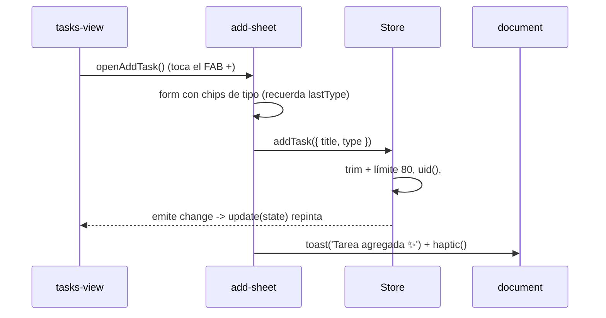
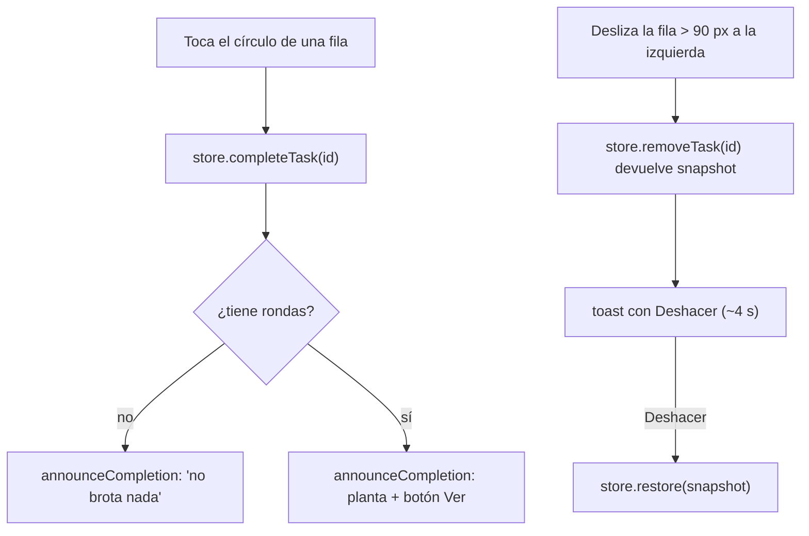

# Diseño: Lista de tareas

## Árbol de archivos

```
src/core/rules.js              (nuevo: TASK_TYPES, TYPE_BY_ID, PLANTS, plantForRounds, roundsByTask, computeStats parcial, dayStart)
src/core/store.js              (nuevo: Store, load/persist, acciones de tareas)
src/ui/base.js                 (modificar: completar StoreView)
src/ui/util.js                 (modificar: + announceCompletion)
src/components/tasks-view.js   (nuevo: <tasks-view>)
src/components/add-sheet.js    (nuevo: openAddTask)
src/components/app-shell.js    (modificar: registrar tasks-view, quitar placeholder)
src/main.js                    (modificar: importar tasks-view)
```

## Diagrama de componentes

Dirección de dependencias `components → ui → core`.



## Flujo: agregar una tarea



## Flujo: completar y deslizar para eliminar



## Modelo de datos

```js
state = {
  tasks:  [{ id, title, type, createdAt, doneAt: null | number }],
  rounds: [],                       // se usa desde la spec 03
  timer:  { ... },                  // se agrega en la spec 03
  settings: {}                      // se agrega en la spec 03
}
```

Clave de almacenamiento: `jardin-movil:v1`. Principio: **solo hechos**. Progreso, plantas y estadísticas se derivan.

## `rules.js` (puro)

- `TASK_TYPES`, `TYPE_BY_ID`.
- `PLANTS` y `plantForRounds(rounds)` (se necesitan ya para el aviso; el mapeo es 1 pasto … 6+ sakura).
- `roundsByTask(state)` → `Map<taskId, count>`.
- `computeStats(state)` con `doneCount`, `totalCount`, `roundsToday` (el resto se completa en la spec 05).
- `dayStart(ts)`.

## `Store extends EventTarget`

- `state` se carga con `load()` (valida arreglos; ante error crea estado nuevo).
- `subscribe(fn)` llama a `fn` de inmediato y en cada `change`; devuelve la función para desuscribirse.
- `#commit()` guarda en `localStorage` (con try/catch por modo privado) y emite `change` agrupado con `queueMicrotask`.
- `addTask({ title, type })`, `removeTask(id)` (devuelve un snapshot con sus rondas), `restore(snapshot)`, `completeTask(id)` (devuelve `{ task, rounds, plant }`), `reopenTask(id)`, `taskById`, `roundsOf`.
- `uid()` usa `crypto.randomUUID` si existe y un respaldo si no (no hay contexto seguro por IP local).
- `window.__store = store` para depurar.

## `StoreView`

Clase base: añade la clase `view`, llama a `setup()`, se suscribe al store y llama `update(state)`; en `disconnectedCallback` se desuscribe y llama `teardown()`.

## `<tasks-view>`

- `update(state)` repinta todo con template literals y conserva el scroll.
- Filas con `data-id`, acciones con `data-act` (`toggle`, `focus`, `add`) y delegación de eventos en el host.
- Deslizado con pointer events: umbral de activación 10 px y proporción horizontal/vertical de 1,5; eliminación a 90 px; `setPointerCapture`; bloquea el clic posterior ~350 ms.
- Animación `pop` solo para filas nuevas (`#seen`).
- Botón ▶ (enfocar): `store.selectTask(id)` existe desde la spec 03; hasta entonces el botón se agrega en esa spec.

## `openAddTask`

`openSheet` con un `<form>`; chips con `role="radio"`; `lastType` a nivel de módulo; `focus()` del input tras ~320 ms.

## Decisiones

- Renderizado total en cada cambio: sencillo y suficiente para cientos de tareas.
- El filtro vive en el componente, no en el store (no se persiste).
