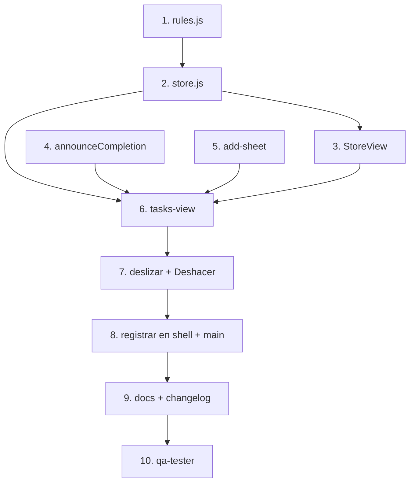

# Tareas: Lista de tareas

## Overview

Construye el módulo `todo-list` completo con estado persistente en `localStorage`: reglas puras, el store como única fuente de verdad y la vista de tareas con alta, filtros, completar y deslizar para eliminar. El enfoque es de abajo hacia arriba: primero `rules.js` y `store.js`, luego la UI compartida y por último la vista y su registro en el shell.

## Tasks

- [ ] 1. Crear `src/core/rules.js` con tipos, plantas, `plantForRounds`, `roundsByTask`, `dayStart` y `computeStats` parcial. Comentario de intención en cada función.
  _Requirements: 1, 6, 9_
- [ ] 2. Crear `src/core/store.js` con carga segura, `subscribe`, `#commit` y las acciones de tareas.
  _Requirements: 4, 5, 7, 12_
- [ ] 3. Completar `src/ui/base.js` (`StoreView`).
  _Requirements: 4, 5_
- [ ] 4. Agregar `announceCompletion` a `src/ui/util.js`.
  _Requirements: 6_
- [ ] 5. Crear `src/components/add-sheet.js`.
  _Requirements: 2, 3, 4_
- [ ] 6. Crear `src/components/tasks-view.js`: encabezado, tarjeta de progreso, filtros, secciones, estado vacío, FAB.
  _Requirements: 1, 3, 5, 8, 9, 10, 11_
- [ ] 7. Implementar deslizar para eliminar + `Deshacer`.
  _Requirements: 7_
- [ ] 8. Registrar `tasks-view` en `app-shell.js` (reemplaza el placeholder) y en `main.js`.
  _Requirements: 1_
- [ ] 9. Revisar `docs/modules/todo-list/README.md`: que la descripción coincida con lo construido y agregar la entrada del changelog. Confirmar que T1 a T8 de `docs/features.md` se cumplen.
  _Requirements: 13_
- [ ] 10. Ejecutar `qa-tester` con el módulo `todo-list` (los casos que dependen de rondas quedan ⚠️ hasta la spec 03).
  _Requirements: 13_

## Notes

- El botón ▶ (enfocar) de cada fila depende de `store.selectTask(id)`, que llega en la spec 03; aquí la fila queda lista pero el botón se agrega en esa spec.
- Las pruebas `TL-*` que dependen de rondas (plantas al completar) quedan en ⚠️ hasta las specs 03 y 04.
- Verificar con `localStorage` corrupto que la app abre vacía sin romperse (criterio 12).
- El filtro por tipo vive en el componente, no se persiste.

## Task Dependency Graph

