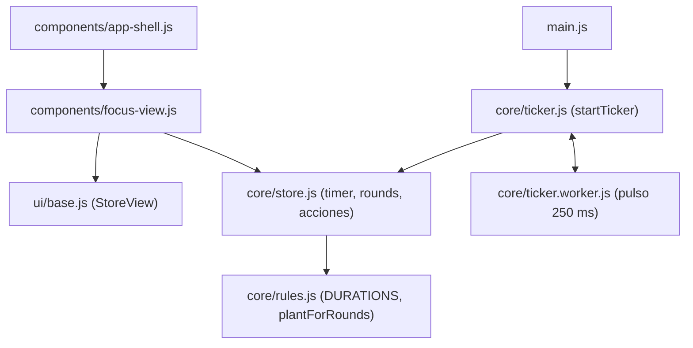
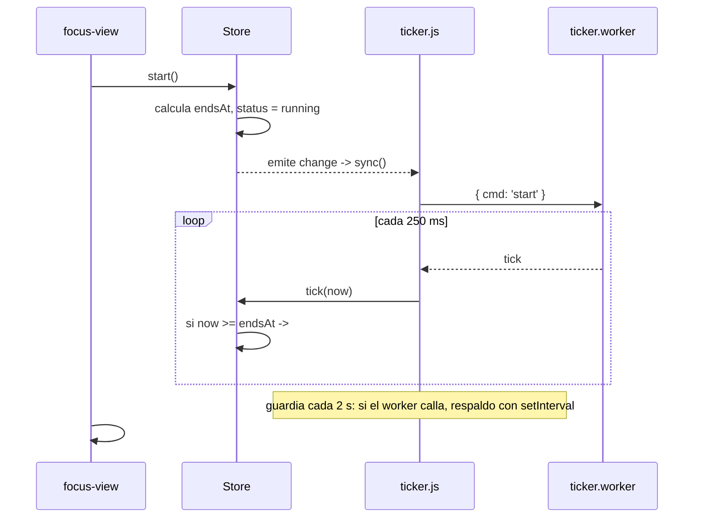
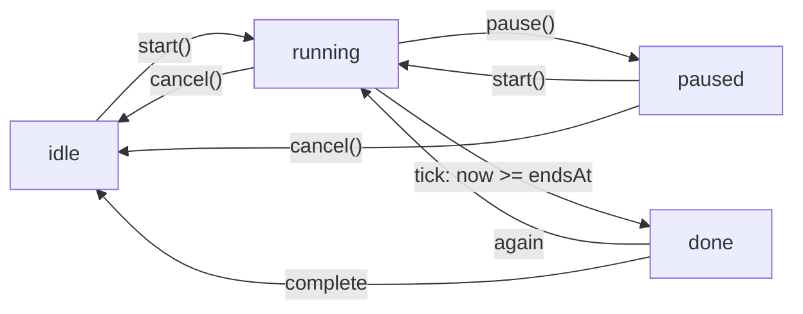

# Diseño: Pomodoro

## Árbol de archivos

```
src/core/rules.js              (modificar: + DURATIONS, DEFAULT_MINUTES, durationLabel)
src/core/store.js              (modificar: + timer, settings, rounds, acciones del pomodoro)
src/core/ticker.js             (nuevo: startTicker(store))
src/core/ticker.worker.js      (nuevo: pulso)
src/components/focus-view.js   (nuevo: <focus-view>)
src/components/tasks-view.js   (modificar: botón ▶, acción 'focus')
src/components/app-shell.js    (modificar: registrar pestaña Foco, toast de ronda)
src/main.js                    (modificar: startTicker(store))
```

## Diagrama de componentes

Dirección de dependencias `components → ui → core`. El worker vive dentro de `core` y se comunica por mensajes.



## Flujo: el pulso del pomodoro (worker + respaldo)



## Flujo: estados del timer



## Modelo

```js
timer    = { taskId, status: 'idle'|'running'|'paused'|'done', totalMs, remainingMs, endsAt }
settings = { demo, sound, music, minutes }       // sound y music se usan en la spec 06
rounds   = [{ id, taskId, at, seconds }]
```

`roundMs(settings)` = 10 000 ms en demo; si no, `minutes * 60 000`.

## Acciones del `Store`

| Método | Regla |
|--------|-------|
| `selectTask(id)` | Con ronda activa solo devuelve si es la misma. Si no, fija la tarea y reinicia el timer |
| `start()` | Requiere tarea pendiente. Desde `paused` usa `remainingMs`, si no `totalMs`. Calcula `endsAt` |
| `pause()` | Guarda `remainingMs = endsAt - now` |
| `cancel()` | Reinicia conservando la tarea |
| `tick(now)` | Si `running` y `now >= endsAt`, `#finishRound()` (idempotente) |
| `#finishRound()` | Agrega la ronda, estado `done`, emite `round` |
| `setDuration(min)` | Solo en `idle`/`done`; valida contra `DURATIONS` |
| `setSetting(key, value)` | `demo` reinicia el timer si está en `idle` |

`load()` hidrata el timer y `constructor` limpia un `taskId` que ya no existe. `completeTask` y `removeTask` reinician el timer si era la tarea activa.

## Ticker

1. `new Worker(new URL('./ticker.worker.js', import.meta.url))`; el worker emite `tick` cada 250 ms tras `{ cmd: 'start' }` y se detiene con `{ cmd: 'stop' }`.
2. `store.subscribe(sync)` arranca/para el worker según `status === 'running'`.
3. Guardia cada 2 s: si el worker calla, lo termina y activa el respaldo.
4. `visibilitychange`, `pageshow` y `focus` llaman `store.tick()`. También una vez al arrancar.
5. Ver skill `web-worker-timer`.

## `<focus-view>`

- Repinta con `update(state)` (estructura) y `#paint()` cada 250 ms (solo texto del reloj y `stroke-dashoffset` del anillo, sin reconstruir el DOM).
- Anillo: `r = 88`, circunferencia `2πr`, `stroke-dashoffset = C * (1 - fracción)`.
- Delegación por `data-act`: `pick`, `toggle`, `again`, `cancel`, `complete`, `duration`, `demo`.
- Si la vista está oculta (`hidden`), `#paint` no hace nada.
- Selector de tarea con `openSheet`.

## Decisiones

- **`endsAt` en vez de contador**: robusto ante pestañas dormidas y recargas.
- **Worker + respaldo**: no se confía en una sola fuente (ver skill).
- La **planta** no se guarda: se calcula con `plantForRounds(roundsOf(taskId))`.
