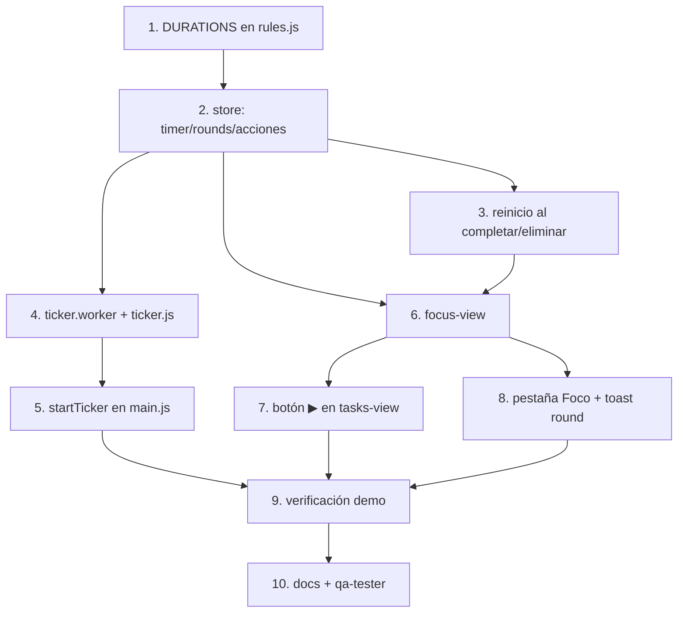

# Tareas: Pomodoro

## Overview

Agrega el módulo `pomodoro`: rondas de enfoque sobre una tarea que sobreviven a cambios de pestaña y recargas gracias a `endsAt` y un Web Worker con respaldo. El enfoque es extender primero `rules.js` y `store.js`, luego el pulso (worker + ticker), después la vista de foco y por último la integración con tareas y el shell.

## Tasks

- [ ] 1. Agregar `DURATIONS`, `DEFAULT_MINUTES` y `durationLabel` a `rules.js`.
  _Requirements: 3_
- [ ] 2. Extender `store.js`: `settings`, `timer`, `rounds`, `roundMs`, validación en `load()` y las acciones de la tabla de diseño.
  _Requirements: 3, 4, 6, 7, 11, 13_
- [ ] 3. Hacer que `completeTask` y `removeTask` reinicien el timer si la tarea era la activa.
  _Requirements: 10_
- [ ] 4. Crear `ticker.worker.js` y `ticker.js` (worker, respaldo, guardia, revisiones al volver).
  _Requirements: 4, 11, 12_
- [ ] 5. Llamar a `startTicker(store)` en `main.js`.
  _Requirements: 12_
- [ ] 6. Crear `focus-view.js`: tarjeta de tarea, duraciones, anillo, controles, tarjeta de fin, tira de plantas, modo demo, selector de tarea.
  _Requirements: 2, 3, 5, 6, 8, 13, 14_
- [ ] 7. Agregar el botón ▶ a las filas pendientes de `tasks-view.js` y el aviso de bloqueo.
  _Requirements: 9_
- [ ] 8. Registrar la pestaña **Foco** en `app-shell.js` (punto parpadeante) y el toast de ronda terminada (evento `round`).
  _Requirements: 1, 7_
- [ ] 9. Verificar con Modo demo: iniciar, pausar, reanudar, terminar, otra ronda, recargar a mitad, cambiar de pestaña.
  _Requirements: 4, 11, 12, 13, 15_
- [ ] 10. Actualizar `docs/modules/pomodoro/README.md` (changelog), marcar P1 a P7 y P10 en `docs/features.md` y ejecutar `qa-tester` con `pomodoro`.
  _Requirements: 15_

## Notes

- El restante siempre se calcula con `endsAt - Date.now()`, nunca acumulando ticks (ver skill `web-worker-timer`).
- El worker solo corre mientras `status === 'running'`; una guardia de 2 s activa el respaldo con `setInterval` si el worker calla.
- Sonido y música llegan en la spec 06; aquí los interruptores de `settings.sound`/`settings.music` se omiten en la UI.
- La planta no se guarda: se deriva con `plantForRounds(roundsOf(taskId))`.
- `__ticker` debe quedar visible en consola para depurar (criterio 12).

## Task Dependency Graph

