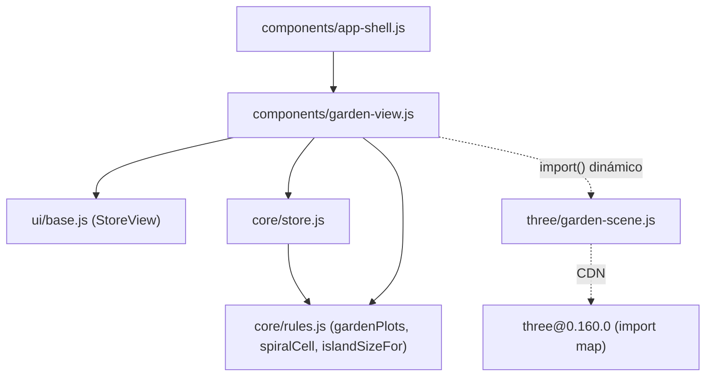
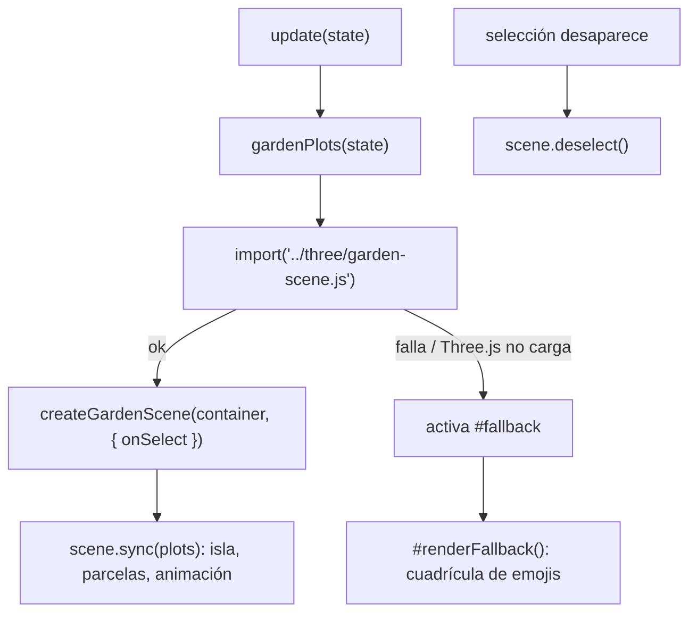
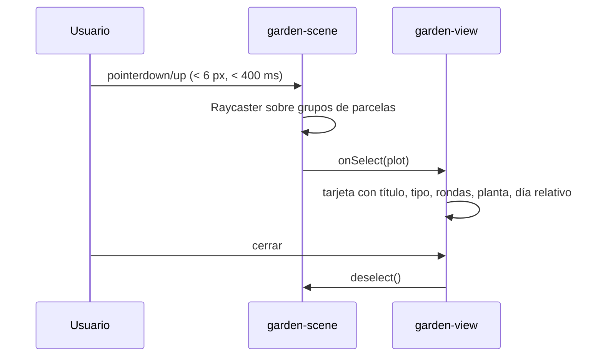

# Diseño: Jardín 3D

## Árbol de archivos

```
index.html                     (modificar: + import map de three, estilo .garden-sky)
src/core/rules.js              (modificar: + gardenPlots, relativeDay, spiralCell, islandSizeFor)
src/components/garden-view.js  (nuevo: <garden-view>)
src/three/garden-scene.js      (nuevo: createGardenScene)
src/components/app-shell.js    (modificar: registrar pestaña Jardín)
src/main.js                    (modificar: importar garden-view)
src/ui/icons.js                (sin cambios: ya tiene 'x' y 'leaf')
```

## Diagrama de componentes

`garden-view` importa la escena dinámicamente con `import()`; `garden-scene.js` vive en `src/three/` y solo depende de Three.js (CDN).



## Flujo: sincronizar el jardín y degradación elegante



## Flujo: selección de una planta



## Import map

```html
<script type="importmap">
{ "imports": {
  "three": "https://unpkg.com/three@0.160.0/build/three.module.js",
  "three/addons/": "https://unpkg.com/three@0.160.0/examples/jsm/"
} }
</script>
```

## Reglas puras (`rules.js`)

- `gardenPlots(state)` → `[{ id, title, type, doneAt, rounds, plant }]`.
- `spiralCell(i)` → `[x, z]`: 0 en el centro, 1 a 8 en el anillo 1, 9 a 24 en el anillo 2…
- `islandSizeFor(count)` → lado impar, mínimo 7, que deja un anillo libre.
- `relativeDay(ts)` → "hoy", "ayer", "hace N días".

## `createGardenScene(container, { onSelect })`

Devuelve `{ sync(plots), deselect(), resize(w, h), dispose() }`.

Secciones del archivo, en orden: renderer/cámara/luces → materiales y geometrías compartidas (`M`, `G`, `put`) → constructores de plantas (`BUILD.grass|flower|bush|tree|butterfly|sakura`) → isla y nubes → encuadre (`fitDistance`, `reframe`) → parcelas (`createPlot`, `sync`) → selección por raycaster → bucle (`update`, `loop`, `setRunning`).

Puntos clave:

- `sync(plots)` reconstruye la isla solo si cambia el tamaño; agrega, quita o reemplaza parcelas comparando `plant.kind|type`; reubica si cambia el índice.
- Animación de aparición con `easeOutBack` y retraso escalonado.
- Selección: `pointerdown/up` con umbral (< 6 px y < 400 ms) y `Raycaster` sobre los grupos de parcelas.
- Cada planta recibe `ctx = { type, wing, anim }`; `anim` es una lista de funciones `(t) => {}`.
- El bucle se detiene si `document.hidden` o el contenedor mide ≤ 2 px.
- Nada de `Math.random()` para la forma de una planta.

## `<garden-view>`

- Contenedor con `.garden-sky`, capa 3D (`[data-stage]`), encabezado, tarjeta vacía, tarjeta de selección y leyenda.
- `ResizeObserver` → `scene.resize`.
- `createGardenScene(...).catch(...)` activa `#fallback` y pinta `#renderFallback()`.
- `update(state)` calcula plots, actualiza subtítulo y llama `scene.sync`. Si la planta seleccionada desaparece, deselecciona.
- `teardown()` llama `scene.dispose()`.

## Decisiones

- Three.js se permite por CDN porque el 3D es complejo (ver `dependencies-policy.md`).
- Se pinta un solo canvas, con geometrías y materiales compartidos, para cuidar la batería.
- Ver skill `update-3d-world` para extender.
