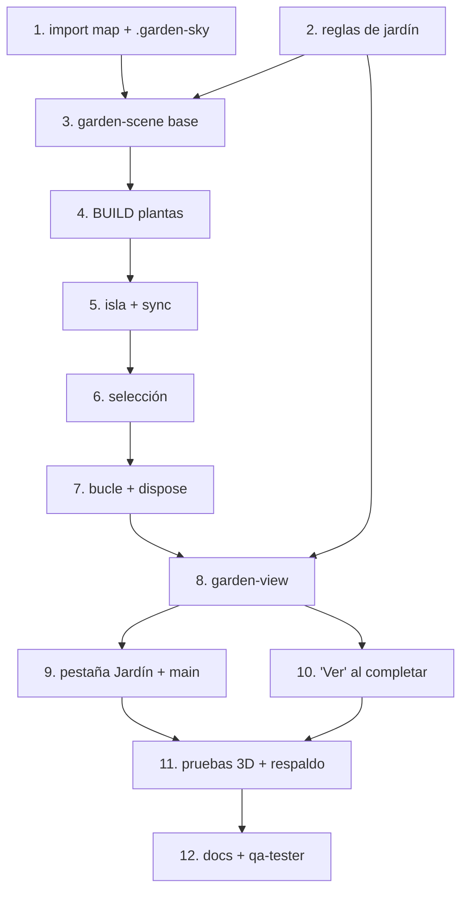

# Tareas: Jardín 3D

## Overview

Agrega el módulo `3d-world`: una isla flotante donde cada tarea terminada con rondas se convierte en una planta. El enfoque es preparar las reglas puras de geometría, construir la escena Three.js por capas (renderer, plantas, isla, selección, bucle) y envolverla en `garden-view` con respaldo 2D para que la app siga si el 3D no carga.

## Tasks

- [ ] 1. Agregar el import map de Three.js a `index.html` y el estilo `.garden-sky`.
  _Requirements: 4, 5_
- [ ] 2. Agregar `gardenPlots`, `relativeDay`, `spiralCell` e `islandSizeFor` a `rules.js`.
  _Requirements: 2, 3, 5_
- [ ] 3. Crear `garden-scene.js`: renderer, cámara, controles, luces, materiales y geometrías compartidas.
  _Requirements: 5, 8, 12_
- [ ] 4. Implementar `BUILD` con las seis plantas (pasto, flor, arbusto, árbol, mariposa, sakura) y sus animaciones.
  _Requirements: 2, 6, 7_
- [ ] 5. Implementar isla, nubes, encuadre y `sync(plots)` con animación de aparición.
  _Requirements: 5, 10_
- [ ] 6. Implementar selección por toque, anillo y salto.
  _Requirements: 9_
- [ ] 7. Implementar bucle con pausa en segundo plano, `resize` y `dispose`.
  _Requirements: 12, 13_
- [ ] 8. Crear `garden-view.js` con encabezado, estado vacío, tarjeta de selección, leyenda y respaldo 2D.
  _Requirements: 9, 11, 14_
- [ ] 9. Registrar la pestaña **Jardín** en `app-shell.js` y el import en `main.js`.
  _Requirements: 1_
- [ ] 10. Hacer que el aviso al completar una tarea (`announceCompletion`) ofrezca **Ver** el jardín.
  _Requirements: 1, 3_
- [ ] 11. Probar con tareas reales y con rondas de 1 a 7; probar bloqueando `unpkg.com/three` para ver el respaldo.
  _Requirements: 2, 5, 14, 15_
- [ ] 12. Actualizar `docs/modules/3d-world/README.md` (changelog), marcar W1 a W6 en `docs/features.md` y ejecutar `qa-tester` con `3d-world`. Nota: los casos con "datos de ejemplo" se completan en la spec 05.
  _Requirements: 15_

## Notes

- El jardín se **deriva** con `gardenPlots(state)`; no se guarda nada nuevo en el estado.
- La forma de cada planta es determinista (`rng(hash(taskId))`): nunca `Math.random()`.
- Degradación elegante obligatoria: si Three.js no carga, se muestra la cuadrícula de emojis y el resto de la app sigue funcionando (criterio 14).
- `prefers-reduced-motion` desactiva flotado y giro automático (criterio 13).
- Los casos de prueba `W3-*` que requieren "datos de ejemplo" se cierran en la spec 05.

## Task Dependency Graph

