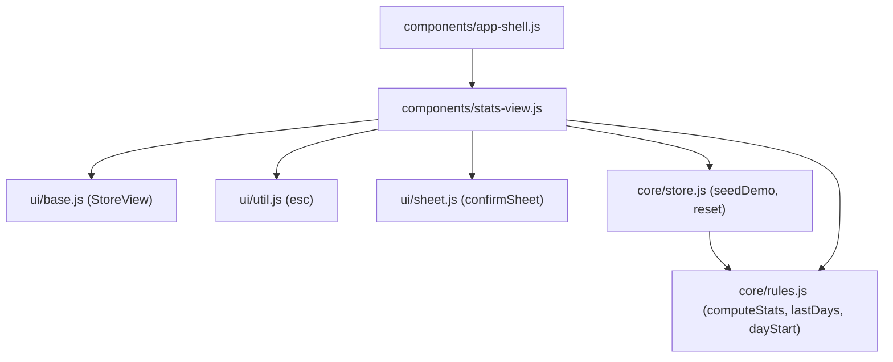
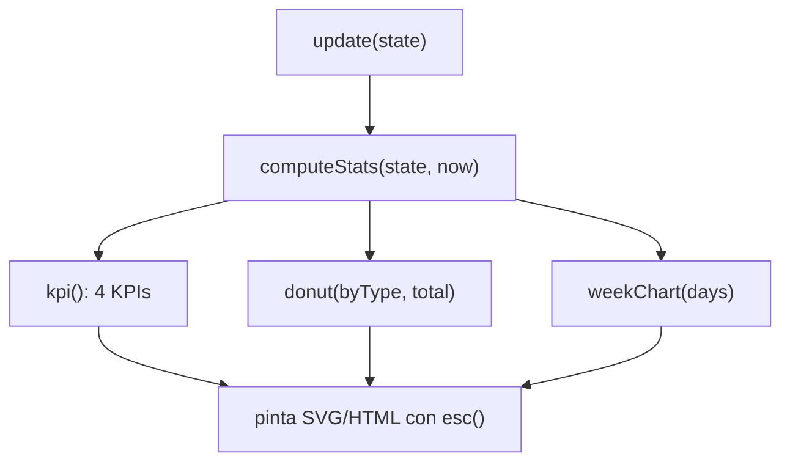
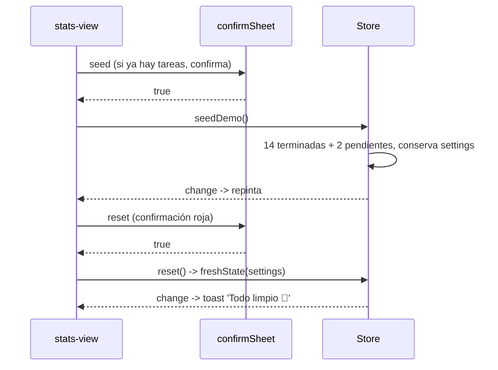

# Diseño: Estadísticas

## Árbol de archivos

```
src/core/rules.js              (modificar: + lastDays, computeStats completo)
src/core/store.js              (modificar: + seedDemo, reset)
src/components/stats-view.js   (nuevo: <stats-view>)
src/components/app-shell.js    (modificar: registrar pestaña Stats)
src/main.js                    (modificar: importar stats-view)
```

## Diagrama de componentes

Dirección de dependencias `components → ui → core`. Las gráficas son SVG propio, sin librerías.



## Flujo: render de estadísticas (derivadas)



## Flujo: datos de ejemplo y borrado



## `rules.js`

- `lastDays(count, now)` → `[{ start, end, label, isToday }]`, con etiqueta `Intl.DateTimeFormat('es-MX', { weekday: 'narrow' })`.
- `computeStats(state, now = Date.now())`:
  - `byType`: conteo de tareas terminadas por tipo (todos los tipos inician en 0).
  - `days`: 7 días con `byType` y `total`, según `doneAt`.
  - `streak`: conjunto de `dayStart(r.at)` de las rondas; se camina hacia atrás desde hoy (o ayer si hoy no tiene).
  - `focusMinutes`: `Math.round(sum(seconds) / 60)`.
- Las fechas usan `dayStart` y `addDays` con `setDate` (correcto en cambios de horario).

## `store.js`

- `seedDemo()`: arreglo `[título, tipo, rondas, hace_cuántos_días]`, ids con `uid()`, `doneAt` repartido en el día, rondas de 1500 s antes de `doneAt`. Dos pendientes. Reemplaza `state` conservando `settings`.
- `reset()`: `freshState(this.state.settings)`.

## `<stats-view>`

- Funciones auxiliares fuera de la clase: `kpi(emoji, value, label)`, `donut(byType, total)`, `weekChart(days)`. Cada una devuelve una cadena SVG/HTML y lleva un comentario de intención.
- Dona: `circle` con `stroke-dasharray` y `stroke-dashoffset` acumulado, separación de 2,5 entre segmentos cuando hay más de uno.
- Barras: ancho 320, alto 170, máximo mínimo de 3, `clipPath` redondeado por barra, animación `grow` escalonada 50 ms.
- Confirmaciones con `confirmSheet`. Acciones por `data-act` (`seed`, `reset`).

## Decisiones

- SVG propio: sin dependencias para gráficas (ver `dependencies-policy.md`).
- Las estadísticas se **derivan** en cada render; no se guardan.
