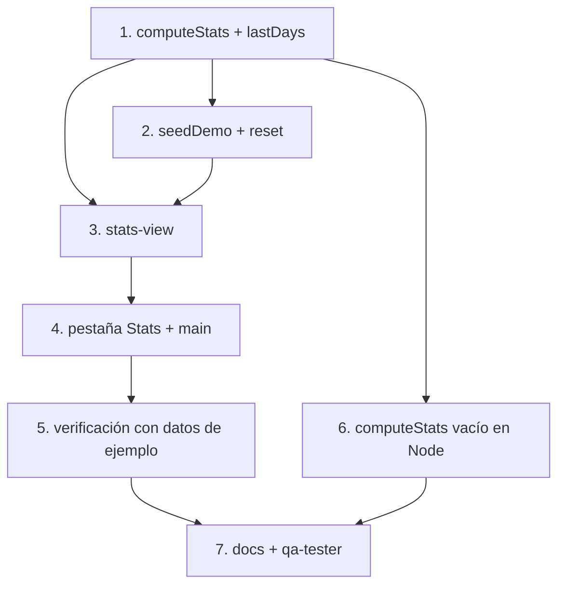

# Tareas: Estadísticas

## Overview

Agrega el módulo `statistics` con KPIs, dona por tipo y tendencia de 7 días, todo derivado de `computeStats` y dibujado con SVG propio. Incluye `seedDemo()` y `reset()` para poblar o limpiar la app. El enfoque es completar primero las reglas puras, luego las acciones del store y por último la vista con sus gráficas.

## Tasks

- [ ] 1. Completar `lastDays` y `computeStats` en `rules.js`.
  _Requirements: 2, 4, 5_
- [ ] 2. Agregar `seedDemo()` y `reset()` al store.
  _Requirements: 6, 7_
- [ ] 3. Crear `stats-view.js` con KPIs, dona, barras, leyenda y botones de datos.
  _Requirements: 1, 2, 3, 4, 8_
- [ ] 4. Registrar la pestaña **Stats** en `app-shell.js` y el import en `main.js`.
  _Requirements: 1_
- [ ] 5. Verificar con datos de ejemplo: porcentajes ≈ 100 %, barras que suman, racha ≥ 7, jardín con 14 plantas.
  _Requirements: 6, 9, 10_
- [ ] 6. Verificar `computeStats` vacío en Node: `node --input-type=module -e "import('./src/core/rules.js').then(m=>console.log(m.computeStats({tasks:[],rounds:[]})))"`.
  _Requirements: 5, 9_
- [ ] 7. Actualizar `docs/modules/statistics/README.md` (changelog), marcar S1 a S5 en `docs/features.md` y ejecutar `qa-tester` con `statistics` y `3d-world`.
  _Requirements: 9, 10_

## Notes

- Las estadísticas se **derivan** en cada render; no se guardan en el estado.
- `seedDemo()` y `reset()` conservan siempre `settings`.
- `computeStats` es pura y debe funcionar con estado vacío sin lanzar (se valida en Node, tarea 6).
- Sin librerías de gráficas: dona y barras son SVG propio; todo texto pasa por `esc()` (criterio 8).
- Con datos de ejemplo se cierran las pruebas `W3-*` que quedaron pendientes en la spec 04 (criterio 10).

## Task Dependency Graph

