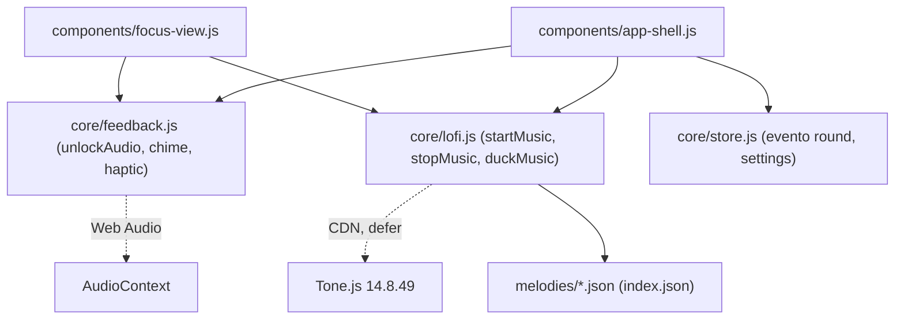
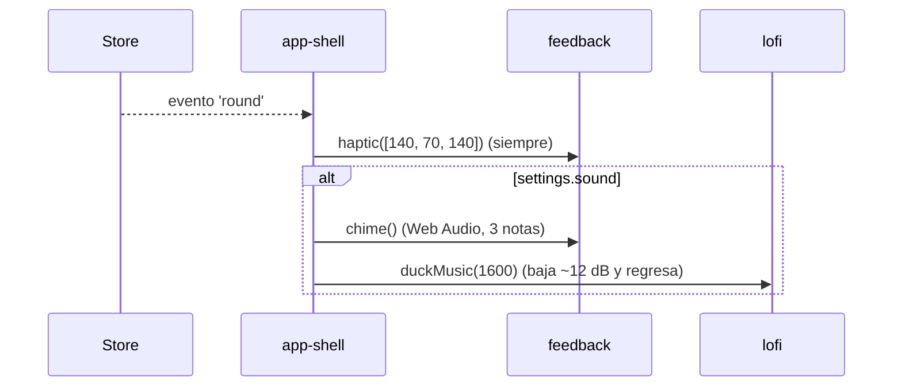
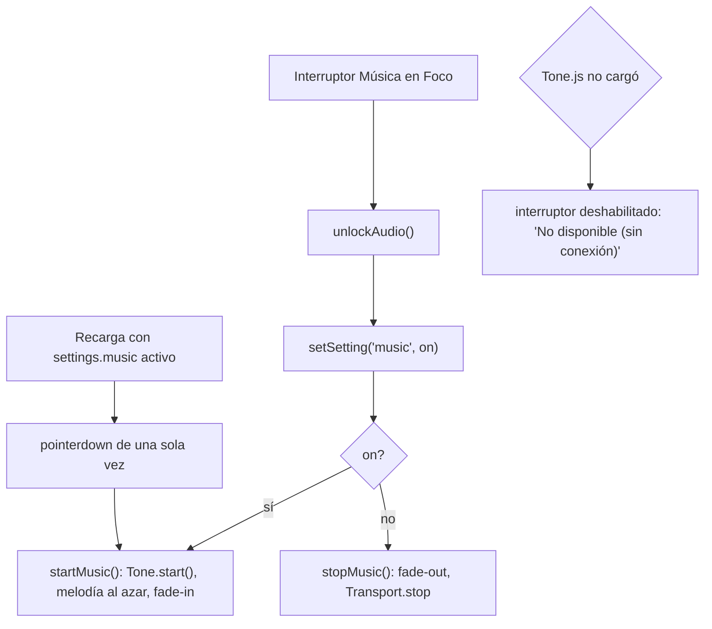

# Diseño: Sonido y música

## Árbol de archivos

```
index.html                     (modificar: + <script src="…/tone@14.8.49/build/Tone.js" defer>)
melodies/index.json            (nuevo: ["jazzy-amin.json"])
melodies/jazzy-amin.json       (nuevo: primera melodía)
melodies/README.md             (nuevo: formato para agregar melodías)
src/core/feedback.js           (modificar: + unlockAudio, chime)
src/core/lofi.js               (nuevo: música)
src/components/focus-view.js   (modificar: + interruptores de sonido y música)
src/components/app-shell.js    (modificar: + reacción al evento 'round', reanudar música tras recarga)
```

## Diagrama de componentes

`feedback.js` usa Web Audio directo (no depende de Tone.js); `lofi.js` es defensivo y comprueba Tone.js en cada llamada.



## Flujo: fin de ronda con campanita, ducking y vibración



## Flujo: encender música y reanudar tras recarga



## `feedback.js`

- Un `AudioContext` perezoso (`audio ??=`) y `unlockAudio()` que lo reanuda si está suspendido.
- `chime()` usa osciladores senoidales con envolvente exponencial (ataque 0,02 s, caída 0,5 s), una nota cada 0,16 s.

## `lofi.js`

Todo defensivo: cada función de la API comprueba `resolveTone()`.

1. `loadMelodies()` pide `index.json` una sola vez y valida cada archivo con `validSong` (listas no vacías y del mismo largo).
2. `build()` crea una sola vez la cadena: `Volume → Reverb → Filter → Chorus`, instrumentos y percusión sintética, ruido de vinilo, `Transport.swing = 0.3`.
3. Cuatro `Tone.Loop` de un compás (acordes, bajo, melodía, batería). El compás actual se toma de `Transport.seconds`, así que cualquier largo de melodía funciona.
4. `startMusic()`: `Tone.start()` (requiere gesto), elige melodía al azar, ajusta bpm (72 por defecto), inicia `Transport` y sube el volumen con rampa.
5. `stopMusic()`: rampa a silencio; el `Transport` se detiene tras el fade.
6. `duckMusic(ms)`: bajada y regreso **programados en el reloj de audio**, no con `setTimeout`.
7. `globalThis.__lofi` para probar en consola.

## Integración

- `app-shell` escucha `store` → `round`: si `settings.sound`, `chime()` y `duckMusic()`; siempre `haptic([140, 70, 140])`.
- Si `settings.music` está activo al cargar, se registra un `pointerdown` de una sola vez que llama `startMusic()`.
- En `focus-view`, el interruptor de música llama `unlockAudio()`, `setSetting('music', on)` y `startMusic()`/`stopMusic()`.

## Decisiones

- **Tone.js por CDN y melodías en JSON**: sin audios, extensible por cualquier persona (skill `add-lofi-melody`).
- La campanita no usa Tone.js para seguir sonando aunque Tone.js no cargue.
