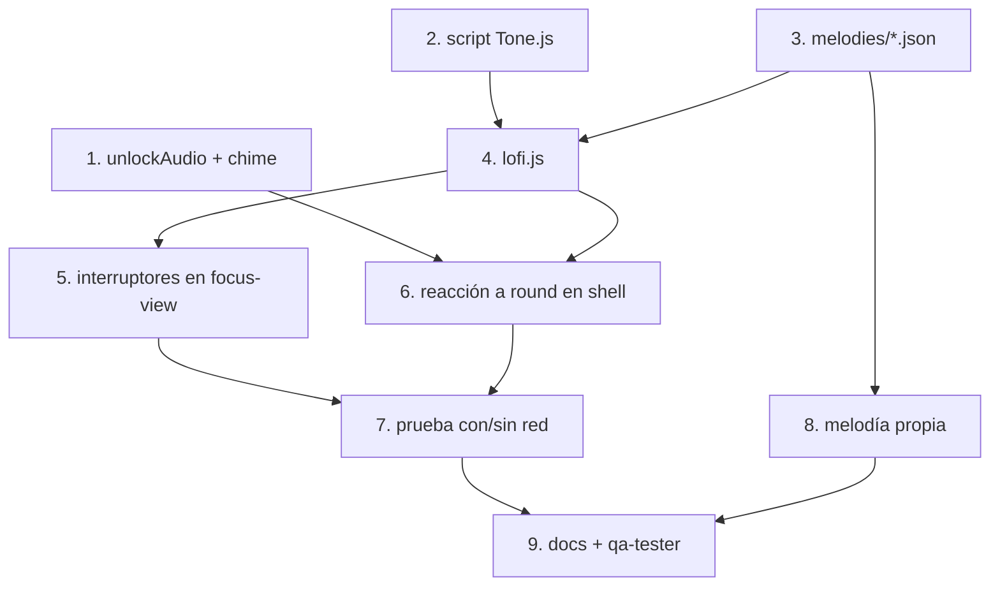

# Tareas: Sonido y música

## Overview

Hace sensorial el pomodoro: una campanita Web Audio al terminar la ronda y música lofi sintetizada con Tone.js, sin archivos de audio y con melodías agregables en JSON. El enfoque es construir primero la campanita (independiente de Tone.js), luego el motor de música defensivo y por último los interruptores y la integración con el evento `round`.

## Tasks

- [ ] 1. Agregar `unlockAudio()` y `chime()` a `feedback.js`.
  _Requirements: 1, 2, 10_
- [ ] 2. Agregar el script de Tone.js (versión fija, `defer`) a `index.html`.
  _Requirements: 4_
- [ ] 3. Crear `melodies/` con `index.json`, `jazzy-amin.json` y `README.md`.
  _Requirements: 7_
- [ ] 4. Crear `lofi.js` con carga de melodías, `build()`, `startMusic`, `stopMusic`, `duckMusic`, `setMusicVolume`, `isMusicAvailable`.
  _Requirements: 4, 5, 6, 7, 8_
- [ ] 5. Agregar los interruptores **Sonido** y **Música de fondo** a `focus-view.js`; llamar `unlockAudio()` al iniciar ronda.
  _Requirements: 3, 10_
- [ ] 6. En `app-shell.js`, reaccionar al evento `round` (campanita, `duckMusic`, vibración) y reanudar música tras recarga en el primer toque.
  _Requirements: 2, 8, 9_
- [ ] 7. Probar con y sin red (bloquear Tone.js): el interruptor de música debe quedar deshabilitado y la ronda debe terminar bien.
  _Requirements: 4, 11_
- [ ] 8. Probar una melodía propia siguiendo la skill `add-lofi-melody`.
  _Requirements: 7, 11_
- [ ] 9. Actualizar `docs/modules/pomodoro/README.md` (changelog), marcar P5 y P8 en `docs/features.md` y ejecutar `qa-tester` con `pomodoro`.
  _Requirements: 11_

## Notes

- La campanita (`chime`) usa Web Audio directo, no Tone.js, para seguir sonando aunque Tone.js no cargue.
- `lofi.js` es defensivo: cada función comprueba `resolveTone()`; si Tone.js falta, el interruptor de música queda deshabilitado con "No disponible (sin conexión)" y nada falla.
- `unlockAudio()` debe llamarse dentro de un gesto del usuario (iniciar ronda o encender música).
- El ducking se programa en el reloj de audio, no con `setTimeout`.
- `__lofi` queda visible en consola para depurar.

## Task Dependency Graph

