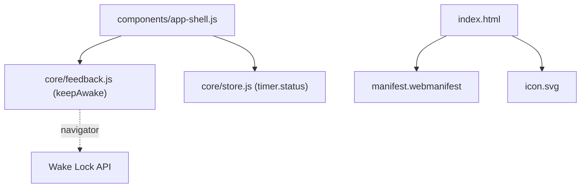
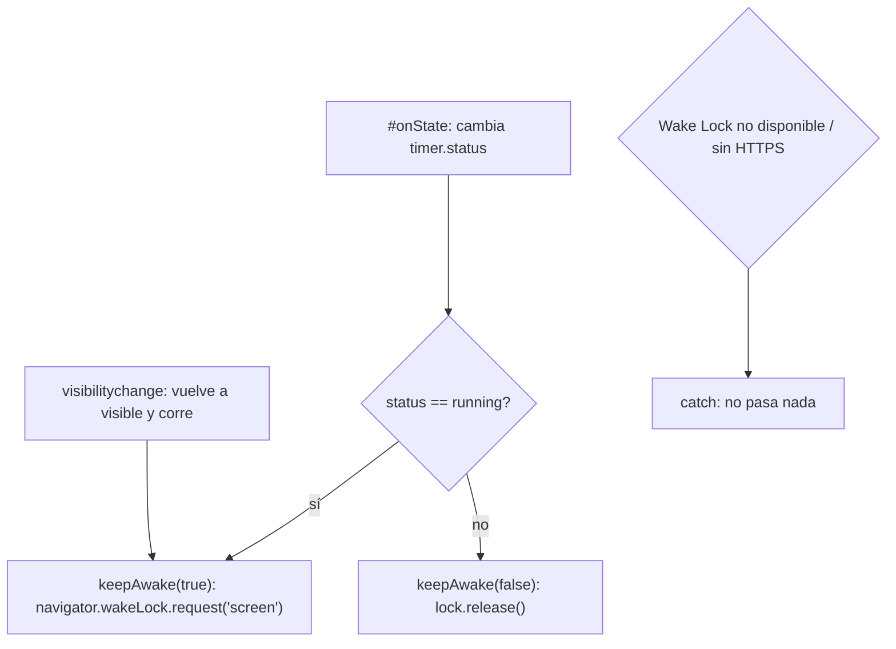
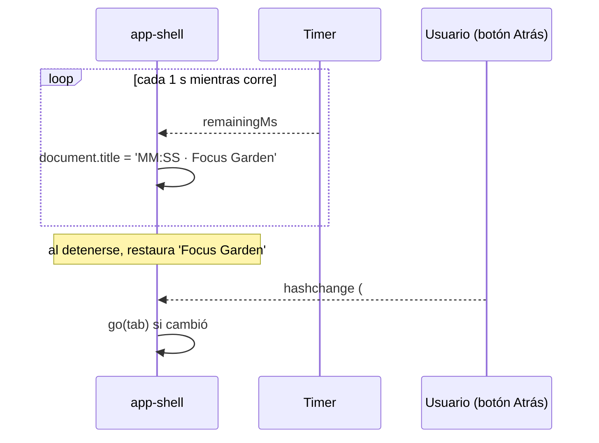

# Diseño: Pulido y PWA

## Árbol de archivos

```
manifest.webmanifest           (nuevo)
icon.svg                       (nuevo)
index.html                     (modificar: metas, <link rel="manifest">, <link rel="icon">)
src/core/feedback.js           (modificar: + keepAwake(on))
src/components/app-shell.js    (modificar: + wake lock, título vivo, hashchange)
README.md                      (modificar: cómo correrlo y estructura)
```

## Diagrama de componentes

El pulido se concentra en `app-shell` (wake lock, título vivo, rutas) apoyado en `feedback.js`; el manifiesto y el ícono son estáticos.



## Flujo: wake lock según el estado del timer



## Flujo: título vivo y rutas por hash



## Wake Lock (`keepAwake`)

```js
let lock = null;
export async function keepAwake(on) {
  try {
    if (on && !lock && 'wakeLock' in navigator) {
      lock = await navigator.wakeLock.request('screen');
      lock.addEventListener('release', () => { lock = null; });
    } else if (!on && lock) { await lock.release(); lock = null; }
  } catch { /* requiere contexto seguro; si falla, no pasa nada */ }
}
```

- `app-shell` detecta cambios de `running` en `#onState` y llama `keepAwake`.
- En `visibilitychange`, si la página vuelve a ser visible y el timer corre, se pide de nuevo (el navegador libera el lock al ocultarla).

## Título vivo

`setInterval` de 1 s en `app-shell` que escribe `document.title = "MM:SS · Focus Garden"` solo si el timer corre; al dejar de correr, se restaura el título.

## Rutas

`go(tab)` hace `history.replaceState(null, '', '#/tab')`; `hashchange` llama `go` si cambió.

## Ícono

SVG de 512×512 con fondo `#fbf6ea`, hoja en `#2f6f4e`/`#4f9d69` con trazo suave. Debe verse bien recortado en círculo o en cuadrado redondeado.

## Decisiones

- **Sin service worker** por ahora: el manifiesto permite instalar en muchos navegadores, pero la app necesita red para los CDN (roadmap alta prioridad).
- Los respaldos (UUID, wake lock, vibración) siguen la política de degradación elegante de `tech.md`.
