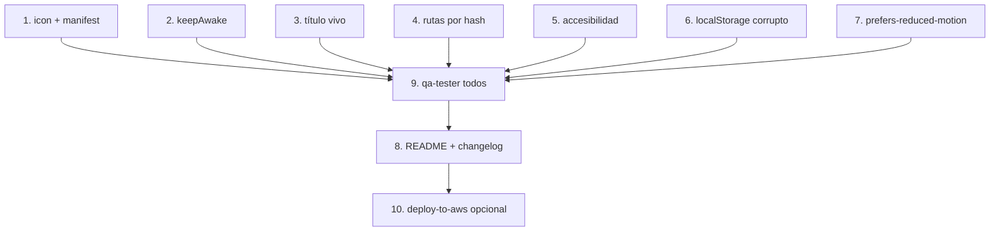

# Tareas: Pulido y PWA

## Overview

Cierra el proyecto con los detalles de app móvil: instalable (manifiesto + ícono), pantalla encendida durante la ronda (Wake Lock), título vivo, rutas por hash, accesibilidad y robustez de los datos. El enfoque es agregar primero lo instalable, luego el wake lock y el título en el shell, y terminar con auditorías de accesibilidad, robustez y documentación.

## Tasks

- [ ] 1. Crear `icon.svg` y `manifest.webmanifest`; enlazarlos y agregar las metas en `index.html`.
  _Requirements: 1, 2, 3_
- [ ] 2. Agregar `keepAwake` a `feedback.js` y usarlo desde `app-shell.js` (inicio/fin de ronda y regreso a la pestaña).
  _Requirements: 4_
- [ ] 3. Agregar el título vivo al shell.
  _Requirements: 5_
- [ ] 4. Verificar rutas por hash y botón Atrás.
  _Requirements: 6_
- [ ] 5. Auditar accesibilidad: `aria-label`, `aria-current`, `aria-live`, roles, enfoque visible; corregir lo que falte.
  _Requirements: 7_
- [ ] 6. Probar `localStorage` corrupto (`localStorage.setItem('jardin-movil:v1','{')`) y recargar: la app abre vacía sin errores.
  _Requirements: 9_
- [ ] 7. Probar con `prefers-reduced-motion` activado.
  _Requirements: 8_
- [ ] 8. Actualizar el README del proyecto y el changelog de los módulos tocados.
  _Requirements: 10_
- [ ] 9. Ejecutar `qa-tester` con `todos` y revisar `docs/features.md`: todo lo disponible marcado, roadmap vigente.
  _Requirements: 11_
- [ ] 10. (Opcional) Publicar con la skill `deploy-to-aws`.
  _Requirements: 10_

## Notes

- Todos los respaldos (Wake Lock, `crypto.randomUUID`, vibración) degradan en silencio si falta contexto seguro o la API: la app no debe fallar.
- Sin service worker en esta spec: el manifiesto permite instalar, pero la app aún necesita red para los CDN (queda en el roadmap).
- La auditoría de accesibilidad plena requiere pruebas manuales con tecnología de asistencia; aquí se cubre lo verificable en el navegador.
- La tarea 10 es opcional y no bloquea el cierre del spec.

## Task Dependency Graph

