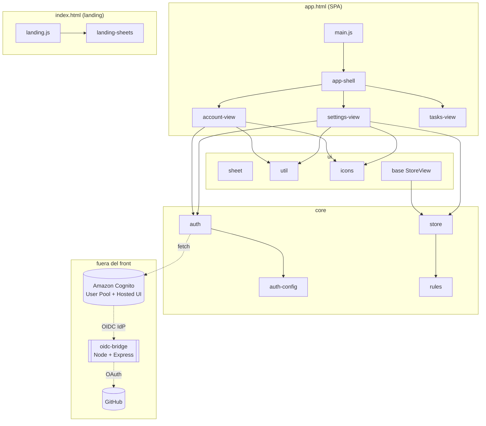
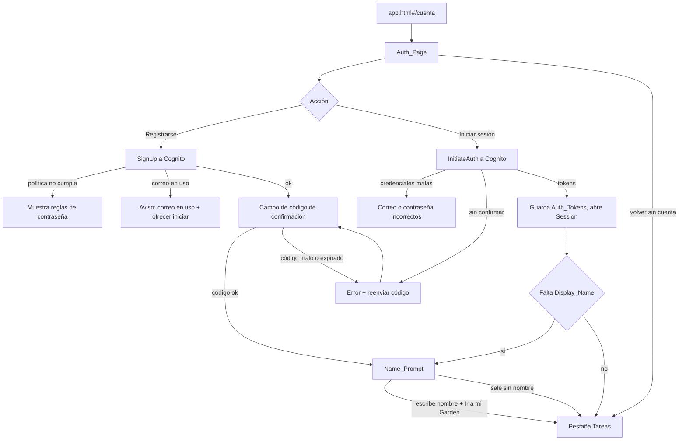

# Design Document

## Overview

Este diseño agrega a Focus Garden la **autenticación con Amazon Cognito**: registro, inicio de sesión y cierre de sesión, de forma **opcional**. Quien no quiera cuenta sigue usando la app igual que hoy, con sus datos en `localStorage` bajo `jardin-movil:v1`, que este spec **no toca**. La sincronización en la nube y la sección "Mis sesiones" son de specs posteriores (`cloud-sync` y `multi-device-sessions`).

Es el primer spec que agrega un backend al proyecto: un **puente OIDC en Node.js + Express** (`oidc-bridge/`) que permite iniciar sesión con GitHub, proveedor que Cognito no soporta de forma nativa. Los demás proveedores (Google, Meta y Login with Amazon) se resuelven con el Hosted UI de Cognito. Esto contradice el principio de producto 6 ("datos locales, sin cuentas ni servidor") y el stack de `tech.md` ("sin backend, sin build"); la documentación lo reconoce y lo resuelve dejando las cuentas opcionales, los datos locales intactos y el único backend acotado al puente de GitHub.

Decisiones principales:

| Tema | Decisión | Motivo |
|------|----------|--------|
| Cliente de Cognito | **Preferida: fetch propio + WebCrypto**, sin SDK. El flujo OAuth 2.0 *authorization code + PKCE* contra el dominio del Hosted UI (`/oauth2/authorize`, `/oauth2/token`), y el registro/confirmación/login por contraseña contra la **API JSON de Cognito Identity Provider** (`SignUp`, `ConfirmSignUp`, `InitiateAuth`, etc.) con `fetch`. **Alternativa documentada**: `amazon-cognito-identity-js` por CDN con versión fija. | `dependencies-policy.md` pide escribir lo simple en local: PKCE es `crypto.subtle.digest('SHA-256')` + base64url, el canje es un `fetch` de formulario y la validación del ID token es WebCrypto. No se agrega peso si el navegador ya lo hace. |
| Account_SDK y degradación | El "Account_SDK" es, en la opción preferida, el propio `auth.js` más una **comprobación de disponibilidad** (`isAuthAvailable()`): hay red (`navigator.onLine`), el dominio de Cognito responde a su descubrimiento OIDC y, si se usa la alternativa, el script de CDN cargó. Si falla, los controles de cuenta se muestran **deshabilitados con aviso** y el resto de Ajustes no se rompe. | Requisito 10: la app sigue sin cuenta. Una sola función concentra "¿puedo autenticar?". |
| Capa del servicio | `src/core/auth.js` (servicio Auth, sin DOM salvo `location.assign` para los redirects) y `src/core/auth-config.js` (valores públicos). `core` no importa de `components`, `ui` ni `three`. | Arquitectura: la lógica va en `core`; la UI la consume. |
| Página de cuenta | Nuevo Web Component `<account-view>` (light DOM) montado en la ruta hash `#/cuenta`, que alberga el registro, el inicio, los proveedores, la confirmación de código y el **Name_Prompt**. | Requisitos 1 y 6: una página propia con el estilo de Focus Garden, no el Hosted UI salvo el redirect social. |
| Ruteo | `app-shell` distingue dos espacios de hash: las **pestañas** (`#tasks`, `#focus`, …) y las **rutas con barra** (`#/cuenta`). `#/cuenta` muestra `<account-view>` a pantalla completa sobre el shell; cualquier otro hash cae en la pestaña (o `tasks`). | Convive con el ruteo por pestañas existente sin romperlo. |
| Tokens | Almacenamiento en `localStorage` **dedicado**, clave `focus-garden:auth:v1`, **separada** de `jardin-movil:v1`. Guarda `idToken`, `accessToken`, `refreshToken` y sus expiraciones. Refresco con el refresh token; validación de firma y claims del ID token contra el JWKS de Cognito. | Requisitos 9 y 12. Separar la clave garantiza que cerrar sesión o perder tokens nunca afecta tareas, rondas ni ajustes. |
| Display_Name | Se guarda como atributo de usuario en Cognito (`name`). Si falta tras iniciar sesión, se repregunta con el Name_Prompt antes de llegar a Tareas. | Requisito 6. Guardar el hecho en Cognito, derivar la pantalla. |
| GitHub | Puente OIDC en `oidc-bridge/` (Node + Express puro), con endpoints `authorize`, `token` y `jwks`. Lee `GITHUB_CLIENT_ID`, `GITHUB_CLIENT_SECRET` y las claves de firma de variables de entorno. La App lo registra como *identity provider* en Cognito y sigue el mismo flujo social. | Requisitos 5 y 11. Los secretos nunca tocan el frontend. |
| Comunicación entre vistas | Eventos en `document`: `app:navigate` para ir a `#/cuenta` o a una pestaña, `app:toast` para "Sesión cerrada". `auth.js` emite `app:auth` cuando cambia la sesión, y `<account-view>` y `<settings-view>` reaccionan. | Arquitectura: las vistas no se importan entre sí. |
| Pruebas | Propiedades de la lógica pura de `auth.js` (PKCE, state, URL authorize, ruteo, persistencia, validación de claims) con el mismo arnés de consola del spec anterior. El puente se prueba por integración con mocks de GitHub. | `tech.md` no tiene ejecutor de pruebas; el puente sí es Node y puede usar `node:test`. |

## Architecture

### Árbol de archivos

```
exercise/
  app.html                           (modificar: cargar auth-config.js y, si se usa la alternativa,
                                      el Account_SDK de Cognito por CDN con versión fija; nada en index.html)
  manifest.webmanifest               (sin cambios de forma; start_url sigue en ./app.html)
  src/
    main.js                          (modificar: importar account-view.js y settings-view.js ya existente)
    core/
      auth.js                        (nuevo: servicio Auth. PKCE, state, authorize/token, refresh,
                                      validación de ID token contra JWKS, persistencia de sesión,
                                      sin DOM salvo location.assign para redirects)
      auth-config.js                 (nuevo: valores PÚBLICOS: userPoolId, clientId, dominio Cognito,
                                      redirectUri, scopes, providers y endpoint del OIDC_Bridge)
      store.js                       (sin cambios: no se toca jardin-movil:v1)
    ui/
      icons.js                       (modificar: íconos 'google', 'github', 'meta', 'amazon', 'mail', 'user')
    components/
      account-view.js                (nuevo: <account-view> en #/cuenta. Registro, inicio, proveedores,
                                      confirmación de código y Name_Prompt)
      app-shell.js                   (modificar: ruteo de #/cuenta a <account-view>; monta la vista,
                                      sin romper el ruteo por pestañas)
      landing-sheets.js              (modificar: Create_Account_Button navega a la Auth_Page;
                                      openComingSoonSheet queda sin uso o se retira)
      settings-view.js               (modificar: el Reserved_Slot "Mi cuenta" pasa a Account_Slot real
                                      con cerrar sesión; "Mis sesiones" sigue "Próximamente")
  index.html                         (modificar: el Create_Account_Button de la landing lleva a
                                      ./app.html#/cuenta)
oidc-bridge/                         (nuevo: backend aparte, Node + Express puro)
  package.json                       (nuevo: deps express y jose; scripts start/dev; sin build de front)
  server.js                          (nuevo: app Express, CORS por allowlist, monta las rutas)
  routes/
    authorize.js                     (nuevo: GET /authorize → redirige a GitHub con state)
    callback.js                      (nuevo: GET /callback → canjea el code de GitHub, crea sesión del puente)
    token.js                         (nuevo: POST /token → emite el ID token OIDC firmado para Cognito)
    jwks.js                          (nuevo: GET /.well-known/jwks.json → clave pública de firma)
    discovery.js                     (nuevo: GET /.well-known/openid-configuration)
  lib/
    github.js                        (nuevo: intercambio con GitHub, lee identidad del usuario)
    jwt.js                           (nuevo: firma y verificación de los ID token del puente)
    origins.js                       (nuevo: isAllowedOrigin(origin, allowlist), lógica pura)
  .env.example                       (nuevo: variables requeridas, sin valores reales)
  README.md                          (nuevo: contrato, variables y cómo correrlo local)
docs/
  features.md                        (modificar: mover accounts-auth de roadmap a disponible)
  current-plan.md                    (modificar: marcar el spec 2 como implementado al cerrar)
  modules/
    accounts-auth/README.md          (nuevo: Descripción, Pruebas para qa-tester, Changelog)
    settings/README.md               (modificar: Account_Slot real; entrada en el Changelog)
.kiro/steering/
  product.md                         (modificar: reconocer que las cuentas son opcionales; tabla de módulos)
  tech.md                            (modificar: Cognito, Account_SDK por CDN y el OIDC_Bridge Node/Express)
  dependencies-policy.md             (modificar: el cliente de Cognito y jose en el puente)
  docs-and-qa.md                     (modificar: módulo accounts-auth en el mapa)
```

### Relación entre componentes

Dirección de dependencias: `components → ui → core`. `auth.js` y `auth-config.js` viven en `core` y **no importan** de `components`, `ui` ni `three`. El puente OIDC es un proceso aparte: el frontend solo conoce su endpoint público (en `auth-config.js`) y habla con él a través de Cognito, no directamente.



Las vistas no se importan entre sí. La landing lleva a la Auth_Page con un enlace a `./app.html#/cuenta`; dentro de la app, Ajustes lleva a la cuenta con `navigate('/cuenta')`. `auth.js` nunca toca el store: la sesión vive en su propia clave de `localStorage`.

### Flujo: registro e inicio con usuario y contraseña



### Flujo: OAuth code + PKCE con Cognito (Google, Meta, Login with Amazon)

```mermaid
sequenceDiagram
  participant A as account-view
  participant S as auth.js
  participant B as Navegador
  participant C as Cognito (Hosted UI)
  A->>S: signInWithProvider('Google')
  S->>S: verifier aleatorio, challenge = base64url(SHA-256(verifier))
  S->>S: state aleatorio; guarda {state, verifier} en sessionStorage
  S->>B: location.assign(authorizeUrl con response_type=code, S256, state, redirect_uri)
  B->>C: GET /oauth2/authorize?identity_provider=Google...
  C-->>B: redirect a redirect_uri?code=...&state=...
  B->>A: carga app.html#/cuenta con code y state
  A->>S: handleRedirect(params)
  S->>S: compara state recibido vs guardado
  alt state coincide
    S->>C: POST /oauth2/token (code, code_verifier, client_id, sin secret)
    C-->>S: id_token, access_token, refresh_token
    S->>C: GET /.well-known/jwks.json (cacheado)
    S->>S: valida firma y claims (iss, aud, exp) del id_token
    S->>S: saveSession(tokens); emite app:auth
    alt falta Display_Name
      S-->>A: route 'name-prompt'
    else
      S-->>A: route 'tasks' → navigate('tasks')
    end
  else state no coincide o error de proveedor
    S-->>A: descarta, sin Session; si error=access_denied vuelve sin mensaje
  end
```

### Flujo: GitHub vía el puente OIDC Node/Express

```mermaid
sequenceDiagram
  participant A as account-view
  participant S as auth.js
  participant C as Cognito
  participant R as oidc-bridge (Node/Express)
  participant G as GitHub
  A->>S: signInWithProvider('GitHub')
  S->>S: verifier, challenge, state (igual que social)
  S->>C: /oauth2/authorize?identity_provider=GitHubBridge (code + PKCE + state)
  C->>R: GET /authorize (Cognito actúa como cliente del puente)
  R->>R: valida origin contra allowlist; genera su propio state
  R->>G: redirect a GitHub authorize (client_id de env)
  G-->>R: GET /callback?code=... (identidad de GitHub)
  R->>G: POST intercambio code → access_token (client_secret de env)
  R->>G: GET /user, /user/emails (perfil)
  R->>C: redirige a Cognito con un code propio
  C->>R: POST /token
  R->>R: firma un ID token OIDC (clave privada de env)
  R-->>C: id_token OIDC que Cognito acepta
  C->>R: GET /.well-known/jwks.json (Cognito valida la firma del puente)
  C-->>S: redirect a redirect_uri con code de Cognito
  A->>S: handleRedirect → mismo canje y validación que el flujo social
  Note over S,R: Si el puente no responde, auth.js avisa "GitHub no disponible"<br/>y los demás métodos siguen funcionando
```

## Components and Interfaces

### `core/auth-config.js` (nuevo, solo valores públicos)

```js
// Configuración PÚBLICA de la autenticación. Nunca contiene secretos:
// ni client secret, ni secreto de GitHub, ni secreto del App Client de Cognito.
export const AUTH_CONFIG = {
  userPoolId: 'us-east-1_XXXXXXXXX',
  clientId: 'xxxxxxxxxxxxxxxxxxxxxxxxxx',          // App Client público, sin secreto
  region: 'us-east-1',
  cognitoDomain: 'https://focus-garden.auth.us-east-1.amazoncognito.com',
  redirectUri: `${location.origin}/app.html`,       // debe estar declarada en el App Client
  scopes: ['openid', 'email', 'profile'],
  providers: {                                       // identity_provider tal como lo nombra Cognito
    Google: 'Google',
    Meta: 'Facebook',
    Amazon: 'LoginWithAmazon',
    GitHub: 'GitHubBridge',
  },
  oidcBridgeEndpoint: 'https://oidc-bridge.example.com', // solo el endpoint público del puente
};
```

- El `issuer` esperado del ID token es `https://cognito-idp.{region}.amazonaws.com/{userPoolId}`; se deriva, no se guarda aparte.
- **No** existe ninguna clave con "secret". Esta forma la fija la Propiedad 6.

### `core/auth.js` (nuevo, servicio Auth sin DOM salvo navegación)

```js
/** Servicio de autenticación. Toda la lógica de OAuth/PKCE, tokens y sesión.
 *  No toca el store ni jardin-movil:v1; la sesión vive en focus-garden:auth:v1. */

// --- Disponibilidad y degradación (req. 10) ---
export function isAuthAvailable();            // red + Cognito alcanzable (+ SDK si se usa la alternativa)
export function onAvailabilityChange(cb);     // escucha online/offline, habilita sin recargar

// --- PKCE y state (lógica pura, req. 12) ---
export function randomState();                // base64url de bytes de crypto.getRandomValues
export async function pkceChallenge(verifier);// base64url(SHA-256(verifier)) con crypto.subtle

// --- Construcción de peticiones (lógica pura, req. 4, 9, 12) ---
export function buildAuthorizeUrl({ provider, state, challenge }); // response_type=code, S256, redirect_uri de config
export function buildTokenRequest({ code, verifier });             // nunca client_secret; siempre code_verifier

// --- Flujos ---
export async function signUp({ email, password });        // Cognito SignUp (req. 2)
export async function confirmSignUp({ email, code });     // Cognito ConfirmSignUp
export async function resendCode({ email });
export async function signInWithPassword({ email, password }); // InitiateAuth (req. 3)
export async function signInWithProvider(provider);       // redirige a Hosted UI / puente (req. 4, 5)
export async function handleRedirect(params);             // valida state, canjea code, valida ID token (req. 4, 9, 12)
export async function saveDisplayName(name);              // UpdateUserAttributes 'name' (req. 6)
export async function refreshIfNeeded();                  // usa refresh token (req. 9.5/9.6)
export function signOut();                                // borra la sesión, emite app:auth (req. 7)

// --- Sesión y validación (req. 7, 9) ---
export function loadSession();                            // null si no hay o si expiró sin refresh válido
export function getSession();                             // sesión en memoria actual
export function sessionAction(now, accessExp, refreshExp);// 'ok' | 'refresh' | 'sign-in'
export function validateIdClaims(claims, cfg, now);       // iss, aud, exp (req. 9.7, 12.5)
export async function verifyIdSignature(idToken, jwks);   // WebCrypto contra el JWKS de Cognito

// --- Ruteo derivado (lógica pura, req. 3.5, 4.7, 6) ---
export function postSignInRoute(session);                 // 'name-prompt' si falta Display_Name, si no 'tasks'
```

Notas de implementación:

- `state` y `verifier` se guardan en `sessionStorage` entre el redirect y la vuelta; se borran al consumirse.
- `handleRedirect` detecta `error=access_denied` (cancelación en el Hosted UI) y vuelve a la Auth_Page **sin** mensaje de error (req. 4.6).
- El JWKS de Cognito se descarga una vez y se cachea en memoria; la validación de firma usa `crypto.subtle.importKey`/`verify` (RS256).
- Degradación de GitHub: si `fetch` al endpoint del puente (o el flujo) falla con error de red, `signInWithProvider('GitHub')` resuelve con un estado "no disponible" que la vista muestra sin tumbar los otros métodos (req. 5.5).

### `components/account-view.js` (nuevo)

`<account-view>` es un `HTMLElement` light DOM montado por `app-shell` cuando el hash es `#/cuenta`. No extiende `StoreView` porque no depende del store; se suscribe a `app:auth` para reaccionar a cambios de sesión.

| Estado interno | Contenido |
|----------------|-----------|
| `signIn` (por defecto) | Formulario de inicio (correo + contraseña), botones de los proveedores y un enlace "Volver sin cuenta". |
| `signUp` | Formulario de registro; muestra reglas de contraseña incumplidas antes de enviar. |
| `confirm` | Campo de código de confirmación + "Reenviar código". |
| `namePrompt` | Pide solo la Display_Name; con texto escrito aparece el Garden_Button "Ir a mi Garden". |
| `disabled` | Si `!isAuthAvailable()`: controles deshabilitados con el aviso "Necesitas conexión para usar tu cuenta". Se rehabilita con `onAvailabilityChange` sin recargar (req. 10.2, 10.4). |

- Accesibilidad: cada input con su `<label>`; los botones de solo ícono con `aria-label`; inputs a 16 px; objetivos de 44 px (req. 1.3, 1.4, 1.6).
- "Volver sin cuenta" hace `navigate('tasks')` (req. 1.5).
- Al establecerse la sesión, usa `postSignInRoute(session)` para ir a `namePrompt` o a Tareas.

### `components/app-shell.js` (cambios)

- Se agrega `routeFromHash(hash)` (pura): devuelve `{ kind: 'route', id: 'account' }` cuando el hash normaliza a `#/cuenta`, y `{ kind: 'tab', id }` en cualquier otro caso (id válido de `TABS` o `tasks`).
- `main` monta `<account-view hidden>`. Cuando la ruta es `account`, se oculta la pestaña activa y la barra, y se muestra `<account-view>` a pantalla completa; al salir de `#/cuenta`, se restaura la pestaña.
- `TABS` **no cambia**: la cuenta no es una pestaña, es una ruta.
- El `pointerdown` que reanuda la música se mantiene.

### `components/settings-view.js` (cambios)

El Reserved_Slot "Mi cuenta" se reemplaza por el **Account_Slot** real, derivado con `accountSlotModel(session, sdkReady)`:

| Situación | Account_Slot |
|-----------|--------------|
| `!sdkReady` (sin red o sin SDK) | Estado deshabilitado con aviso; el resto de Ajustes funciona (req. 10.1, 10.3). |
| Sin sesión | Control "Crear cuenta o iniciar sesión" que hace `navigate('/cuenta')` (req. 7.3). |
| Con sesión | Muestra la Display_Name (o el correo si falta) y el control "Cerrar sesión" (req. 7.2). |

- "Cerrar sesión" llama `signOut()`, muestra el toast "Sesión cerrada" y, por diseño, **no toca** `jardin-movil:v1` (req. 7.4, 7.5). Se suscribe a `app:auth` para repintar.
- El Reserved_Slot "Mis sesiones" se queda con la etiqueta "Próximamente" (req. 7.6).

### `components/landing-sheets.js` e `index.html` (cambios)

- El Create_Account_Button de la landing pasa a navegar a la Auth_Page: en `index.html` se cambia a un enlace `./app.html#/cuenta` (o un handler que haga `location.assign`). `openComingSoonSheet` queda sin uso; se retira o se deja documentado como obsoleto.
- "Iniciar sin cuenta" (el flujo de entrada actual) no cambia (req. 8.2, 8.3).

### `oidc-bridge/` (nuevo, Node + Express puro)

Servicio aparte, sin build de frontend. Contrato OIDC que Cognito espera de un identity provider:

| Endpoint | Método | Responsabilidad |
|----------|--------|-----------------|
| `/.well-known/openid-configuration` | GET | Descubrimiento OIDC (apunta a authorize, token y jwks). |
| `/authorize` | GET | Recibe a Cognito, valida el origen contra la allowlist, genera su state y redirige a GitHub. |
| `/callback` | GET | Recibe el code de GitHub, lo intercambia (con `GITHUB_CLIENT_SECRET`), lee el perfil y redirige a Cognito con un code propio. |
| `/token` | POST | Emite un **ID token OIDC firmado** (RS256, clave privada de env) con los claims de la identidad de GitHub. |
| `/.well-known/jwks.json` | GET | Clave **pública** de firma para que Cognito valide los tokens del puente. |

Variables de entorno (en `.env.example`, sin valores): `GITHUB_CLIENT_ID`, `GITHUB_CLIENT_SECRET`, `OIDC_SIGNING_KEY` (clave privada), `OIDC_KEY_ID`, `ALLOWED_ORIGINS` (lista separada por comas, incluye el redirect de Cognito), `ISSUER`, `PORT`.

- `lib/origins.js` expone `isAllowedOrigin(origin, allowlist)` (pura): acepta **solo** orígenes de la allowlist exacta y rechaza cualquier otro (req. 11.5, 12.6). Se aplica como CORS y como verificación en `/authorize`.
- Dependencia nueva del puente: `jose` (firma/verificación JWT), por ser criptografía no trivial; se documenta en `dependencies-policy.md` y se pide confirmación del usuario. `express` es la base del servicio.
- `README.md` del puente documenta cómo correrlo local (`npm install`, copiar `.env.example` a `.env`, `npm start`) y el registro del proveedor en Cognito (req. 11.6).

## Data Models

```js
// Sesión guardada en localStorage bajo focus-garden:auth:v1 (clave NUEVA y separada)
{
  idToken: '...',            // JWT de identidad (claims: sub, email, name, iss, aud, exp)
  accessToken: '...',        // para llamadas autenticadas a Cognito (p.ej. UpdateUserAttributes)
  refreshToken: '...',       // para renovar sin re-login
  accessExpiresAt: 0,        // epoch ms; cuándo caduca el access token
  refreshExpiresAt: 0,       // epoch ms; cuándo caduca el refresh token
  displayName: '',           // atributo 'name' del usuario; '' si falta
  email: '',                 // del claim email del ID token validado
}

// Transitorio en sessionStorage durante un redirect OAuth (se borra al consumirse)
{ state: '...', verifier: '...', provider: 'Google' }

// Modelo derivado del Account_Slot (no se guarda)
{ enabled: bool, mode: 'guest' | 'signed-in', label: string, canSignOut: bool }
```

| Dato | Dónde vive | Se guarda |
|------|------------|-----------|
| Auth_Tokens y Session | `localStorage` `focus-garden:auth:v1` | Sí, separado de los datos del jardín |
| `state` y `verifier` PKCE | `sessionStorage` | Temporal, solo durante el redirect |
| Display_Name | Atributo `name` en Cognito; copia en la Session | En Cognito (fuente de verdad) |
| JWKS de Cognito | Caché en memoria de `auth.js` | No persiste |
| Local_Data (tareas, rondas, ajustes) | `localStorage` `jardin-movil:v1` | **Sin cambios**: este spec no la toca |

`jardin-movil:v1` no cambia de forma ni de versión. La no interferencia la fija la Propiedad 8.

## Error Handling

| Situación | Respuesta |
|-----------|-----------|
| El Account_SDK (alternativa por CDN) no carga | `isAuthAvailable()` es `false`; los controles de cuenta se muestran deshabilitados con aviso y el resto de Ajustes sigue (req. 10.1, 10.3). |
| Sin conexión (`navigator.onLine` falso) | La Auth_Page deshabilita registro, inicio y proveedores con "Necesitas conexión para usar tu cuenta"; al volver la red se rehabilita sin recargar (req. 10.2, 10.4). |
| Correo ya registrado | Mensaje "Ese correo ya tiene cuenta" y se ofrece el inicio de sesión (req. 2.4). |
| Contraseña no cumple la política | Se listan las reglas incumplidas **antes** de llamar a Cognito (req. 2.5). |
| Código de confirmación incorrecto o expirado | Mensaje de error y botón "Reenviar código" (req. 2.6). |
| Credenciales de inicio incorrectas | "El correo o la contraseña no son correctos", sin decir cuál (req. 3.3). |
| Cuenta sin confirmar al iniciar | Se ofrece reenviar el código y continuar la confirmación (req. 3.4). |
| `state` devuelto no coincide | Se descarta la respuesta y se muestra error, sin abrir Session (req. 4.5, 12.2). |
| Cancelación en el Hosted UI (`access_denied`) | Vuelve a la Auth_Page sin mensaje de error (req. 4.6). |
| ID token con firma inválida o claim (iss/aud/exp) incorrecto | Se rechazan los tokens; no se abre Session (req. 9.7, 12.5). |
| Refresh token expirado o rechazado | Se termina la Session y se muestra la Auth_Page para un nuevo inicio (req. 9.6). |
| El OIDC_Bridge no responde | "El inicio con GitHub no está disponible"; los demás métodos siguen funcionando (req. 5.5). |
| Origen no permitido en el puente | El puente rechaza la petición (CORS + verificación en `/authorize`) (req. 11.5, 12.6). |

## Security Considerations

- **Flujo de código con PKCE para todos los proveedores**, nunca implícito: `buildAuthorizeUrl` siempre usa `response_type=code` y `code_challenge_method=S256`; `buildTokenRequest` siempre envía `code_verifier` y **nunca** `client_secret` (req. 12.1, 9.3).
- **State contra CSRF**: un `state` fresco por intento, comparado por igualdad estricta al volver; cualquier desajuste descarta la respuesta (req. 12.2).
- **Redirect URIs cerradas**: el App Client de Cognito solo permite las redirect declaradas en `auth-config.js`, y `auth.js` solo redirige a esas (req. 12.3).
- **Sin secretos en el frontend**: `auth-config.js` solo tiene valores públicos; los secretos de GitHub y las claves de firma viven en el puente, en variables de entorno, y nunca llegan al navegador (req. 9.2, 11.3, 12.4, 12.6).
- **Validación del ID token**: firma verificada contra el JWKS de Cognito y claims `iss`, `aud` y `exp` comprobados antes de confiar en la Display_Name o el correo (req. 9.7, 12.5).
- **Aislamiento de datos**: la sesión usa una clave de `localStorage` separada; perder o borrar tokens nunca afecta los datos del jardín.
- **Allowlist del puente**: el puente responde solo a orígenes configurados (req. 11.5).

## Testing Strategy

Como el spec anterior, el frontend no tiene ejecutor de pruebas y `dependencies-policy.md` pide confirmación antes de sumar librerías. El puente sí es Node y puede usar `node:test` nativo.

- **Propiedades (lógica pura de `auth.js` y `oidc-bridge/lib/origins.js`)**: se ejecutan en la consola del navegador (y en Node para el puente) con el arnés mínimo documentado en `docs/modules/accounts-auth/README.md`. Cada propiedad corre **al menos 100 iteraciones** con datos aleatorios; los dominios finitos (códigos de error, ramas de expiración) se recorren completos. Etiqueta: **Feature: accounts-auth, Property N: título**.

```js
// Arnés mínimo: corre `check` con `runs` entradas aleatorias y falla con la primera que no cumpla.
const forAll = (runs, generate, check) => {
  for (let i = 0; i < runs; i++) {
    const input = generate();
    if (!check(input)) throw new Error(`Falla con: ${JSON.stringify(input)}`);
  }
};
```

- **Integración (Cognito y GitHub)**: el registro, la confirmación, el inicio con contraseña y el canje de código se prueban con 1-3 ejemplos contra un User Pool de prueba o con mocks; no se repiten 100 veces porque el comportamiento no varía con el input y el costo es alto. El puente se prueba con mocks de GitHub para sus endpoints `authorize`, `token` y `jwks`.
- **Ejemplos y bordes (UI y degradación)**: casos de `qa-tester` con pasos y resultado esperado en el README de `accounts-auth`, uno por cada requisito 1 a 12, apoyados en Chrome DevTools: bloqueo del CDN y de la red para la degradación, medición de objetivos táctiles de 44 px e inputs de 16 px, y la pestaña Network para comprobar que ningún secreto viaja y que "Cerrar sesión" no escribe `jardin-movil:v1`.
- **Smoke**: el tag del Account_SDK con versión fija, el arranque del puente con `.env` válido y que sus secretos vienen de variables de entorno.
- **Qué no se prueba con propiedades**: render de la Auth_Page, estilos, el intercambio real con GitHub y la firma contra claves reales. Se usan ejemplos, mocks e integración.

## Correctness Properties

*A property is a characteristic or behavior that should hold true across all valid executions of a system-essentially, a formal statement about what the system should do. Properties serve as the bridge between human-readable specifications and machine-verifiable correctness guarantees.*

### Property 1: La ruta de cuenta se decide solo por el hash

For any URL hash string, `routeFromHash(hash)` returns `{ kind: 'route', id: 'account' }` if and only if the hash normalizes to `#/cuenta`; for every other hash it returns `{ kind: 'tab', id }` where `id` is a valid tab from `TABS` when present and `'tasks'` otherwise. The function never throws and never mutates its input.

**Validates: Requirements 1.1**

### Property 2: El desafío PKCE deriva del verificador y es verificable

For any verifier produced by the service, `pkceChallenge(verifier)` equals the base64url encoding of `SHA-256(verifier)`, contains only URL-safe characters without padding, and recomputing it from the same verifier yields the identical challenge.

**Validates: Requirements 4.4, 12.1**

### Property 3: La URL de autorización usa code, PKCE, state y una redirect permitida

For any provider in `AUTH_CONFIG.providers`, any `state` and any `challenge`, `buildAuthorizeUrl({ provider, state, challenge })` is a URL whose query contains `response_type=code`, `code_challenge_method=S256`, the given `state`, the given `challenge`, the provider's `identity_provider`, and a `redirect_uri` equal to `AUTH_CONFIG.redirectUri`. It never contains `response_type=token` and never contains a client secret.

**Validates: Requirements 4.2, 5.2, 12.1, 12.3**

### Property 4: El canje valida el state y nunca envía secreto

For any pair `(sent, returned)` of state values, the redirect is accepted and the code exchanged if and only if `sent === returned`; when they differ no Session is established. For any code and verifier, `buildTokenRequest({ code, verifier })` always includes `code_verifier` and never includes `client_secret`.

**Validates: Requirements 4.3, 4.5, 5.4, 9.3, 12.2**

### Property 5: El state es fresco y suficientemente aleatorio

For many invocations of `randomState()`, every value has at least the minimum length, uses only URL-safe characters, and no two values collide within the sample, so each sign-in attempt gets a fresh state.

**Validates: Requirements 12.2**

### Property 6: Auth_Config solo contiene valores públicos

For the `AUTH_CONFIG` object, every key belongs to the allowed public set (`userPoolId`, `clientId`, `region`, `cognitoDomain`, `redirectUri`, `scopes`, `providers`, `oidcBridgeEndpoint`), no key or string value matches a secret pattern (contains `secret`, `clientSecret` or a private key marker), and the `oidcBridgeEndpoint` used by the service is exactly the one declared in the config.

**Validates: Requirements 5.6, 9.1, 9.2, 12.4**

### Property 7: El destino tras iniciar sesión depende solo de la Display_Name

For any session object, `postSignInRoute(session)` returns `'name-prompt'` if and only if the Display_Name is missing or empty, and returns `'tasks'` otherwise.

**Validates: Requirements 3.5, 4.7, 6.1, 6.5**

### Property 8: La autenticación nunca altera los datos locales

For any Local_Data stored under `jardin-movil:v1`, after any sequence of Auth_Service operations (`saveSession`, `loadSession`, `refreshIfNeeded`, `saveDisplayName`, `signOut`) the value stored under `jardin-movil:v1` is byte-for-byte identical to its value before, and after `signOut` the key `focus-garden:auth:v1` holds no session so that `loadSession()` returns null.

**Validates: Requirements 7.4, 7.5, 8.4**

### Property 9: Guardar y cargar la sesión es un round-trip

For any set of valid Auth_Tokens, `saveSession(tokens)` followed by `loadSession()` returns an equivalent session (same tokens, expirations, email and Display_Name); when the stored access token is expired and the refresh token is also expired, `loadSession()` returns null.

**Validates: Requirements 9.4**

### Property 10: La decisión de refresco cubre todas las expiraciones

For any `now`, `accessExp` and `refreshExp`, `sessionAction(now, accessExp, refreshExp)` returns `'ok'` when the access token is still valid, `'refresh'` when the access token is expired but the refresh token is valid, and `'sign-in'` when the refresh token is expired, covering every combination exactly once.

**Validates: Requirements 9.5, 9.6**

### Property 11: El ID token se acepta solo con claims correctos

For any set of claims, `validateIdClaims(claims, cfg, now)` accepts if and only if `iss` equals the expected Cognito issuer, `aud` equals `cfg.clientId`, and `exp` is strictly greater than `now`; any mismatch in issuer, audience or expiry causes rejection.

**Validates: Requirements 9.7, 12.5**

### Property 12: El modelo del Account_Slot refleja disponibilidad y sesión

For any session and any `sdkReady` flag, `accountSlotModel(session, sdkReady)` is disabled when `sdkReady` is false; when enabled and there is no session it offers the control to the Auth_Page; when enabled and there is a session it shows the Display_Name, or the email when the Display_Name is missing, and always exposes the sign-out control.

**Validates: Requirements 7.1, 7.2, 7.3, 10.1, 10.3**

### Property 13: Las reglas de contraseña incumplidas son exactas

For any candidate password and the User Pool policy, `passwordUnmetRules(password, policy)` is empty if and only if the password satisfies every rule of the policy, and otherwise lists each unmet rule exactly once and no satisfied rule.

**Validates: Requirements 2.5**

### Property 14: Los errores de autenticación mapean a mensajes seguros

For any known Cognito error code, `mapAuthError(code)` returns a non-empty Spanish message and a valid suggested action; the message for invalid credentials is a single generic message that does not reveal whether the correo or the contraseña was wrong.

**Validates: Requirements 2.4, 3.3**

### Property 15: El puente acepta solo orígenes de la allowlist

For any origin and any allowlist, `isAllowedOrigin(origin, allowlist)` returns true if and only if the origin is an exact member of the allowlist; every other origin, including subdomain or prefix variants, is rejected.

**Validates: Requirements 11.5, 12.6**
