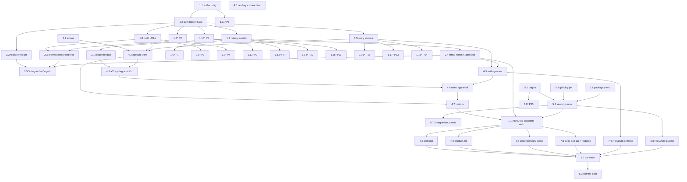

# Implementation Plan: Cuentas y autenticación

## Overview

Este plan construye la autenticación opcional con Amazon Cognito (registro, inicio y cierre de sesión) y el puente OIDC de GitHub, sin tocar los datos locales de `jardin-movil:v1`. Se avanza de abajo hacia arriba respetando `components → ui → core`: primero la configuración pública y la lógica pura de `auth.js` (PKCE, state, URLs, ruteo, sesión y validación de claims), luego los flujos de integración con Cognito, después los íconos y los componentes (`account-view`, ruteo del shell, `settings-view`, landing), en paralelo el puente `oidc-bridge/` como servicio Node/Express, y al final la documentación y la verificación con `qa-tester`. Las rutas del frontend son relativas a `exercise/`; el puente vive en `oidc-bridge/` en la raíz y los steerings en `.kiro/steering/`.

La opción preferida del cliente de Cognito es `fetch` propio + WebCrypto, sin SDK. La alternativa por CDN (`amazon-cognito-identity-js`) queda marcada como opcional, igual que las pruebas extendidas. Las tareas que tocan infraestructura real de AWS (crear el User Pool, registrar proveedores, desplegar el puente) **no son código que este plan ejecute**: se señalan como configuración manual/externa.

## Tasks

- [x] 1. Configuración pública y lógica pura de `auth.js`
  - [x] 1.1 Crear `src/core/auth-config.js` con los valores públicos
    - Exportar `AUTH_CONFIG` con `userPoolId`, `clientId` (App Client público, sin secreto), `region`, `cognitoDomain`, `redirectUri`, `scopes`, `providers` (`Google`, `Meta`→`Facebook`, `Amazon`→`LoginWithAmazon`, `GitHub`→`GitHubBridge`) y `oidcBridgeEndpoint`.
    - No incluir ninguna clave con "secret"; el `issuer` esperado se deriva de `region` y `userPoolId`, no se guarda aparte. Comentario de intención en el archivo.
    - _Requirements: 9.1, 9.2, 9.3, 12.3, 12.4_

  - [x] 1.2 Crear `src/core/auth.js` con la base del servicio y PKCE/state
    - Cabecera del módulo y `randomState()` (base64url de `crypto.getRandomValues`) y `pkceChallenge(verifier)` (`base64url(SHA-256(verifier))` con `crypto.subtle`), sin DOM.
    - `core` no importa de `components`, `ui` ni `three`; importa solo `AUTH_CONFIG`.
    - _Requirements: 12.1, 12.2_

  - [x] 1.3 Implementar la construcción pura de peticiones en `auth.js`
    - `buildAuthorizeUrl({ provider, state, challenge })`: `response_type=code`, `code_challenge_method=S256`, `redirect_uri` de config, `identity_provider` del proveedor; nunca `response_type=token` ni secreto.
    - `buildTokenRequest({ code, verifier })`: siempre `code_verifier`, nunca `client_secret`.
    - _Requirements: 4.2, 5.2, 9.3, 12.1, 12.3_

  - [x] 1.4 Implementar el ruteo y la persistencia de sesión pura en `auth.js`
    - `postSignInRoute(session)` (`'name-prompt'` si falta Display_Name, si no `'tasks'`), `sessionAction(now, accessExp, refreshExp)` (`'ok'|'refresh'|'sign-in'`) y `validateIdClaims(claims, cfg, now)` (iss, aud, exp).
    - `saveSession`/`loadSession`/`getSession` sobre `localStorage` clave `focus-garden:auth:v1`, separada de `jardin-movil:v1`; `loadSession()` devuelve null si expiró sin refresh válido.
    - _Requirements: 3.5, 4.7, 6.1, 9.4, 9.5, 9.6, 9.7, 12.5_

  - [x] 1.5 Implementar el modelo del Account_Slot y utilidades de error/contraseña en `auth.js`
    - `accountSlotModel(session, sdkReady)` (deshabilitado sin SDK; invitado vs con sesión), `passwordUnmetRules(password, policy)` y `mapAuthError(code)` (mensaje seguro en español; credenciales inválidas con un solo mensaje genérico).
    - _Requirements: 2.4, 2.5, 3.3, 7.1, 7.2, 7.3, 10.1, 10.3_

  - [x] 1.6 Prueba de la propiedad 1 (la ruta de cuenta depende solo del hash)
    - **Property 1: La ruta de cuenta se decide solo por el hash** (vive en `app-shell.js`; se importa la función pura `routeFromHash`).
    - Arnés `forAll`, al menos 100 iteraciones; etiqueta `Feature: accounts-auth, Property 1`.
    - **Validates: Requirements 1.1**

  - [x] 1.7 Prueba de la propiedad 2 (el desafío PKCE deriva del verificador)
    - **Property 2: El desafío PKCE deriva del verificador y es verificable**
    - Al menos 100 iteraciones; etiqueta `Feature: accounts-auth, Property 2`.
    - **Validates: Requirements 4.4, 12.1**

  - [x] 1.8 Prueba de la propiedad 3 (la URL de autorización usa code, PKCE, state y redirect permitida)
    - **Property 3: La URL de autorización usa code, PKCE, state y una redirect permitida**
    - Recorrer todos los proveedores de `AUTH_CONFIG.providers`; etiqueta `Feature: accounts-auth, Property 3`.
    - **Validates: Requirements 4.2, 5.2, 12.1, 12.3**

  - [x] 1.9 Prueba de la propiedad 4 (el canje valida el state y nunca envía secreto)
    - **Property 4: El canje valida el state y nunca envía secreto**
    - Pares `(sent, returned)` aleatorios y iguales/distintos; etiqueta `Feature: accounts-auth, Property 4`.
    - **Validates: Requirements 4.3, 4.5, 5.4, 9.3, 12.2**

  - [x] 1.10 Prueba de la propiedad 5 (el state es fresco y suficientemente aleatorio)
    - **Property 5: El state es fresco y suficientemente aleatorio**
    - Muestra grande sin colisiones; etiqueta `Feature: accounts-auth, Property 5`.
    - **Validates: Requirements 12.2**

  - [x] 1.11 Prueba de la propiedad 6 (Auth_Config solo contiene valores públicos)
    - **Property 6: Auth_Config solo contiene valores públicos**
    - Recorrer claves y valores buscando patrones de secreto; etiqueta `Feature: accounts-auth, Property 6`.
    - **Validates: Requirements 5.6, 9.1, 9.2, 12.4**

  - [x] 1.12 Prueba de la propiedad 7 (el destino tras iniciar sesión depende solo de la Display_Name)
    - **Property 7: El destino tras iniciar sesión depende solo de la Display_Name**
    - Sesiones aleatorias con y sin Display_Name; etiqueta `Feature: accounts-auth, Property 7`.
    - **Validates: Requirements 3.5, 4.7, 6.1, 6.5**

  - [x] 1.13 Prueba de la propiedad 9 (guardar y cargar la sesión es un round-trip)
    - **Property 9: Guardar y cargar la sesión es un round-trip**
    - Restaurar el `localStorage` al terminar; etiqueta `Feature: accounts-auth, Property 9`.
    - **Validates: Requirements 9.4**

  - [x] 1.14 Prueba de la propiedad 10 (la decisión de refresco cubre todas las expiraciones)
    - **Property 10: La decisión de refresco cubre todas las expiraciones**
    - Recorrer completo el dominio finito de combinaciones de expiración; etiqueta `Feature: accounts-auth, Property 10`.
    - **Validates: Requirements 9.5, 9.6**

  - [x] 1.15 Prueba de la propiedad 11 (el ID token se acepta solo con claims correctos)
    - **Property 11: El ID token se acepta solo con claims correctos**
    - Claims aleatorios con iss/aud/exp válidos e inválidos; etiqueta `Feature: accounts-auth, Property 11`.
    - **Validates: Requirements 9.7, 12.5**

  - [x] 1.16 Prueba de la propiedad 12 (el modelo del Account_Slot refleja disponibilidad y sesión)
    - **Property 12: El modelo del Account_Slot refleja disponibilidad y sesión**
    - Combinar `sdkReady` y sesión con/sin Display_Name; etiqueta `Feature: accounts-auth, Property 12`.
    - **Validates: Requirements 7.1, 7.2, 7.3, 10.1, 10.3**

  - [x] 1.17 Prueba de la propiedad 13 (las reglas de contraseña incumplidas son exactas)
    - **Property 13: Las reglas de contraseña incumplidas son exactas**
    - Contraseñas aleatorias contra una política; etiqueta `Feature: accounts-auth, Property 13`.
    - **Validates: Requirements 2.5**

  - [x] 1.18 Prueba de la propiedad 14 (los errores de autenticación mapean a mensajes seguros)
    - **Property 14: Los errores de autenticación mapean a mensajes seguros**
    - Recorrer completo el dominio finito de códigos de error conocidos; etiqueta `Feature: accounts-auth, Property 14`.
    - **Validates: Requirements 2.4, 3.3**

- [x] 2. Flujos de integración de `auth.js` con Cognito
  - [x] 2.1 Implementar disponibilidad y degradación en `auth.js`
    - `isAuthAvailable()` (red con `navigator.onLine`, descubrimiento OIDC de Cognito alcanzable y, si se usa la alternativa, SDK cargado) y `onAvailabilityChange(cb)` que escucha `online`/`offline` para rehabilitar sin recargar.
    - _Requirements: 10.1, 10.2, 10.4_

  - [x] 2.2 Implementar registro, confirmación y login por contraseña en `auth.js`
    - `signUp({ email, password })` (`SignUp`), `confirmSignUp({ email, code })` (`ConfirmSignUp`), `resendCode({ email })` y `signInWithPassword({ email, password })` (`InitiateAuth`) con `fetch` a la API JSON de Cognito; mapear errores con `mapAuthError`.
    - _Requirements: 2.1, 2.2, 2.3, 2.4, 2.6, 3.1, 3.3, 3.4_

  - [x] 2.3 Implementar el inicio con proveedores y el redirect en `auth.js`
    - `signInWithProvider(provider)` (guarda `{ state, verifier, provider }` en `sessionStorage`, `location.assign(buildAuthorizeUrl(...))`); GitHub resuelve "no disponible" si el puente falla, sin tumbar los otros métodos.
    - `handleRedirect(params)`: compara el state guardado, detecta `error=access_denied` (vuelve sin mensaje), canjea el code con `buildTokenRequest`, valida el ID token y abre la Session emitiendo `app:auth`.
    - _Requirements: 4.1, 4.2, 4.3, 4.4, 4.5, 4.6, 5.1, 5.2, 5.5, 5.6_

  - [x] 2.4 Implementar la validación de firma, el refresco y los atributos en `auth.js`
    - `verifyIdSignature(idToken, jwks)` (RS256 con `crypto.subtle.importKey`/`verify`, JWKS de Cognito cacheado en memoria), `refreshIfNeeded()` (usa `sessionAction` y el refresh token; termina la sesión si se rechaza), `saveDisplayName(name)` (`UpdateUserAttributes` del atributo `name`) y `signOut()` (borra `focus-garden:auth:v1`, emite `app:auth`).
    - _Requirements: 6.2, 7.4, 9.5, 9.6, 9.7, 12.5_

  - [x] 2.5 (Opcional) Pruebas de integración de `auth.js` con mocks de Cognito
    - 1-3 ejemplos por flujo (registro, confirmación, login, canje de code, refresco) con mocks; no se repiten 100 veces.
    - _Requirements: 2.1, 2.2, 2.3, 3.1, 4.4, 9.5_

  - [x] 2.6 (Opcional) Cargar el Account_SDK alternativo por CDN
    - Solo si la opción preferida (`fetch` + WebCrypto) no cubre: agregar `amazon-cognito-identity-js` por CDN con versión fija en `app.html`, con degradación elegante; pedir confirmación del usuario antes de sumarlo.
    - _Requirements: 10.5_

- [x] 3. Checkpoint - Lógica de autenticación
  - Ensure all tests pass, ask the user if questions arise.

- [x] 4. Íconos y componentes del frontend
  - [x] 4.1 Agregar los íconos de proveedores en `src/ui/icons.js`
    - Añadir a `PATHS` las entradas `google`, `github`, `meta`, `amazon`, `mail` y `user` (trazo estilo Lucide, viewBox 24×24, `currentColor`).
    - _Requirements: 1.2, 1.6_

  - [x] 4.2 Crear `src/components/account-view.js` (`<account-view>`)
    - `HTMLElement` light DOM montado en `#/cuenta`; estados internos `signIn` (por defecto), `signUp`, `confirm`, `namePrompt` y `disabled`; se suscribe a `app:auth`.
    - Formulario de inicio y registro, botones de los cuatro proveedores, "Volver sin cuenta" (`navigate('tasks')`), campo de código con "Reenviar código", y Name_Prompt que solo pide la Display_Name y muestra el Garden_Button "Ir a mi Garden" con texto escrito.
    - Reglas de contraseña incumplidas antes de enviar (`passwordUnmetRules`); al abrir sesión usa `postSignInRoute(session)`.
    - _Requirements: 1.1, 1.2, 2.2, 2.3, 2.4, 2.5, 2.6, 3.2, 3.3, 3.4, 3.5, 4.1, 4.6, 4.7, 5.1, 5.5, 6.1, 6.2, 6.3, 6.4, 6.6_

  - [x] 4.3 Dar accesibilidad y degradación a `account-view.js`
    - Cada input con su `<label>`; botones de solo ícono con `aria-label`; inputs a 16 px; objetivos de 44 px; tokens `cream`, `paper`, `ink`, `moss`, `leaf`, `line` y fuente redondeada.
    - Estado `disabled` con el aviso "Necesitas conexión para usar tu cuenta" cuando `!isAuthAvailable()`; se rehabilita con `onAvailabilityChange` sin recargar.
    - _Requirements: 1.3, 1.4, 1.5, 1.6, 10.2, 10.4_

  - [x] 4.4 Agregar el ruteo de `#/cuenta` en `src/components/app-shell.js`
    - `routeFromHash(hash)` (pura): `{ kind: 'route', id: 'account' }` para `#/cuenta`; `{ kind: 'tab', id }` en cualquier otro caso (id válido de `TABS` o `tasks`), sin lanzar ni mutar.
    - Montar `<account-view hidden>`; en la ruta `account` ocultar la pestaña activa y la barra y mostrar la cuenta a pantalla completa; al salir restaurar la pestaña. `TABS` no cambia; se conserva el `pointerdown` que reanuda la música.
    - _Requirements: 1.1, 5.5, 8.5_

  - [x] 4.5 Reemplazar el Reserved_Slot por el Account_Slot en `src/components/settings-view.js`
    - Derivar con `accountSlotModel(session, sdkReady)`: deshabilitado con aviso sin SDK; sin sesión, control "Crear cuenta o iniciar sesión" que hace `navigate('/cuenta')`; con sesión, Display_Name (o correo) y "Cerrar sesión".
    - "Cerrar sesión" llama `signOut()`, muestra el toast "Sesión cerrada" y no toca `jardin-movil:v1`; se suscribe a `app:auth`. El Reserved_Slot "Mis sesiones" sigue "Próximamente".
    - _Requirements: 7.1, 7.2, 7.3, 7.4, 7.5, 7.6, 8.1, 8.5, 10.1, 10.3_

  - [x] 4.6 Conectar el Create_Account_Button en `src/components/landing-sheets.js` e `index.html`
    - En `index.html` el Create_Account_Button pasa a enlace `./app.html#/cuenta` (o handler con `location.assign`); `openComingSoonSheet` queda sin uso (retirar o documentar como obsoleto). "Iniciar sin cuenta" no cambia.
    - _Requirements: 8.2, 8.3_

  - [x] 4.7 Registrar `account-view` en `src/main.js`
    - Importar `./components/account-view.js` para definir el componente; `settings-view` ya está importado.
    - _Requirements: 1.1, 8.1_

- [x] 5. Puente OIDC de GitHub (`oidc-bridge/`, Node + Express)
  - [x] 5.1 Crear `oidc-bridge/package.json` y `.env.example`
    - `package.json` con dependencias `express` y `jose`, scripts `start`/`dev` y `"type": "module"`, sin build de frontend.
    - `.env.example` con `GITHUB_CLIENT_ID`, `GITHUB_CLIENT_SECRET`, `OIDC_SIGNING_KEY`, `OIDC_KEY_ID`, `ALLOWED_ORIGINS`, `ISSUER` y `PORT`, sin valores reales.
    - _Requirements: 11.1, 11.3, 11.6_

  - [x] 5.2 Crear `oidc-bridge/lib/origins.js` (lógica pura)
    - `isAllowedOrigin(origin, allowlist)`: true solo si el origen es miembro exacto de la allowlist; rechaza subdominios y prefijos.
    - _Requirements: 11.5, 12.6_

  - [x] 5.3 Crear `oidc-bridge/lib/github.js` y `oidc-bridge/lib/jwt.js`
    - `github.js`: intercambio del code con GitHub (con `GITHUB_CLIENT_SECRET`) y lectura del perfil (`/user`, `/user/emails`).
    - `jwt.js`: firma (RS256, clave privada de env) y verificación de los ID token del puente con `jose`.
    - _Requirements: 11.3, 11.4, 12.6_

  - [x] 5.4 Crear `oidc-bridge/server.js` y las rutas
    - `server.js`: app Express, CORS por allowlist con `isAllowedOrigin`, monta las rutas.
    - `routes/authorize.js` (valida origen y redirige a GitHub con state), `routes/callback.js` (canjea el code de GitHub y redirige a Cognito), `routes/token.js` (emite el ID token OIDC firmado), `routes/jwks.js` (clave pública) y `routes/discovery.js` (`/.well-known/openid-configuration`).
    - _Requirements: 5.3, 11.1, 11.2, 11.4, 11.5, 12.6_

  - [x] 5.5 Crear `oidc-bridge/README.md`
    - Documentar el contrato de endpoints, las variables de entorno y cómo correrlo local (`npm install`, copiar `.env.example` a `.env`, `npm start`).
    - _Requirements: 11.6_

  - [x] 5.6 Prueba de la propiedad 15 (el puente acepta solo orígenes de la allowlist)
    - **Property 15: El puente acepta solo orígenes de la allowlist** (lógica pura de `origins.js`, con `node:test`).
    - Al menos 100 iteraciones con orígenes y allowlists aleatorias, incluidas variantes de subdominio y prefijo; etiqueta `Feature: accounts-auth, Property 15`.
    - **Validates: Requirements 11.5, 12.6**

  - [x] 5.7 (Opcional) Pruebas de integración del puente con mocks de GitHub
    - Con `node:test`, probar `authorize`, `callback`/`token` y `jwks` con mocks de GitHub; 1-3 ejemplos por endpoint.
    - _Requirements: 11.2, 11.4_

- [x] 6. Checkpoint - Frontend y puente integrados
  - Ensure all tests pass, ask the user if questions arise.

- [x] 7. Documentación
  - [x] 7.1 Crear `docs/modules/accounts-auth/README.md`
    - Secciones **Descripción**, **Pruebas para qa-tester** (un caso con pasos y resultado esperado por cada requisito 1 a 12, incluidos bloqueo de CDN/red, medición de 44 px e inputs de 16 px, y pestaña Network para comprobar que ningún secreto viaja y que "Cerrar sesión" no escribe `jardin-movil:v1`) y **Changelog** con `1.0.0` y fecha `AAAA-MM-DD`.
    - Incluir el arnés `forAll` y enlazar los scripts de propiedades.
    - _Requirements: 13.1, 13.2, 13.7_

  - [x] 7.2 Actualizar `.kiro/steering/tech.md`
    - Reemplazar "sin backend, sin build" por la descripción de Cognito, el Account_SDK por CDN (alternativa) y el OIDC_Bridge Node/Express.
    - _Requirements: 13.3_

  - [x] 7.3 Actualizar `.kiro/steering/product.md`
    - Reconocer la tensión con el principio 6 (cuentas opcionales, datos locales intactos) y agregar el módulo `accounts-auth` a la tabla de módulos.
    - _Requirements: 13.4_

  - [x] 7.4 Actualizar `.kiro/steering/dependencies-policy.md`
    - Documentar el cliente de Cognito (preferido local, alternativa por CDN) y `jose` en el puente, con su motivo.
    - _Requirements: 13.3, 13.4_

  - [x] 7.5 Actualizar `.kiro/steering/docs-and-qa.md` y `docs/features.md`
    - Añadir `docs/modules/accounts-auth/README.md` al mapa de `docs-and-qa.md`.
    - Mover `accounts-auth` del roadmap a los casos de uso disponibles en `docs/features.md`.
    - _Requirements: 13.5, 13.6_

  - [x] 7.6 Actualizar `docs/modules/settings/README.md`
    - Documentar el Account_Slot real y el cierre de sesión; agregar entrada MENOR al Changelog.
    - _Requirements: 13.1, 13.7_

- [x] 8. Verificación y cierre
  - [x] 8.1 Ejecutar el agente `qa-tester` sobre `accounts-auth` y la regresión de `settings`
    - Correr las pruebas del README (y las propiedades en consola/Node), corregir lo que falle y repetir hasta que pasen, incluida la no interferencia con `jardin-movil:v1`.
    - _Requirements: 1.1, 7.4, 8.1, 8.4, 10.1, 12.4, 13.2_

  - [x] 8.2 Marcar el spec 2 como implementado en `exercise/docs/current-plan.md`
    - Actualizar el estado del spec `accounts-auth` a implementado al cerrar el trabajo.
    - _Requirements: 13.6_

## Notes

- Las tareas marcadas con `*` son opcionales (propiedades del diseño y pruebas de integración) y se pueden omitir para llegar antes a un MVP. Las propiedades se ejecutan con el arnés `forAll` en la consola del navegador para `auth.js` y con `node:test` para `oidc-bridge/lib/origins.js`, con al menos 100 iteraciones y recorrido completo en dominios finitos.
- **Opción preferida sin SDK.** La tarea 2.6 (Account_SDK por CDN) es opcional: solo se hace si `fetch` + WebCrypto no cubre algún flujo. La propiedad 6 y la seguridad exigen que `auth-config.js` no tenga secretos en ningún caso.
- **Configuración manual/externa (no la ejecuta este plan).** Crear el User Pool y el App Client público sin secreto en Amazon Cognito, declarar las redirect URIs permitidas, registrar Google, Meta y Login with Amazon como proveedores sociales, registrar el puente como identity provider OIDC y desplegar `oidc-bridge/` con sus variables de entorno. El plan solo escribe código y configuración pública; estos pasos se documentan en el README del puente y del módulo.
- **Claves y propiedades.** La propiedad 8 (la autenticación nunca altera los datos locales) se verifica como parte de la tarea 8.1 y de los casos de `qa-tester`, no como una prueba `forAll` aislada, porque cruza varias operaciones con `localStorage` real.
- `routeFromHash` es pura pero vive en `app-shell.js` (tarea 4.4); su prueba de propiedad (1.6) la importa desde ahí.
- Las tareas de documentación leen el código ya hecho, por eso van después de los componentes y el puente. Las tareas 7.2 a 7.5 modifican archivos de `.kiro/steering/`, fuera de `exercise/`.
- El grafo de dependencias se da en Mermaid (formato de `spec-format.md`) y en JSON por olas. Los checkpoints y las tareas de primer nivel no aparecen en el JSON.

## Task Dependency Graph



```json
{
  "waves": [
    { "id": 0, "tasks": ["1.1", "5.1", "5.2", "5.3", "4.1", "4.6"] },
    { "id": 1, "tasks": ["1.2", "1.11", "5.4", "5.6"] },
    { "id": 2, "tasks": ["1.3", "1.4", "1.5", "1.7", "1.10", "5.5", "5.7"] },
    { "id": 3, "tasks": ["2.1", "2.2", "2.3", "2.4", "1.6", "1.8", "1.9", "1.12", "1.13", "1.14", "1.15", "1.16", "1.17", "1.18"] },
    { "id": 4, "tasks": ["2.5", "4.2", "4.5"] },
    { "id": 5, "tasks": ["4.3"] },
    { "id": 6, "tasks": ["4.4", "4.7"] },
    { "id": 7, "tasks": ["7.1", "7.6"] },
    { "id": 8, "tasks": ["7.2", "7.3", "7.4", "7.5"] },
    { "id": 9, "tasks": ["8.1"] },
    { "id": 10, "tasks": ["8.2"] }
  ]
}
```
