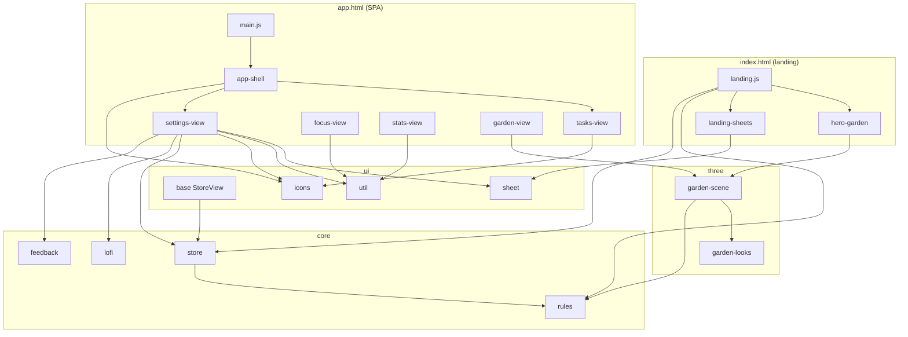
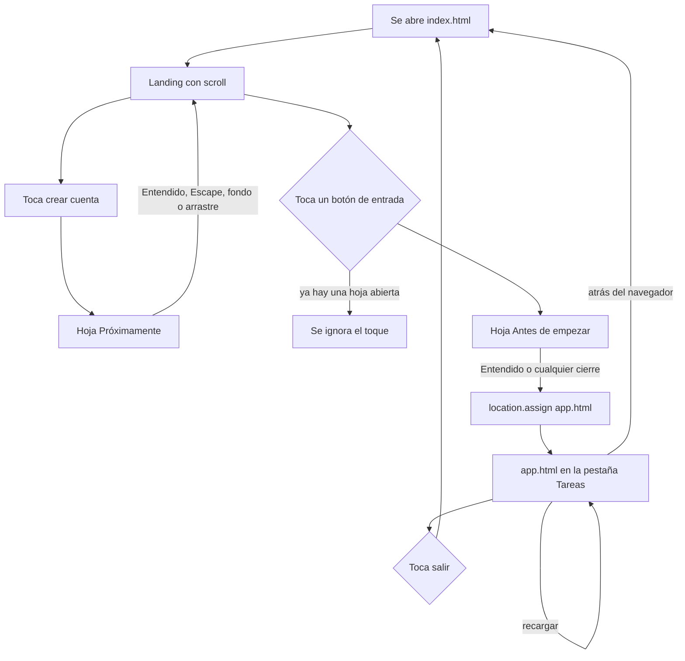
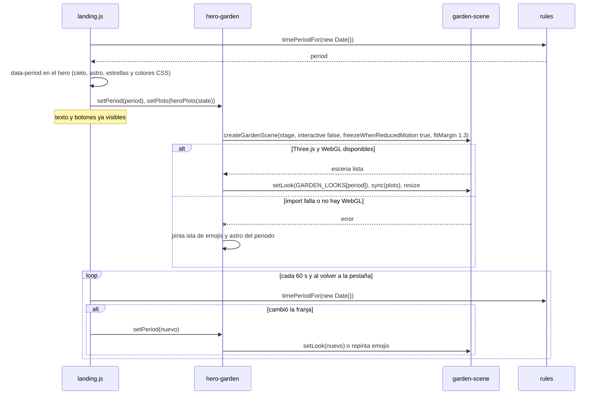
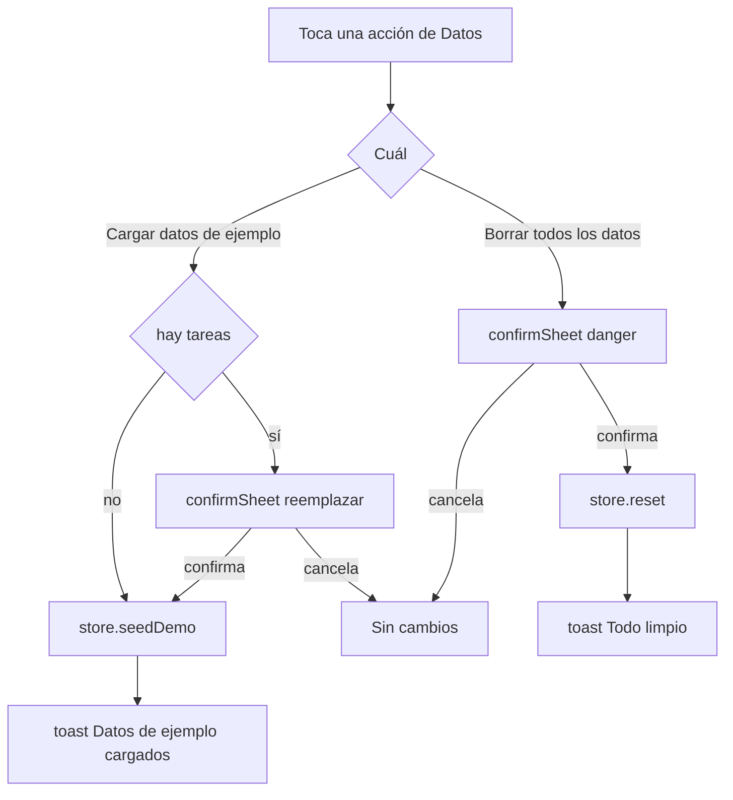

# Design Document

## Overview

Este diseño agrega a Focus Garden una **landing** de presentación con el jardín 3D (cambia según la hora local) y un módulo de **Ajustes** que reúne los controles que antes vivían en Foco y Estadísticas. No hay backend: todo sigue en `localStorage` bajo la clave `jardin-movil:v1`.

**Revisión del 2026-10-31.** La primera versión hizo la landing como un componente encima de las pestañas, dentro de la misma SPA, con un aviso de una sola vez. Resultó pobre como presentación, no dejaba volver a ella y se mostraba en cada recarga. La revisión la convierte en **una página aparte** (`index.html`), con secciones de contenido, y deja la SPA en `app.html`. Las secciones de abajo ya describen la versión revisada.

Decisiones principales:

| Tema | Decisión | Motivo |
|------|----------|--------|
| Dos páginas | `index.html` es la landing (HTML estático con scroll) y `app.html` es la SPA. Entrar y salir son navegaciones reales (`location.assign` y enlaces). | Atrás, adelante y recargar funcionan como en cualquier sitio; recargar la app ya no muestra la landing; la landing no carga el shell ni las vistas. |
| Estilos y colores compartidos | `src/styles/base.css` (tipografía, hojas, animaciones), `app.css`, `landing.css`, y `src/ui/tailwind-config.js` con los tokens de Tailwind. | Dos páginas no deben duplicar la paleta ni las hojas de `sheet.js`. |
| Franja horaria | `timePeriodFor(date)` pura en `rules.js`, con la tabla de looks 3D como datos en `src/three/garden-looks.js`. | Lógica nueva primero en `core`; la tabla de colores es presentación. |
| Hero 3D | Se reutiliza `createGardenScene` con tres opciones nuevas, todas con un valor por defecto que conserva el comportamiento actual: `interactive` (`true`), `freezeWhenReducedMotion` (`false`) y `fitMargin` (`1`), más el método `setLook(look)`. No se crea una segunda escena. | Evita duplicar ~300 líneas de plantas, isla y nubes sin tocar al jardín del módulo `3d-world`. |
| Movimiento reducido | El soporte ampliado (animación detenida, sin "pop", nubes y alas quietas, reencuadre directo) se activa solo con `freezeWhenReducedMotion: true`, que únicamente pasa `<hero-garden>`. En CSS se apagan las estrellas, la estrella fugaz, los chips flotantes y el scroll suave. `<garden-view>` **no cambia**. | El requisito 3.3 es del hero. Una opción explícita no depende de `interactive`. |
| Cielo, astro y estrellas | El cielo es un degradado CSS por franja (`data-period` en el hero). Un astro (sol o luna) y las estrellas se pintan con CSS; las estrellas las genera `landing.js` de forma determinista. El texto del hero cambia de color de noche con variables CSS. | La landing nunca depende de la red y las estrellas se ven igual en cada visita. |
| Degradación | Si Three.js o WebGL fallan, el hero muestra una isla de emojis sobre ese mismo cielo. | La landing nunca depende de la red (`tech.md`). |
| Recordatorio de la cuenta | Una hoja (`openAccountReminderSheet`, con `openSheet`) que se abre **en cada entrada** desde cualquier botón de entrada; al cerrarse, de cualquier forma, se navega a `app.html`. No guarda ningún indicador. | La versión de una sola vez no aparecía con "Continuar" y parecía no funcionar. Como recargar la app ya no pasa por la landing, repetirlo no estorba. |
| "Próximamente" | Segunda hoja (`openComingSoonSheet`) que solo informa y se cierra; la landing sigue abierta. | Evita encadenar dos hojas al entrar. |
| Salida de la app | Enlaces normales a `index.html`: ícono en el encabezado de Tareas y fila al final de Ajustes. | Un enlace no necesita JavaScript ni confirmación; los datos quedan guardados. |
| Ajustes | `<settings-view>` es la quinta pestaña. Recibe los switches, el modo demo y las acciones de datos. | Una sola ubicación para preferencias. |
| Pruebas | Propiedades verificadas con un arnés mínimo en consola (sin librería), documentado en el README de `settings`. | `tech.md` no tiene Node ni bundler; `dependencies-policy.md` pide confirmación para sumar dependencias. |

## Architecture

### Árbol de archivos

```
exercise/
  index.html                         (reescribir: la landing, página estática con secciones; antes era la SPA)
  app.html                           (nuevo: la SPA, con <app-shell> y el import map)
  manifest.webmanifest               (modificar: start_url ./app.html)
  src/
    landing.js                       (nuevo: arranque de la landing)
    main.js                          (modificar: arranque de la app, importa settings-view)
    styles/
      base.css                       (nuevo: tipografía, .press, hojas y animaciones comunes)
      app.css                        (nuevo: layout de la SPA, chips, switch, fila deslizable, toasts)
      landing.css                    (nuevo: cielos por franja, astro, estrellas, botones y tarjetas de la landing)
    core/
      rules.js                       (modificar: TIME_PERIODS, timePeriodFor, hasLocalData,
                                      LANDING_STARTER_PLOTS, heroPlots)
      store.js                       (modificar: hasLocalData(), exportar freshState)
    ui/
      icons.js                       (modificar: íconos 'settings' y 'logout')
      tailwind-config.js             (nuevo: tokens de color de Tailwind para las dos páginas)
    three/
      garden-looks.js                (nuevo: GARDEN_LOOKS por franja, datos sin Three.js)
      garden-scene.js                (modificar: opciones interactive, freezeWhenReducedMotion y fitMargin,
                                      método setLook; sin cambio de comportamiento para garden-view)
    components/
      app-shell.js                   (modificar: TABS + settings; ya no contiene la landing)
      landing-sheets.js              (nuevo: openAccountReminderSheet, openComingSoonSheet)
      hero-garden.js                 (nuevo: <hero-garden>, escena 3D o fallback CSS/emojis)
      settings-view.js               (nuevo: <settings-view>, con la fila de salir)
      tasks-view.js                  (modificar: botón de salir en el encabezado)
      focus-view.js                  (modificar: quita switches, agrega indicador de modo demo)
      stats-view.js                  (modificar: quita acciones de datos, agrega estado vacío)
docs/
  features.md                        (modificar: casos de uso y roadmap)
  modules/
    settings/README.md               (nuevo)
    pomodoro/README.md               (modificar)
    statistics/README.md             (modificar)
    3d-world/README.md               (modificar: API nueva de la escena y entradas PARCHE en el Changelog;
                                      el comportamiento del módulo no cambia)
.kiro/steering/
  product.md                         (modificar: módulo settings en la tabla)
  docs-and-qa.md                     (modificar: módulo settings en el mapa)
  tech.md, design-system.md          (modificar: dos páginas, estilos y colores compartidos)
.kiro/skills/
  deploy-to-aws/                     (modificar: los scripts publican también app.html)
  responsive-mobile-first/           (modificar: dónde viven los estilos)
```

### Relación entre componentes

Dirección de dependencias: `components → ui → core`. `three/` solo importa de `core` y lo usan los componentes. `core` no importa nada de arriba. Cada página tiene su propio punto de entrada: `landing.js` (landing) y `main.js` (app).



Las vistas no se importan entre sí. Focus y Stats llevan a Ajustes con `navigate('settings')`. La landing y la app **no se conocen**: se enlazan con URLs (`./app.html` y `./index.html`).

### Flujo: entrada desde la landing y salida de la app

Cualquier botón de entrada abre el recordatorio. Cualquier forma de cerrarlo (Entendido, Escape, backdrop, arrastre) navega a la app.



### Flujo: jardín según la franja con degradación



Al navegar a `app.html` la página se descarga entera, así que no hace falta liberar la escena a mano; `dispose()` queda para cualquier otro uso futuro del componente.

### Flujo: acciones de datos en Ajustes



## Components and Interfaces

### `core/rules.js` (lógica nueva, sin DOM)

```js
/** Franjas del día según la hora local del dispositivo. */
export const TIME_PERIODS = ['morning', 'midday', 'afternoon', 'night'];

/**
 * Franja del día para pintar el jardín de bienvenida. Solo mira la hora local:
 * 06-11 morning, 12-15 midday, 16-19 afternoon, 20-05 night. Una fecha inválida
 * devuelve 'midday', el look neutro, para no dejar el hero sin cielo.
 */
export function timePeriodFor(date) {
  const hour = date.getHours();
  if (Number.isNaN(hour)) return 'midday';
  if (hour >= 6 && hour < 12) return 'morning';
  if (hour >= 12 && hour < 16) return 'midday';
  if (hour >= 16 && hour < 20) return 'afternoon';
  return 'night';
}

/** Hay algo que "continuar": al menos una tarea o una ronda. No muta el estado. */
export const hasLocalData = (state) => state.tasks.length > 0 || state.rounds.length > 0;

/** Plantas de muestra cuando aún no hay jardín propio. Ids fijos: la escena las dibuja siempre igual. */
const starterPlot = (id, type, rounds) =>
  ({ id, title: '', type, doneAt: 0, rounds, plant: plantForRounds(rounds) });
export const LANDING_STARTER_PLOTS = [
  starterPlot('starter-tree', 'personal', 4),
  starterPlot('starter-flower', 'salud', 2),
  starterPlot('starter-grass', 'trabajo', 1),
  starterPlot('starter-bush', 'social', 3),
  starterPlot('starter-flower-2', 'ocio', 2),
];

/** El hero muestra el jardín real si tiene plantas; si no, las plantas de inicio. */
export function heroPlots(state) {
  const plots = gardenPlots(state);
  return plots.length ? plots : LANDING_STARTER_PLOTS;
}
```

### `core/store.js`

- `freshState` se exporta (con comentario) para poder probar que un guardado viejo o corrupto termina con ajustes válidos. No agrega ajustes nuevos: la primera versión de este spec le sumó `introSeen`, y la revisión lo retiró.
- `reset()` y `seedDemo()` ya llaman a `freshState(this.state.settings)`, por lo que **conservan** `music`, `sound`, `demo` y `minutes` sin cambios. El diseño no agrega código ahí; lo cubre la propiedad 4.
- Método de lectura nuevo `hasLocalData()`, que delega en la función pura de `rules.js` (se importa con alias para no chocar con el nombre del método).

```js
import { DEFAULT_MINUTES, DURATIONS, hasLocalData as stateHasLocalData, plantForRounds } from './rules.js';

export const freshState = (settings = {}) => {
  const s = { demo: false, sound: true, music: false, minutes: DEFAULT_MINUTES, ...settings };
  if (!DURATIONS.includes(s.minutes)) s.minutes = DEFAULT_MINUTES; // datos viejos o corruptos
  /* ...timer y listas igual que hoy... */
};

class Store extends EventTarget {
  /** ¿Hay tareas o rondas guardadas? Define el texto del botón de la landing. */
  hasLocalData() { return stateHasLocalData(this.state); }
}
```

Compatibilidad: la clave `jardin-movil:v1` no cambia. Un guardado de la primera versión que traiga `settings.introSeen` lo conserva sin leerlo.

### `three/garden-looks.js` (nuevo, datos)

Valores de luz por franja. `midday` repite los valores que `garden-scene.js` usa hoy, así `garden-view` se ve igual.

```js
// Luces del jardín por franja del día. Son datos puros: no importan Three.js.
export const GARDEN_LOOKS = {
  morning:   { hemiSky: 0xfff1d6, hemiGround: 0x8fb89a, hemiIntensity: 1.5, sunColor: 0xffd9a8, sunIntensity: 2.0, sunPosition: [-9, 6, 5],  cloudColor: 0xfff4e6 },
  midday:    { hemiSky: 0xfff6e5, hemiGround: 0x7fa98a, hemiIntensity: 1.5, sunColor: 0xfff0d0, sunIntensity: 2.4, sunPosition: [7, 12, 5],  cloudColor: 0xffffff },
  afternoon: { hemiSky: 0xffe6c4, hemiGround: 0x8a9f7e, hemiIntensity: 1.3, sunColor: 0xffb877, sunIntensity: 2.2, sunPosition: [9, 5, -4],  cloudColor: 0xffe3cc },
  night:     { hemiSky: 0x8fa3d6, hemiGround: 0x3b4f5c, hemiIntensity: 0.9, sunColor: 0xb7c6ff, sunIntensity: 0.9, sunPosition: [-6, 10, 6], cloudColor: 0xb9c4de },
};
```

### `three/garden-scene.js` (cambios)

| Cambio | Detalle |
|--------|---------|
| Firma | `createGardenScene(container, { onSelect, interactive = true, freezeWhenReducedMotion = false, fitMargin = 1 } = {})`. Con los valores por defecto la escena se comporta igual que hoy; `garden-view` sigue llamándola como ahora, sin pasar las opciones nuevas. |
| `interactive: false` | `controls.enabled = false`, no se registran `pointerdown`/`pointerup` y el canvas lleva `pointer-events:none`. La rotación automática sigue, porque `OrbitControls.update()` no consulta `enabled`. |
| `setLook(look)` | Aplica `hemiSky`, `hemiGround`, `hemiIntensity`, `sunColor`, `sunIntensity`, `sunPosition` y `M.cloud.color`. Al crear la escena se llama con `GARDEN_LOOKS.midday`, que reemplaza los literales actuales (mismos valores, así `garden-view` se ve igual). El cambio es instantáneo. |
| `freezeWhenReducedMotion: true` | Solo tiene efecto si además `prefers-reduced-motion: reduce` está activo. La escena calcula `const isMotionFrozen = freezeWhenReducedMotion && reduceMotion` una vez al crearse y la usa en tres puntos, todos protegidos por esa constante. (1) `update(dt)` no avanza el tiempo de animación, por lo que la isla, las nubes, las alas y los pétalos quedan en su pose inicial. (2) `sync` crea las parcelas con escala 1 y sin `pop`. (3) El reencuadre de cámara toma la rama directa (`snap`) en lugar de interpolar con `needsFrame`. Completa el requisito 3.3 únicamente para el hero. |
| `fitMargin` | Multiplica la distancia de encuadre (`fitDistance`) para dejar aire alrededor de la isla. Por defecto `1`, igual que hoy. El hero usa `1.3` porque su lienzo es más ancho que alto y, al girar, las esquinas del cuadrado se cortaban en los bordes. |
| Comportamiento existente con movimiento reducido | Sin cambios y válido para cualquier escena: `controls.autoRotate = !reduceMotion` y `world.position.y = reduceMotion ? 0 : ...`. Cuando `isMotionFrozen` es `false`, que es el caso de `garden-view`, el resto del movimiento sigue como hoy: las nubes orbitan, las plantas aparecen con "pop" y el reencuadre se interpola. |
| API devuelta | Se agrega `setLook` a `{ sync, deselect, resize, dispose }`. Los métodos existentes conservan su firma. |

### `components/hero-garden.js` (nuevo)

`<hero-garden>` es un `HTMLElement` simple (light DOM) que no se suscribe al store; la landing le pasa los datos.

```js
// <hero-garden>: isla 3D de fondo de la landing, o una isla de emojis si Three.js/WebGL no cargan.
class HeroGarden extends HTMLElement {
  #scene = null;
  #plots = [];
  #period = 'midday';
  #failed = false;
  #disposed = false;

  connectedCallback()   // crea el contenedor y llama a #loadScene()
  setPlots(plots)       // guarda y sincroniza: scene.sync(plots) o #paintFallback()
  setPeriod(period)     // guarda y aplica: scene.setLook(GARDEN_LOOKS[period]) o #paintFallback()
  dispose()             // libera la escena; si la carga sigue en curso, la descarta al terminar
}
```

- La escena se crea con `createGardenScene(stage, { interactive: false, freezeWhenReducedMotion: true, fitMargin: HERO_FIT_MARGIN })` (`HERO_FIT_MARGIN = 1.3`). Es el único llamador que activa `freezeWhenReducedMotion` y `fitMargin`; `garden-view` no los pasa.
- Un `ResizeObserver` sobre el contenedor llama a `scene.resize(w, h)`, igual que `garden-view`.
- `#loadScene()` captura cualquier error (falla del import, ausencia de WebGL) y pone `#failed = true`. Después usa `#paintFallback()`.
- Si `dispose()` ocurre antes de que termine la carga (el usuario tocó muy rápido), al resolver la promesa se llama `scene.dispose()` de inmediato.
- Fallback: un astro emoji por franja (`morning` 🌅, `midday` ☀️, `afternoon` 🌇, `night` 🌙), una elipse verde con tierra y hasta `MAX_FALLBACK_PLANTS = 12` emojis de las plantas. Sin animaciones, por lo que cumple movimiento reducido.

### Página `index.html` y `src/landing.js` (la landing)

La landing es HTML estático con el contenido ya escrito; solo unas pocas piezas necesitan JavaScript y todas viven en `src/landing.js`. Carga Tailwind y el import map de Three.js (no Tone.js: no hay música) y los estilos `base.css` y `landing.css`.

Estructura de la página:

```
<header>   barra fija: nombre, enlaces a las secciones (desde 768 px) y botón "Entrar"
<section #inicio .hero-sky data-period>
  .sky-stars   estrellas (las crea landing.js) y una estrella fugaz
  .sky-body    sol o luna según la franja
  grid 2 columnas desde 1024 px
    izquierda: insignia, <h1>, texto, botones, tres cifras, nota de datos locales, botón de crear cuenta
    derecha:   <hero-garden> y dos chips decorativos flotantes
<section #como-funciona>   tres pasos y la escalera de plantas
<section #funciones>       seis tarjetas
<section #open-source>     texto, lista del stack, comandos para correrlo y enlace a GitHub
<section>                  llamada final
<footer>
<div id="sheet-host">      capa fija para las hojas de sheet.js
```

El cielo, el astro y los colores del texto dependen solo de `data-period` en `#inicio`: `landing.css` define variables (`--hero-ink`, `--hero-muted`, `--hero-accent`, `--hero-cta`, etc.) por franja, de modo que de noche el texto cambia a colores claros sin tocar el HTML. Los degradados del cielo terminan fundiéndose con el fondo crema de la página (`::after` del hero). Bajo 1024 px el astro se achica y se mueve a la esquina para no tapar el título.

Funciones de `landing.js`:

| Función | Responsabilidad |
|---------|-----------------|
| `applyPeriod()` | Calcula `timePeriodFor(new Date())`; si cambió, actualiza `data-period` y `heroGarden.setPeriod`. Corre al cargar, cada `PERIOD_CHECK_MS = 60_000` y en `visibilitychange`. |
| `renderStars()` | Crea `STAR_COUNT = 70` elementos `<i>` con posición, tamaño y retardo calculados con aritmética determinista (sin `Math.random`). Una de cada `BRIGHT_STAR_EVERY = 7` brilla más. Solo se ven con `data-period="night"`. |
| `renderPlantLadder()` | Pinta la escalera de plantas desde `PLANTS` (emoji, nombre y rondas; la última lleva "6+"). |
| `renderTaskTypeChips()` | Pinta los chips de tipo desde `TASK_TYPES`, con el color de cada tipo. |
| `renderHeroStats()` | Escribe en las cifras del hero `PLANTS.length` y `TASK_TYPES.length`. |
| `renderEntryState()` | Con `store.hasLocalData()` pone "Continuar mi jardín" o "Empezar mi jardín" en los botones con `data-enter-label`, oculta o muestra la nota de datos locales y entrega `heroPlots(store.state)` al hero. |
| `enterApp()` | Si `isEntering` ya es `true`, ignora el toque. Si no, abre `openAccountReminderSheet({ onDone })`, y `onDone` navega con `location.assign('./app.html')`. |

Eventos: un `click` delegado en `document` (`[data-enter]` llama a `enterApp`; `[data-act="account"]` abre `openComingSoonSheet`), `visibilitychange` para recalcular la franja y `pageshow` con `event.persisted` para recargar cuando el navegador restaura la página desde su caché al volver con "atrás".

Los textos de la landing (títulos, funciones, comandos) son contenido estático. Lo que sale de las reglas del juego (plantas, tipos, cifras) se genera desde `rules.js` para que la landing no contradiga a la app.

### `components/landing-sheets.js` (nuevo)

```js
/** Recordatorio de la cuenta, en cada entrada. Cualquier cierre llama a onDone. */
export function openAccountReminderSheet({ onDone })
/** Anuncia que las cuentas llegan pronto. Solo informa; la landing sigue abierta. */
export function openComingSoonSheet()
```

- **Recordatorio**: título "Antes de empezar", texto "Puedes crear una cuenta desde los ajustes si así lo deseas" y un botón "Entendido" con el foco inicial. `openSheet` ya aporta `role="dialog"`. En `onClose` se quita el foco del elemento activo (vuelve al documento) y se ejecuta `onDone`. No guarda ningún indicador.
- **Próximamente**: título "Próximamente", frase "Las cuentas llegan pronto. Por ahora tu jardín vive en este dispositivo." y un botón "Entendido" que cierra la hoja. No navega ni hace peticiones.

`openSheet` (de `ui/sheet.js`) necesita `#sheet-host` en el documento. En la app es un contenedor `display: contents`; en la landing es una capa `position: fixed` con `pointer-events: none` que acepta eventos solo en sus hijos, para no bloquear la página cuando está vacía. Las reglas de la hoja viven en `base.css`, compartidas por ambas páginas.

### `components/app-shell.js` (cambios)

- `TABS` suma `{ id: 'settings', label: 'Ajustes', icon: 'settings' }` como **última** entrada. `main` suma `<settings-view data-tab="settings" hidden>`.
- La barra de pestañas con cinco entradas necesita que cada píldora quepa en 320 px: el ancho `w-16` pasa a `w-14` (56 px). Cada botón ya es `flex: 1 1 0; min-width: 0`.
- El shell **ya no contiene la landing**: no hay `<landing-view>`, ni `main`/`nav` ocultos al inicio, ni el evento `app:entered`. Al conectar, `this.go(this.#tabFromHash())` muestra la pestaña del hash (`#tabFromHash()` devuelve el id si existe en `TABS` y `'tasks'` en cualquier otro caso).
- La landing es otra página, por lo que `garden-view` y los demás componentes de la app nunca se cargan mientras se ve la landing. Solo hay un contexto WebGL por página.
- El `pointerdown` que reanuda la música al primer toque se mantiene tal cual.

### `components/settings-view.js` (nuevo)

`<settings-view>` extiende `StoreView` y repinta en `update(state)` conservando el scroll, como las demás vistas. Orden de la pantalla: cabecera "Ajustes", tarjeta de preferencias, sección "Datos", y los dos Reserved_Slot.

| Bloque | Contenido |
|--------|-----------|
| Preferencias | Tres filas con `role="switch"` y `aria-checked` leído de `state.settings`: "Música de fondo", "Sonido de la campanita" y "Modo demo" (texto de apoyo "Rondas de 10 segundos para mostrar la app"). |
| Música | Misma lógica que hoy en `focus-view`: `unlockAudio()`, `setSetting('music', on)`, `haptic(10)` y `startMusic()` o `stopMusic()`. Sin Tone.js (`!isMusicAvailable()`) el switch va `disabled` con el texto "No disponible sin conexión", `aria-checked="false"`, y los otros dos siguen activos. |
| Modo demo | Se deshabilita mientras la ronda está en curso o en pausa, igual que hoy, con el apoyo "Termina o reinicia la ronda para cambiarlo". Así el store no cambia su comportamiento. |
| Datos | Sección titulada "Datos" con "Cargar datos de ejemplo" y "Borrar todos los datos", cuyo código se mueve desde `stats-view` (confirmaciones y toasts idénticos). |
| Reserved_Slot | "Mi cuenta" y "Mis sesiones": `<section aria-disabled="true">` con `text-ink/50`, etiqueta "Próximamente" y el texto de cada una. Sin `data-act`, sin botones y sin foco; no hay peticiones ni datos de cuenta. |
| Salir | Al final, un enlace `<a href="./index.html">` con el ícono `logout` y el texto "Salir a la página de inicio", de al menos 48 px de alto. No cambia ningún dato. |

Todo interruptor llama a `haptic(10)` y el valor persiste porque pasa por `store.setSetting`.

### `components/tasks-view.js` (cambios)

El encabezado pasa a una fila: a la izquierda la fecha y "Mis tareas", a la derecha un enlace `<a href="./index.html">` circular de 44×44 px con el ícono `logout`, `aria-label="Salir a la página de inicio"` y `title="Salir"`. Es un enlace normal, no usa `data-act`, así que el manejador de clics de la vista no lo intercepta.

### `components/focus-view.js` (cambios)

- Se elimina la tarjeta de filas (`row`, `musicAvailable`) y los casos `demo`, `sound` y `music` de `#onClick`. Se quitan los imports de `startMusic`, `stopMusic` e `isMusicAvailable`. `unlockAudio` y `haptic` se conservan.
- Las fichas de duración (5, 10, 15, 25, 35, 45 y 60) no cambian.
- Con `settings.demo` activo, el encabezado de duración reemplaza "Modo demo: 10 s" por el texto **Modo demo** y un control tipo enlace "Cambiar en Ajustes" (`data-act="settings"`, `min-h-11`) que llama `navigate('settings')`.
- El ducking de música y la campanita viven en `app-shell.#onRound` y no se tocan (req. 10.6).

### `components/stats-view.js` (cambios)

- Se eliminan los dos botones de datos, `#onClick` de seed/reset y los imports `confirmSheet`, `toast` y `store`, que quedan sin uso.
- Estado vacío: cuando `!hasLocalData(state)`, aparece una tarjeta con 📊, "Aún no hay nada que contar" y un botón "Cargar datos de ejemplo en Ajustes" (`data-act="settings"`) que llama `navigate('settings')`. Las gráficas se siguen mostrando en cero.

### `ui/icons.js`, `ui/tailwind-config.js` y `src/styles/`

- `PATHS.settings`: engrane de trazo Lucide en viewBox 24×24, es decir el contorno de rueda dentada más `<circle cx="12" cy="12" r="3"/>`.
- `PATHS.logout`: flecha de salida de trazo Lucide, para los dos botones de salir.
- `tailwind-config.js` asigna `tailwind.config` con los tokens `cream`, `paper`, `ink`, `moss`, `leaf` y `line`. Las dos páginas lo cargan justo después de Tailwind.
- `base.css`: tipografía, `[hidden]`, `.press`, animaciones comunes y las reglas de la hoja (`.sheet-root`, `.sheet`), incluido el diálogo centrado desde 768 px.
- `app.css`: el layout de la SPA (`app-shell` en rejilla, riel lateral desde 768 px), `.scroll`, chips, switch, fila deslizable, FAB y toasts.
- `landing.css`: los cuatro cielos (`.hero-sky[data-period]`), variables de color por franja, astro, estrellas con `twinkle` y la estrella fugaz, `.btn-primary` (con un borde inferior grueso, guiño a los videojuegos que se limita a la landing), `.btn-ghost`, los chips flotantes y el bloque `prefers-reduced-motion`.

Las franjas usan saturación media y nada de neón, según `design-system.md`; la noche usa un azul profundo para que las estrellas se noten.

## Data Models

```js
// settings dentro de jardin-movil:v1 (sin cambios de forma)
{ demo: false, sound: true, music: false, minutes: 25 }

// Plot (ya existe en gardenPlots; LANDING_STARTER_PLOTS usa la misma forma)
{ id, title, type, doneAt, rounds, plant }

// Look de luz por franja
{ hemiSky, hemiGround, hemiIntensity, sunColor, sunIntensity, sunPosition: [x, y, z], cloudColor }
```

| Dato | Dónde vive | Se guarda |
|------|------------|-----------|
| Franja actual (`period`) | Atributo `data-period` del hero | No, se deriva de la hora |
| Plantas del hero | Derivadas con `heroPlots(state)` | No |
| Local_Data | Derivada con `hasLocalData(state)` | No |
| Recordatorio ya mostrado | No existe | No: se muestra en cada entrada |

La landing no define eventos en `document`. La primera versión usaba `app:entered`; desapareció al separar las páginas.

## Error Handling

| Situación | Respuesta |
|-----------|-----------|
| Falla el CDN de Three.js o no hay WebGL | `hero-garden` captura el error, pinta la isla de emojis sobre el cielo CSS y los botones siguen funcionando (`console.warn` como en `garden-view`). |
| Falla el CDN de Tone.js | El switch de música queda `disabled` con "No disponible sin conexión". Sonido y modo demo siguen. |
| El usuario entra antes de que cargue Three.js | La navegación a `app.html` descarga la página, y con ella la carga en curso. `dispose()` sigue marcando la carga como descartada por si el componente se retira sin navegar. |
| Hash inválido o vacío al entrar | `#tabFromHash()` devuelve `tasks`. |
| Guardado de la primera versión con `settings.introSeen` | Se conserva sin leerlo; no afecta a nada. |
| `localStorage` no disponible (modo privado) | `#commit` ya lo ignora; la app funciona en memoria. La landing muestra "Empezar mi jardín" porque no puede leer datos. |
| Fecha inválida en `timePeriodFor` | Devuelve `midday`. |
| Se visita la landing con una ronda en curso | El ticker solo corre en `app.html`, así que no suena la campanita mientras se ve la landing. Al volver a la app, `store.tick()` completa la ronda con `endsAt` (ver skill `web-worker-timer`). |
| La landing vuelve del caché del navegador ("atrás") con datos viejos | `pageshow` con `persisted` recarga la página para leer lo guardado. |
| Se abre una hoja y se toca otro botón de entrada | `isEntering` evita abrir una segunda hoja. |
| `prefers-reduced-motion: reduce` en el hero | Con `freezeWhenReducedMotion: true`: sin rotación, sin "pop", isla, nubes y alas quietas, reencuadre directo. El fallback de emojis no anima. |
| `prefers-reduced-motion: reduce` en `garden-view` | Sin cambios: no gira solo ni flota, como hoy. Las nubes siguen orbitando y las plantas conservan su "pop", porque la escena se crea sin `freezeWhenReducedMotion`. |

## Testing Strategy

El proyecto no tiene Node, bundler ni ejecutor de pruebas, y `dependencies-policy.md` pide confirmación del usuario antes de sumar una librería. Por eso:

- **Propiedades (lógica pura de `core`)**: se ejecutan en la consola del navegador con un arnés de ~10 líneas, sin dependencias, documentado en `docs/modules/settings/README.md` (sección "Pruebas para qa-tester"). Cada propiedad corre **al menos 100 iteraciones** con datos aleatorios; las de dominio finito (la franja horaria) se recorren completas. Etiqueta: **Feature: landing-and-settings, Property N: título**.

```js
// Arnés mínimo: corre `check` con `runs` entradas aleatorias y falla con la primera que no cumpla.
const forAll = (runs, generate, check) => {
  for (let i = 0; i < runs; i++) {
    const input = generate();
    if (!check(input)) throw new Error(`Falla con: ${JSON.stringify(input)}`);
  }
};
```

- **Ejemplos y bordes (UI)**: casos de `qa-tester` con pasos y resultado esperado en el README de `settings`, uno por cada requisito 1 a 11 y 14, apoyados en Chrome DevTools: emulación de `prefers-reduced-motion`, bloqueo de `unpkg.com` para el fallback, anchos de 320, 360 y 1024 px, y la pestaña Network para comprobar que no hay peticiones desde "Crear cuenta" ni Ajustes.
- **Regresión**: Foco sin switches pero con chips de duración, ducking y campanita al terminar una ronda, `garden-view` con la luz de mediodía idéntica, `garden-view` con movimiento reducido igual que hoy (caso W3-14 de `3d-world`: sin giro ni flotado; las nubes orbitan y las plantas nuevas aparecen con "pop"), el hero con movimiento reducido completamente quieto (sin nubes en movimiento, sin "pop", sin giro ni flotado, y con las plantas ya visibles al abrir), y una carga con datos previos de `v1` que conserva tareas, rondas y ajustes.
- **Qué no se prueba con propiedades**: render del hero, layout y estilos. Se usan capturas y casos de ejemplo.

## Correctness Properties

*A property is a characteristic or behavior that should hold true across all valid executions of a system-essentially, a formal statement about what the system should do. Properties serve as the bridge between human-readable specifications and machine-verifiable correctness guarantees.*

### Property 1: La franja depende solo de la hora local y cubre todo el día

For any valid `Date`, `timePeriodFor(date)` returns exactly one of `morning`, `midday`, `afternoon` or `night`, and the result equals the period of its local hour: 6 to 11 is `morning`, 12 to 15 is `midday`, 16 to 19 is `afternoon`, and 20 to 23 or 0 to 5 is `night`. Two dates with the same local hour yield the same period, whatever their day, month, minutes or seconds.

**Validates: Requirements 2.1, 2.3**

### Property 2: El hero nunca queda vacío y respeta el jardín real

For any store state, `heroPlots(state)` is non-empty. When `gardenPlots(state)` is non-empty it is returned unchanged, so the plants match those of `3d-world`; otherwise it equals `LANDING_STARTER_PLOTS`, and every returned plot has a non-null `plant`.

**Validates: Requirements 2.5, 2.6**

### Property 3: hasLocalData es exacto y no muta

For any state with arbitrary `tasks` and `rounds`, `hasLocalData(state)` is true if and only if `tasks.length + rounds.length > 0`, and the state is deeply equal before and after the call. `store.hasLocalData()` returns the same value.

**Validates: Requirements 4.1, 4.2, 4.3, 12.4**

### Property 4: reset y seedDemo conservan los ajustes

For any valid combination of `music`, `sound`, `demo` and `minutes`, and for any set of tasks and rounds in the store, after `reset()` those four settings are unchanged and `tasks` and `rounds` are empty; after `seedDemo()` those four settings are also unchanged.

**Validates: Requirements 9.7**

### Property 5: Alternar un ajuste dos veces restaura el valor y se persiste

For any boolean setting among `music`, `sound` and `demo` (with the timer idle), calling `setSetting(key, !value)` and then `setSetting(key, value)` leaves `state.settings[key]` equal to the original, and after each call the JSON saved under `jardin-movil:v1` holds the same value as `state.settings[key]`.

**Validates: Requirements 8.3, 8.4, 8.6, 8.7, 8.9**

*Nota de la revisión:* la primera versión tenía dos propiedades más (la 4, sobre cuándo aparece el aviso de una sola vez, y la 5, sobre la normalización de `introSeen`). Se retiraron junto con `introSeen`, y las antiguas 6 y 7 se renumeraron como 4 y 5.
