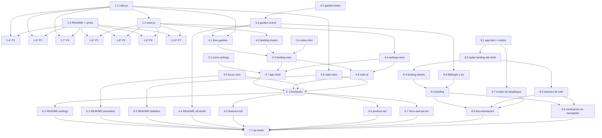

# Implementation Plan: Landing y Ajustes

## Overview

Este plan construye la landing de bienvenida (jardín 3D que cambia según la hora, con alternativa de CSS y emojis) y el módulo de Ajustes que absorbe los controles de Foco y Estadísticas. Se avanza de abajo hacia arriba, respetando `components → ui → core`: primero reglas y estado en `core`, luego iconos, escena y estilos, después los componentes, y al final la documentación y la verificación con `qa-tester`. Las rutas son relativas a `exercise/`, salvo las de `.kiro/steering/`.

**Revisión del 2026-10-31.** Después de la primera versión, la landing se rediseñó como una página aparte (`index.html`) y la app pasó a `app.html`; el recordatorio de la cuenta se muestra en cada entrada. Las tareas 1 a 6 son la primera versión (algunas llevan la marca "Reemplazada" porque la revisión cambió su resultado), la tarea 8 agrupa el rediseño y la 7 es la verificación final de todo.

## Tasks

- [x] 1. Reglas y estado en `core`
  - [x] 1.1 Agregar las reglas puras de la landing en `src/core/rules.js`
    - Exportar `TIME_PERIODS` y `timePeriodFor(date)` (06-11 `morning`, 12-15 `midday`, 16-19 `afternoon`, 20-05 `night`; fecha inválida devuelve `midday`).
    - ~~Exportar `ENTRY_MODES` y `shouldShowIntro(entryMode, introSeen)`.~~ Reemplazada por 8.2: ambas se retiraron al mostrar el recordatorio en cada entrada.
    - Exportar `hasLocalData(state)` sin mutar el estado, `LANDING_STARTER_PLOTS` (usa los tipos `personal`, `salud`, `trabajo`, `social` y `ocio` ya existentes) y `heroPlots(state)`.
    - Cada función pública lleva su comentario de intención.
    - _Requirements: 2.3, 2.5, 2.6, 4.1, 4.2, 4.3, 5.1, 5.4, 5.5, 6.5, 12.4_

  - [x] 1.2 Agregar `introSeen` y `hasLocalData()` en `src/core/store.js`
    - Exportar `freshState` con su comentario. (La primera versión también le sumaba `introSeen`; la tarea 8.2 lo retiró.)
    - Importar `hasLocalData` de `rules.js` con alias `stateHasLocalData` y agregar el método `hasLocalData()` al `Store`.
    - Dejar la clave `jardin-movil:v1` y no tocar `reset()` ni `seedDemo()`: ya conservan los ajustes.
    - _Requirements: 5.8, 9.7, 12.1, 12.2, 12.3, 12.4_

  - [x] 1.3 Crear `docs/modules/settings/README.md` con el esqueleto y el arnés de propiedades
    - Crear las secciones fijas **Descripción**, **Pruebas para qa-tester** y **Changelog**.
    - Incluir en **Pruebas para qa-tester** el arnés `forAll(runs, generate, check)` de la consola, sin dependencias, y la forma de ejecutarlo (mínimo 100 iteraciones, recorrido completo en dominios finitos).
    - Dejar un enlace a la carpeta `docs/modules/settings/properties/`, donde cada propiedad guarda su script.
    - _Requirements: 13.1_

  - [x] 1.4 Escribir la prueba de la propiedad 1 (franja horaria)
    - **Property 1: La franja depende solo de la hora local y cubre todo el día**
    - Guardar el script en `docs/modules/settings/properties/propiedad-1-franja-horaria.md`; recorrer las 24 horas y fechas aleatorias con la misma hora.
    - Etiqueta: Feature: landing-and-settings, Property 1.
    - **Validates: Requirements 2.1, 2.3**

  - [x] 1.5 Escribir la prueba de la propiedad 2 (el hero nunca queda vacío)
    - **Property 2: El hero nunca queda vacío y respeta el jardín real**
    - Guardar el script en `docs/modules/settings/properties/propiedad-2-hero-plots.md` con estados aleatorios (tareas hechas con y sin rondas).
    - **Validates: Requirements 2.5, 2.6**

  - [x] 1.6 Escribir la prueba de la propiedad 3 (`hasLocalData` exacto y sin mutación)
    - **Property 3: hasLocalData es exacto y no muta**
    - Guardar el script en `docs/modules/settings/properties/propiedad-3-has-local-data.md`; comparar el estado antes y después y contrastar con `store.hasLocalData()`.
    - **Validates: Requirements 4.1, 4.2, 4.3, 12.4**

  - [x] 1.7 Escribir la prueba de la propiedad 4 (cuándo aparece la Intro_Modal) — *Reemplazada por 8.2: propiedad retirada junto con `shouldShowIntro`.*
    - **Property 4: La Intro_Modal solo aparece al entrar sin cuenta la primera vez**
    - Guardar el script en `docs/modules/settings/properties/propiedad-4-intro.md`; combinar ambos modos con `introSeen` en `true`, `false`, `undefined` y valores no booleanos.
    - **Validates: Requirements 5.1, 5.4, 5.5, 6.5**

  - [x] 1.8 Escribir la prueba de la propiedad 5 (`introSeen` booleano, aditivo e idempotente) — *Reemplazada por 8.2: propiedad retirada junto con `introSeen`.*
    - **Property 5: introSeen es siempre booleano, aditivo e idempotente**
    - Guardar el script en `docs/modules/settings/properties/propiedad-5-intro-seen.md`; usar cualquier valor JSON o campo ausente y reaplicar `freshState`.
    - **Validates: Requirements 12.1, 12.3**

  - [x] 1.9 Escribir la prueba de la propiedad 4 (`reset` y `seedDemo` conservan los ajustes)
    - **Property 4: reset y seedDemo conservan los ajustes** (era la propiedad 6 antes de la revisión)
    - Guardar el script en `docs/modules/settings/properties/propiedad-4-reset-seed.md`; restaurar el `localStorage` original al terminar.
    - **Validates: Requirements 5.8, 9.7**

  - [x] 1.10 Escribir la prueba de la propiedad 5 (alternar un ajuste dos veces)
    - **Property 5: Alternar un ajuste dos veces restaura el valor y se persiste** (era la propiedad 7 antes de la revisión)
    - Guardar el script en `docs/modules/settings/properties/propiedad-5-alternar-ajustes.md`; verificar también el JSON guardado en `jardin-movil:v1` con el timer en reposo.
    - **Validates: Requirements 8.3, 8.4, 8.6, 8.7, 8.9**

- [x] 2. Checkpoint - Reglas y estado
  - Ensure all tests pass, ask the user if questions arise.

- [x] 3. Iconos, escena 3D y estilos base
  - [x] 3.1 Agregar el ícono `settings` en `src/ui/icons.js`
    - Añadir la entrada `settings` a `PATHS` (engrane de trazo estilo Lucide, viewBox 24×24, con círculo central de radio 3).
    - _Requirements: 7.1_

  - [x] 3.2 Crear `src/three/garden-looks.js` con `GARDEN_LOOKS`
    - Datos puros por franja (`morning`, `midday`, `afternoon`, `night`) sin importar Three.js; `midday` replica los valores actuales de `garden-scene.js`.
    - _Requirements: 2.1, 2.2_

  - [x] 3.3 Modificar `src/three/garden-scene.js`
    - Aceptar `{ onSelect, interactive = true, freezeWhenReducedMotion = false }`; con los valores por defecto la escena se comporta igual que hoy.
    - Con `interactive: false` desactivar los controles, no registrar `pointerdown`/`pointerup` y poner `pointer-events:none` al canvas.
    - Agregar `setLook(look)` (luces, sol y color de nubes) y devolverlo en la API; crear la escena con `GARDEN_LOOKS.midday` en lugar de los literales.
    - Calcular una sola vez `const isMotionFrozen = freezeWhenReducedMotion && reduceMotion` y usarla en tres puntos: `update(dt)` no avanza el tiempo de animación (isla, nubes, alas y pétalos quietos), `sync` crea las parcelas con escala 1 y sin "pop", y el reencuadre de cámara toma la rama directa (`snap`).
    - Conservar sin cambios `controls.autoRotate = !reduceMotion` y el flotado de la isla con movimiento reducido: `garden-view` no pasa la opción nueva y no debe cambiar (nubes orbitando, "pop" de plantas y reencuadre interpolado).
    - _Requirements: 2.1, 2.2, 3.3, 3.4_

  - [x] 3.4 Agregar los cielos y el apilado de la landing en `index.html`
    - Añadir `landing-view { z-index: 20; }` y las cuatro reglas `.hero-sky[data-period="..."]` con degradados de saturación media. *Reemplazada por 8.1 y 8.3: los cielos viven ahora en `src/styles/landing.css` y no hay apilado.*
    - _Requirements: 1.5, 1.6, 2.1, 2.2, 3.1_

- [x] 4. Componentes
  - [x] 4.1 Crear `src/components/hero-garden.js` (`<hero-garden>`)
    - Cargar `garden-scene.js` con `import()` dinámico y crear la escena con `{ interactive: false, freezeWhenReducedMotion: true }`; es el único llamador que activa `freezeWhenReducedMotion`. Exponer `setPlots`, `setPeriod` y `dispose`.
    - Observar el tamaño con `ResizeObserver` y llamar a `scene.resize`.
    - Si falla Three.js o no hay WebGL, pintar la isla de emojis (astro por franja y hasta `MAX_FALLBACK_PLANTS = 12` plantas) sin animación.
    - Si `dispose()` llega antes de terminar la carga, liberar la escena al resolverse.
    - _Requirements: 2.1, 2.2, 2.5, 2.6, 2.7, 3.1, 3.2, 3.3, 3.4, 3.5_

  - [x] 4.2 Crear `src/components/landing-sheets.js` *(reescrita en 8.4)*
    - `openIntroSheet({ onDone })`: título "Antes de empezar", texto de la Intro_Modal, botón "Entendido" con el foco inicial; cualquier cierre marca `introSeen` con `store.setSetting`, devuelve el foco al documento y llama a `onDone`.
    - `openComingSoonSheet({ onStartWithoutAccount })`: etiqueta "Próximamente", frase de que las cuentas llegan pronto y botón "Iniciar sin cuenta"; solo ese botón llama al callback tras `SHEET_CLOSE_MS = 260`; sin peticiones de red.
    - _Requirements: 5.2, 5.3, 5.6, 5.7, 6.3, 6.4, 6.5, 6.6, 6.7_

  - [x] 4.3 Crear `src/components/landing-view.js` (`<landing-view>`) *(Reemplazada por 8.2 y 8.3: se eliminó el componente; la landing es la página `index.html` con `src/landing.js`.)*
    - Extender `StoreView`: pintar el esqueleto una sola vez en `setup()` y parchear texto y plantas en `update(state)`.
    - Botón principal ("Continuar" o "Iniciar sin cuenta"), nota "Tus datos se guardan solo en este dispositivo. Ideal para probar." solo sin datos, y botón "Mantén vivo tu jardín, lleva tu progreso contigo" que abre la hoja "Próximamente".
    - Recalcular la franja cada `PERIOD_CHECK_MS = 60_000` y al volver a la pestaña; actualizar `data-period` y `hero.setPeriod`.
    - Al entrar, usar `shouldShowIntro`; `#leave()` quita la landing y emite `app:entered`; `teardown()` limpia el intervalo y libera el hero.
    - Botones de al menos 44 px, tokens del sistema de diseño y zonas seguras.
    - _Requirements: 1.1, 1.2, 1.3, 1.5, 1.6, 1.7, 2.4, 2.7, 3.5, 4.1, 4.2, 4.3, 4.4, 4.5, 4.6, 5.1, 5.4, 5.5, 6.1, 6.2, 6.7_

  - [x] 4.4 Crear `src/components/settings-view.js` (`<settings-view>`)
    - Tres switches con `role="switch"` y `aria-checked`: "Música de fondo", "Sonido de la campanita" y "Modo demo" (apoyo "Rondas de 10 segundos para mostrar la app"), todos con `haptic(10)`.
    - Música con la lógica de `focus-view` (`unlockAudio`, `startMusic`/`stopMusic`); sin Tone.js queda deshabilitada con "No disponible sin conexión". Modo demo deshabilitado mientras haya ronda en curso o en pausa.
    - Sección "Datos" con "Cargar datos de ejemplo" y "Borrar todos los datos", con las confirmaciones y toasts movidos desde `stats-view`.
    - Dos Reserved_Slot ("Mi cuenta" y "Mis sesiones") con `aria-disabled="true"`, `text-ink/50`, etiqueta "Próximamente" y sin acciones.
    - _Requirements: 8.1, 8.2, 8.3, 8.4, 8.5, 8.6, 8.7, 8.8, 8.9, 9.1, 9.2, 9.3, 9.4, 9.5, 9.6, 11.1, 11.2, 11.3, 11.4, 11.5_

  - [x] 4.5 Modificar `src/components/focus-view.js`
    - Quitar la tarjeta de música, sonido y modo demo, sus casos en `#onClick` y los imports sin uso; conservar las fichas de duración y el ducking/campanita de `app-shell`.
    - Con `settings.demo` activo, mostrar el texto "Modo demo" y un control tipo enlace "Cambiar en Ajustes" (`data-act="settings"`, `min-h-11`) que llama `navigate('settings')`.
    - _Requirements: 10.1, 10.2, 10.3, 10.6_

  - [x] 4.6 Modificar `src/components/stats-view.js`
    - Quitar los botones y manejadores de datos y los imports sin uso (`confirmSheet`, `toast`, `store`).
    - Con `!hasLocalData(state)`, mostrar el estado vacío con 📊, "Aún no hay nada que contar" y el botón "Cargar datos de ejemplo en Ajustes" que llama `navigate('settings')`.
    - _Requirements: 10.4, 10.5_

  - [x] 4.7 Modificar `src/components/app-shell.js` *(la parte de la landing se retiró en 8.2)*
    - Agregar `settings` como última entrada de `TABS` (etiqueta "Ajustes", ícono `settings`, `aria-label` "Ajustes") y `<settings-view data-tab="settings" hidden>` en `main`.
    - Reducir el ancho de las píldoras de `w-16` a `w-14` para que quepan cinco pestañas en 320 px.
    - Incluir `<landing-view>` después de `#sheet-host`, con `main` y `nav` ocultos al inicio; al recibir `app:entered` mostrarlos y llamar `go(#tabFromHash())` (hash válido o `tasks`).
    - _Requirements: 1.4, 4.4, 4.6, 7.1, 7.2, 7.3, 7.4, 7.5, 7.6, 7.7_

  - [x] 4.8 Modificar `src/main.js`
    - Importar `landing-view` y `settings-view` para registrar los componentes. (`landing-view` se quitó en 8.2.)
    - _Requirements: 1.1, 7.5_

- [x] 5. Checkpoint - Componentes integrados
  - Ensure all tests pass, ask the user if questions arise.

- [x] 6. Documentación
  - [x] 6.1 Completar `docs/modules/settings/README.md`
    - Escribir la **Descripción** del módulo, un caso por cada requisito 1 a 11 en **Pruebas para qa-tester** (pasos y resultado esperado, con ancho 320/360/1024 px, bloqueo de CDN y movimiento reducido) y enlazar los scripts de propiedades.
    - Changelog: `1.0.0` con fecha `AAAA-MM-DD`. (La revisión suma `2.0.0` en 8.8.)
    - _Requirements: 13.1, 13.2, 13.7_

  - [x] 6.2 Actualizar `docs/modules/pomodoro/README.md`
    - Retirar los controles movidos, documentar el indicador "Modo demo" con enlace a Ajustes y agregar entrada MENOR al Changelog.
    - _Requirements: 13.3, 13.7_

  - [x] 6.3 Actualizar `docs/modules/statistics/README.md`
    - Retirar las acciones de datos, documentar el estado vacío con enlace a Ajustes y agregar entrada MENOR al Changelog.
    - _Requirements: 13.3, 13.7_

  - [x] 6.4 Actualizar `docs/modules/3d-world/README.md`
    - Agregar solo una nota de la API nueva de la escena (`interactive`, `setLook` y `freezeWhenReducedMotion`, esta última con valor por defecto `false` y activada únicamente por el hero de la landing).
    - Agregar una entrada PARCHE al Changelog. No cambiar la **Descripción** ni las pruebas: el comportamiento del módulo `3d-world` no cambia, incluido el movimiento reducido de `garden-view`.
    - _Requirements: 3.3, 13.3_

  - [x] 6.5 Actualizar `docs/features.md`
    - Añadir los casos de uso de la landing y de `settings` en "Casos de uso disponibles".
    - Añadir al roadmap `accounts-auth`, `cloud-sync` (sugiriendo DynamoDB en lugar de MongoDB) y `multi-device-sessions`.
    - _Requirements: 13.4, 13.5_

  - [x] 6.6 Agregar el módulo `settings` a la tabla de módulos de `.kiro/steering/product.md`
    - Fila `settings` (qué hace: música, sonido, modo demo y datos; vista `<settings-view>`).
    - _Requirements: 13.6_

  - [x] 6.7 Agregar el módulo `settings` al mapa de `.kiro/steering/docs-and-qa.md`
    - Añadir `docs/modules/settings/README.md` al mapa de documentación.
    - _Requirements: 13.6_

- [x] 8. Rediseño de la landing como página aparte
  - [x] 8.1 Separar la app y la landing en dos páginas
    - Crear `app.html` con la SPA (Tailwind, Tone.js, import map de Three.js y `<app-shell>`) y reescribir `index.html` como la landing.
    - Mover los estilos a `src/styles/`: `base.css` (compartido), `app.css` y `landing.css`; mover los tokens de Tailwind a `src/ui/tailwind-config.js`, cargado por las dos páginas.
    - Cambiar el `start_url` de `manifest.webmanifest` a `./app.html`.
    - _Requirements: 1.1, 1.4, 14.1, 14.3, 14.6_

  - [x] 8.2 Quitar la landing del shell y retirar el aviso de una sola vez
    - Borrar `src/components/landing-view.js`; en `app-shell.js` quitar `<landing-view>`, el `hidden` inicial de `main` y `nav`, `#showApp` y el evento `app:entered`; en `main.js` quitar su import.
    - Retirar `ENTRY_MODES` y `shouldShowIntro` de `rules.js` y el ajuste `introSeen` de `freshState`.
    - Eliminar las propiedades 4 y 5 antiguas (`propiedad-4-intro.md`, `propiedad-5-intro-seen.md`), quitar `introSeen` de las demás y renumerar las propiedades 6 y 7 como 4 y 5.
    - _Requirements: 5.7, 12.1, 12.2, 12.3_

  - [x] 8.3 Construir la landing
    - `index.html`: barra superior fija, hero (texto a la izquierda, `<hero-garden>` a la derecha, chips flotantes), *Cómo funciona* con la escalera de plantas, *Funciones* con seis tarjetas, *Open source* con los comandos y el enlace a GitHub, llamada final y pie.
    - `src/styles/landing.css`: cielos por franja con variables de color, astro (sol y luna), estrellas que titilan, estrella fugaz, botones y bloque `prefers-reduced-motion`.
    - `src/landing.js`: `applyPeriod`, `renderStars` (determinista), `renderPlantLadder` y `renderTaskTypeChips` (desde `PLANTS` y `TASK_TYPES`), `renderHeroStats`, `renderEntryState`, `enterApp`, y recarga con `pageshow` persistido.
    - _Requirements: 1.2, 1.3, 1.5, 1.6, 1.7, 2.1, 2.4, 2.7, 2.8, 2.9, 3.3, 4.1, 4.2, 4.3, 4.6, 14.8, 15.1, 15.2, 15.3, 15.4, 15.5, 15.6, 15.7, 15.8_

  - [x] 8.4 Reescribir `src/components/landing-sheets.js`
    - `openAccountReminderSheet({ onDone })`: hoja "Antes de empezar" con "Entendido" enfocado; cualquier cierre devuelve el foco al documento y llama a `onDone`; sin indicador guardado.
    - `openComingSoonSheet()`: hoja "Próximamente" con "Entendido" que solo cierra.
    - `enterApp()` abre el recordatorio en cada entrada y navega a `app.html` al cerrarlo; `isEntering` evita abrir dos hojas.
    - _Requirements: 4.4, 4.5, 5.1, 5.2, 5.3, 5.4, 5.5, 5.6, 6.2, 6.3, 6.4, 6.5, 6.6_

  - [x] 8.5 Agregar los botones de salir
    - Ícono `logout` en `src/ui/icons.js`.
    - Enlace circular de 44×44 px en el encabezado de `tasks-view.js` y fila "Salir a la página de inicio" al final de `settings-view.js`, ambos con `href="./index.html"`.
    - _Requirements: 14.4, 14.5_

  - [x] 8.6 Ajustar la escena 3D para el hero
    - Opción `fitMargin` (por defecto `1`) en `createGardenScene` que `hero-garden.js` pasa con `HERO_FIT_MARGIN = 1.3`, para que la isla no se corte al girar en un lienzo ancho.
    - Luz de la franja `night` más clara en `garden-looks.js`.
    - _Requirements: 2.2, 3.3_

  - [x] 8.7 Publicar las dos páginas
    - Agregar `app.html` a `deploy-s3-cloudfront.sh`, `deploy-amplify.sh` y a la lista de archivos y los comandos de `deploy-to-aws/SKILL.md`.
    - _Requirements: 14.7_

  - [x] 8.8 Actualizar la documentación
    - README de `settings`: nueva Descripción (dos páginas, landing, salida), casos 1 a 6 reescritos, caso 12 nuevo, propiedades renumeradas y Changelog `2.0.0`.
    - `docs/features.md` (casos L1 a L8), README de `3d-world` (`fitMargin`, entrada `1.0.2`), README de la app, `tech.md`, `design-system.md`, `responsive-mobile-first` y `deploy-to-aws`.
    - _Requirements: 13.1, 13.2, 13.4, 13.7, 13.8_

  - [x] 8.9 Verificar el rediseño en un navegador
    - Con Chrome DevTools: landing a 1280 y 390 px en noche, mediodía y tarde; entrada con y sin datos; recordatorio y hoja "Próximamente"; salida, atrás, adelante y recarga; `app.html#/settings` directo; sin errores en consola.
    - _Requirements: 1.1, 2.9, 4.1, 4.2, 5.1, 14.2, 14.3, 14.5_

- [x] 7. Verificación final
  - [x] 7.1 Ejecutar el agente `qa-tester` sobre `settings`, `pomodoro`, `statistics` y `3d-world`
    - Correr las pruebas de cada README, corregir lo que falle y repetir hasta que pasen, incluida la regresión con datos previos de `v1`.
    - **Resultado (aprobación parcial).** Reporte: `docs/qa-reports/2026-10-31-landing-and-settings.md`. `qa-tester` ejecutó en Node las 5 propiedades de `settings` y ST-13 de `statistics`: todas pasan. Su sesión no tenía el MCP `chrome-devtools`, por lo que los casos de UI quedaron ⚠️ en su reporte y su veredicto es "No aprobado todavía" (ninguna prueba ❌).
    - **Segunda pasada con navegador** (Chrome DevTools, hecha por la sesión principal tras el reporte, sin sustituirlo): landing sin desbordes a 320, 390 y 1280 px; jardín a la derecha del texto desde 1024 px; todos los botones y enlaces de al menos 44 px (se corrigieron tres incumplimientos: el logo, los enlaces de la barra y el enlace del pie); movimiento reducido (estrellas, estrella fugaz, chips y scroll suave detenidos, y dos capturas separadas por 4 s idénticas en la isla 3D); respaldo de emojis con aviso `Three.js no disponible` y botones activos; entrada, recordatorio, salida, atrás, adelante, recarga y `app.html#/settings` directo; Foco sin interruptores y con sus 7 duraciones, indicador de modo demo con enlace a Ajustes; Estadísticas con estado vacío; jardín 3D con su lienzo; sin errores en consola.
    - **Sin verificar** (queda para una pasada de `qa-tester` con navegador): sonido real y vibración, ronda de 10 s de punta a punta, campanita con música, red lenta (Slow 3G), gestos táctiles del jardín 3D y de deslizar para eliminar, y los casos PO, ST y W3 que no tocó este spec.
    - _Requirements: 1.1, 2.1, 3.1, 4.4, 5.1, 6.2, 7.6, 8.3, 9.4, 10.1, 11.1, 12.1, 13.2_

## Notes

- Las tareas marcadas con `*` son opcionales (propiedades del diseño) y se pueden omitir para llegar antes a un MVP. Se ejecutan en la consola del navegador con el arnés `forAll` (sin Node ni librería, según `tech.md` y `dependencies-policy.md`).
- Cada script de propiedad vive en `docs/modules/settings/properties/propiedad-N-*.md`. Es una carpeta nueva que el diseño no listaba; se eligió para que las siete tareas de prueba no escriban el mismo archivo y puedan correr en paralelo.
- La tarea 6.1 reescribe el README creado en la 1.3: debe conservar el arnés y completar el resto de las secciones.
- Las tareas 6.6 y 6.7 modifican archivos de `.kiro/steering/`, fuera de `exercise/`.
- El movimiento reducido ampliado queda acotado al hero con la opción `freezeWhenReducedMotion` (por defecto `false`) de `createGardenScene`. Solo `<hero-garden>` la activa, junto con `interactive: false`; `garden-view` no la pasa.
- Riesgos a verificar a mano: que `garden-view` con movimiento reducido se comporte igual que hoy (caso W3-14 de `3d-world`: sin giro ni flotado, nubes orbitando y plantas nuevas con "pop"); que el hero con movimiento reducido quede totalmente quieto (sin nubes en movimiento, sin "pop", sin giro ni flotado y con las plantas ya visibles al abrir); que `garden-view` se vea idéntico con la luz `midday`; que la barra inferior no desborde a 320 px con cinco pestañas; que solo haya un contexto WebGL activo mientras dura la landing; y que "Crear cuenta" y Ajustes no generen peticiones de red (pestaña Network).
- **Orden de los números.** La tarea 8 (rediseño) se escribió después de la 7, pero va antes en la lista porque la verificación final (7.1) debe correr sobre el resultado del rediseño. Los números no se reutilizaron para no perder el historial de la primera versión.
- **Tareas reemplazadas.** Las tareas 1.7, 1.8, 3.4 y 4.3 se conservan marcadas como hechas pero reemplazadas: documentan lo que se construyó primero y la tarea 8 dice qué lo sustituyó.
- **Decisión del recordatorio.** El aviso de la cuenta sale en cada entrada y no guarda ningún indicador. La primera versión lo mostraba una sola vez y solo sin cuenta; con "Continuar" no salía y eso parecía un fallo.
- **Borde grueso del botón principal.** `design-system.md` pide evitar sombras duras; el botón principal de la landing usa un borde inferior grueso como guiño a los videojuegos y se limita a esa página. Si no se quiere, se quita de `.btn-primary` en `landing.css`.
- **Sin licencia declarada.** El repositorio no tiene archivo `LICENSE`, por eso la landing dice "open source" sin nombrar una licencia (requisito 15.6). Conviene agregar una.
- Las tareas de documentación leen el código ya hecho, por eso van después de los componentes.
- El grafo de dependencias se da en Mermaid (formato de `spec-format.md`) y en JSON por olas (para programar tareas en paralelo). Los checkpoints y las tareas de primer nivel no aparecen en el JSON.

## Task Dependency Graph



```json
{
  "waves": [
    { "id": 0, "tasks": ["1.1", "1.3", "3.1", "3.2", "3.4"] },
    { "id": 1, "tasks": ["1.2", "3.3", "4.4", "4.5", "4.6", "1.4", "1.5", "1.7"] },
    { "id": 2, "tasks": ["4.1", "4.2", "1.6", "1.8", "1.9", "1.10"] },
    { "id": 3, "tasks": ["4.3"] },
    { "id": 4, "tasks": ["4.7", "4.8"] },
    { "id": 5, "tasks": ["6.1", "6.2", "6.3", "6.4", "6.5", "6.6", "6.7"] },
    { "id": 6, "tasks": ["8.1"] },
    { "id": 7, "tasks": ["8.2", "8.6", "8.7"] },
    { "id": 8, "tasks": ["8.4", "8.5"] },
    { "id": 9, "tasks": ["8.3"] },
    { "id": 10, "tasks": ["8.8", "8.9"] },
    { "id": 11, "tasks": ["7.1"] }
  ]
}
```
