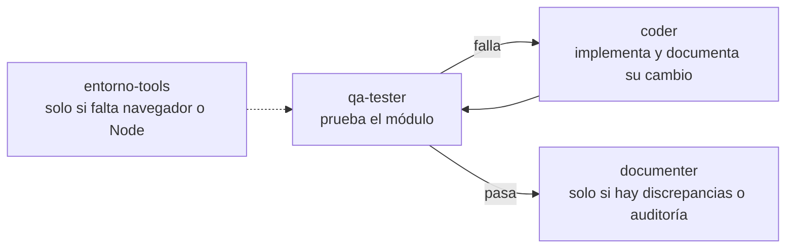

# Cuándo usar cada custom agent

Los agentes viven en `.kiro/agents/`. Cada uno tiene un alcance fijo; elegir el correcto evita que un agente haga trabajo que no le toca. Si la tarea mezcla varios, se encadenan en el orden de la sección "Flujo habitual".

## Elegir por tarea

| Quiero... | Agente | Escribe en | No toca |
|-----------|--------|------------|---------|
| Implementar, cambiar o corregir la app (vistas, `rules.js`, `store.js`, servicios, escena 3D, páginas de Astro) | `coder` | `src/`, `public/`, `test/`, y la documentación de lo que cambió | `.kiro/`, `docs/qa-reports/` |
| Verificar que un módulo hace lo que dice su README | `qa-tester` | solo `docs/qa-reports/` (si se pide) | el código de la app |
| Poner `docs/` al día con lo que el código hace, o auditar docs contra el código | `documenter` | solo `docs/` | `src/`, `.kiro/`, `docs/qa-reports/` |
| Instalar o diagnosticar herramientas (Node, Chrome DevTools MCP, servidor local) | `entorno-tools` | `.kiro/settings/mcp.json`, con confirmación | el código de la app |

## Frases que indican cada agente

- **`coder`**: "agrega", "implementa", "cambia", "arregla", "nueva planta", "nuevo tipo de tarea", "ajusta el diseño".
- **`qa-tester`**: "prueba", "verifica", "QA", "¿funciona?", "revisa el módulo".
- **`documenter`**: "documenta", "actualiza docs", "audita la documentación", "¿el README sigue siendo cierto?".
- **`entorno-tools`**: "instala el MCP", "no abre Chrome", "no carga localhost", "¿qué sistema operativo tengo?", "no encuentra npx".

## Flujo habitual

1. `coder` implementa y deja actualizado el README y el changelog del módulo (`docs-and-qa.md`).
2. `qa-tester` ejecuta las pruebas del módulo en el navegador. Si algo falla, el reporte vuelve a `coder`.
3. `documenter` entra aparte cuando solo hay que alinear docs (cambios hechos a mano, commits previos, auditoría) o cuando `qa-tester` reporta discrepancias entre README y comportamiento.
4. `entorno-tools` va primero solo si `qa-tester` necesita el navegador automatizado y no está disponible.

## Reglas de elección

- **Un cambio de código nunca se prueba con el mismo agente que lo escribió.** Implementar es de `coder`; la verificación en navegador es de `qa-tester`.
- **`qa-tester` y `documenter` no corrigen código de la app.** Si encuentran un error, lo reportan y el arreglo se pide a `coder`.
- **`coder` pregunta antes de decidir producto**: otro idioma, cuentas o servidor, dependencias nuevas, cambiar la regla de recompensa de las plantas.
- **Pedir ayuda al agente de entorno solo con un síntoma de herramienta**, no por un fallo de la app. Un error en la consola de la app es de `coder`.
- **No hay agente de despliegue.** Publicar la app lo hace `coder` con la skill `deploy-to-aws`, con confirmación del usuario antes de crear recursos.
- **Si la tarea no encaja en ninguno** (conversación, dudas, cambios en steerings o agentes), la atiende la sesión principal, sin delegar.

## Ejemplos

| Petición | Agente(s) |
|----------|-----------|
| "Agrega un botón para pausar la música" | `coder`, luego `qa-tester` sobre `pomodoro` |
| "¿Ya funciona la racha en estadísticas?" | `qa-tester` sobre `statistics` |
| "El README de 3d-world quedó viejo" | `documenter` |
| "Audita todos los docs contra el código" | `documenter` (modo auditoría) |
| "Chrome DevTools no conecta" | `entorno-tools` |
| "Cambié `rules.js` a mano, falta documentarlo" | `documenter`, luego `qa-tester` |
