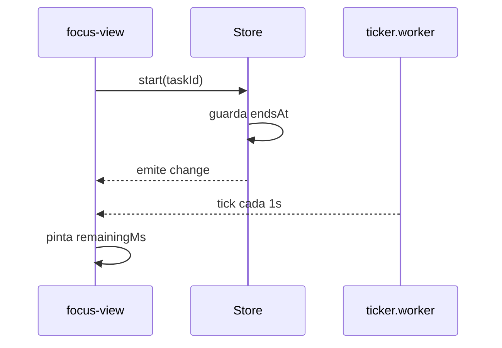
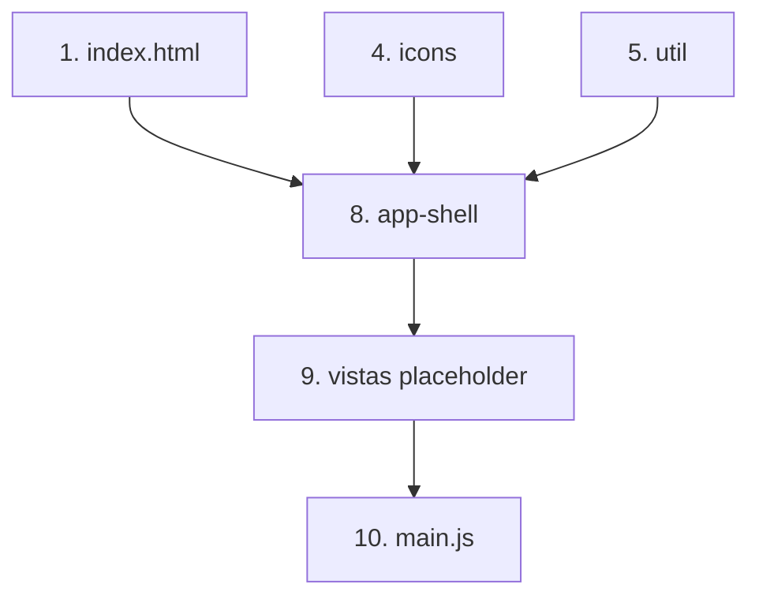

# Formato de specs

Los specs viven en `.kiro/specs/<nombre>/` y constan de tres archivos: `requirements.md`, `design.md` y `tasks.md`. Estas reglas fijan el formato de `design.md` y `tasks.md` para respetar el estándar de Kiro. Idioma: español, igual que el resto del producto.

## `design.md`

Todo diseño debe documentar la estructura y los flujos de forma visual, no solo en prosa. Incluir siempre:

1. **Árbol de archivos.** Un bloque de código con la estructura de archivos que el spec crea o modifica, marcando cuáles son nuevos y cuáles cambian.

   ```
   src/
     core/
       store.js        (modificar: nueva acción addTask)
       rules.js        (nuevo)
     components/
       tasks-view.js   (nuevo)
   ```

2. **Diagramas de Mermaid** para documentar flujos y estructuras. Elegir el tipo según lo que se quiera mostrar, y usar al menos uno:
   - **Flujo** (`flowchart`): recorrido de una acción o decisión del usuario.
   - **Componentes** (`flowchart` o `graph`): cómo se relacionan vistas, store, servicios y reglas, respetando la dirección de dependencias `components → ui → core`.
   - **Secuencia** (`sequenceDiagram`): interacción en el tiempo entre vista, store, servicios y APIs del navegador (por ejemplo, el pulso del pomodoro con el worker).

   Los diagramas van en bloques ` ```mermaid `. Un diseño que toca varios flujos lleva un diagrama por flujo, no uno solo que intente mostrarlo todo.

Ejemplo de diagrama de secuencia:



## `tasks.md`

El plan de implementación usa estos encabezados `##` en este orden, para respetar el estándar de Kiro:

- `## Overview` — una o dos frases sobre qué construye el spec y el enfoque general.
- `## Tasks` — la lista de tareas con casillas (`- [ ]`), numeradas, cada una con su referencia `_Requirements: X.Y_`.
- `## Notes` — decisiones, supuestos, riesgos o puntos a verificar manualmente.
- `## Task Dependency Graph` — un diagrama de Mermaid que muestra el orden y las dependencias entre tareas, para saber qué puede hacerse en paralelo y qué debe esperar.

Ejemplo del grafo de dependencias:



## Al cerrar un spec

Antes de dar por terminado un `design.md` o `tasks.md`, verificar que tiene todas sus secciones obligatorias: el árbol de archivos y al menos un diagrama de Mermaid en el diseño; los cuatro encabezados (`Overview`, `Tasks`, `Notes`, `Task Dependency Graph`) en las tareas.
