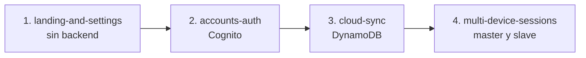

# Plan actual: cuentas, sincronización y sesiones multidispositivo

Este documento guarda el requerimiento original y el plan para construirlo en varios specs progresivos. Léelo antes de retomar el trabajo.

Última actualización: 2026-11-03.

> **Decisión (2026-11-01): se migrará la app a Astro.** El desarrollo con Web Components nativos se complicó demasiado. La migración queda pendiente y la hará la persona dueña del proyecto en otro IDE. Detalle, qué se conserva y qué cambia en [`docs/decisions/0001-migrar-a-astro.md`](decisions/0001-migrar-a-astro.md). Los specs 3 (`cloud-sync`) y 4 (`multi-device-sessions`) deben plantearse sobre el stack nuevo, no sobre Web Components.

> **Decisión (2026-11-03): se pausan Google, Meta, Amazon y GitHub; solo correo y contraseña por ahora.** El primer despliegue real a AWS dejó funcionando el sitio, Cognito con correo/contraseña y el puente OIDC de GitHub en Lambda, pero conectar los cuatro proveedores sociales con credenciales reales de terceros es trabajo independiente que se retoma más adelante. Mientras tanto se avanza con los specs 3 y 4. Detalle en [`docs/decisions/0002-pausar-proveedores-sociales.md`](decisions/0002-pausar-proveedores-sociales.md).

> **Decisión (2026-11-03): spec 3 (`cloud-sync`) implementado directo a código, sin `requirements.md`/`design.md`/`tasks.md`.** Base de datos DynamoDB, un ítem por persona indexado por `sub`, último cambio gana por `updatedAt`. Nuevo servicio `sync-api/`. El spec 4 (`multi-device-sessions`, sincronización en vivo con master/slave) queda explícitamente fuera de este cambio. Detalle en [`docs/decisions/0003-cloud-sync-mvp.md`](decisions/0003-cloud-sync-mvp.md).

> **Decisión (2026-11-03): spec 4 (`multi-device-sessions`) implementado, acotado al timer en vivo por WebSocket.** Nuevo servicio `live-sync-api/` (API Gateway WebSocket + Event Functions, primera vez que el proyecto usa este form factor). Master/slave: el primero en conectar manda el timer, los demás lo reciben; aviso de reanudar si el master se desconecta. La UI de "Mis sesiones" queda fuera de esta entrega — sigue "Próximamente". Detalle en [`docs/decisions/0004-multi-device-sessions-websocket.md`](decisions/0004-multi-device-sessions-websocket.md).

## Estado

| # | Spec | Estado |
|---|------|--------|
| 1 | `landing-and-settings` | ✅ **Completado** (2026-10-31). Todas las tareas de `tasks.md` cerradas, con la landing rediseñada como página aparte. QA: propiedades en Node y una pasada en navegador; queda como seguimiento una pasada de `qa-tester` con navegador para sonido, vibración y gestos (ver `docs/qa-reports/2026-10-31-landing-and-settings.md`). |
| 2 | `accounts-auth` | ✅ **Completado** (2026-11-01); **desplegado parcialmente** (2026-11-03): correo y contraseña funcionando en AWS real, Google/Meta/Amazon/GitHub en pausa (ver decisión 0002 arriba). Spec en `.kiro/specs/accounts-auth/` (`requirements.md`, `design.md`, `tasks.md`). QA: ver `docs/qa-reports/2026-11-01-accounts-auth.md`. |
| 3 | `cloud-sync` | ✅ **Completado e implementado** (2026-11-03), directo a implementación (ver decisión 0003 arriba). Servicio `sync-api/`, desplegado y probado en AWS real. |
| 4 | `multi-device-sessions` | ✅ **Implementado en código** (2026-11-03), acotado al timer en vivo (ver decisión 0004 arriba). Servicio nuevo `live-sync-api/`. **Pendiente de desplegar**: tablas, rol y las dos Lambdas + la API WebSocket (mismo patrón manual que `oidc-bridge`/`sync-api`). "Mis sesiones" queda fuera, a futuro. |

El spec 1 vive en `.kiro/specs/landing-and-settings/` (`requirements.md`, `design.md`, `tasks.md`). Cada spec siguiente se crea cuando termine el anterior, no antes.

## Requerimiento original

Texto de la persona dueña del proyecto, ordenado por tema y sin cambiar su intención.

### Cuentas y autenticación

- Sesión de usuario con autenticación por GitHub, usuario y contraseña, AWS account, Google e Instagram/Meta.
- 2FA opcional.
- Usar servicios de AWS para manejar la autenticación.
- Al crear la cuenta con éxito, preguntar solo el nombre de la persona. Si lo escribe, mostrar el botón "Ir a mi Garden".
- Si se va sin completar el nombre, volver a preguntárselo cuando inicie sesión.

### Uso opcional

- Todo es opcional. Quien quiera crear una cuenta puede hacerlo; quien no, usa la app sin cuenta.

### Persistencia

- Persistir y sincronizar tareas, ajustes y el jardín 3D.
- Base de datos: se pensó en algo como Mongo. Puede ser una DB de AWS o el servicio que se sugiera para apps sencillas como esta.

### Landing y ajustes

- Landing en el `index` que siempre reciba a la persona con "Bienvenido a Focus Garden".
- Fondo 3D en el hero con un jardín bonito según la hora: mañana, mediodía, tarde o noche.
- Dos botones:
  - "Iniciar sin cuenta", con un texto chico que explique que los datos se guardan localmente (ideal para probar).
  - Crear cuenta, con un mensaje como "Mantén vivo tu jardín, lleva tu progreso contigo".
- Si elige iniciar sin cuenta, al entrar a la app mostrar una modal: "Puedes crear una cuenta desde los ajustes si así lo deseas". (Decisión posterior 2026-11-01: la modal salía en cada entrada, también con "Continuar". Decisión posterior 2026-11-03: en vez de un solo aviso, "Entrar" pregunta primero si se quiere iniciar sesión o entrar sin cuenta; el aviso de Ajustes ahora es un toast dentro de la app, solo al elegir "Entrar sin cuenta" — ver `docs/decisions/0002-pausar-proveedores-sociales.md`.)
- Botón de ajustes (engrane) en la barra. Mover ahí los ajustes de música y demás.
- Si elige crear cuenta, llevar a una página de registro con las opciones de creación de cuenta.

### Sesiones activas y multidispositivo

- Las sesiones activas se guardan en la base de datos para controlar varios dispositivos. Si la app está abierta en dos, ambos se actualizan, pero solo uno es el dispositivo master.
- Ejemplo: si empiezo el conteo en la computadora, al abrir el celular éste muestra la tarea activa y se pone en modo slave. El slave manda un evento por webhook al master para preguntar en qué va el conteo. El master escucha y responde, y el slave empieza desde ahí.
- Si el master no está conectado, mostrar "Tenías una sesión activa, ¿la quieres reanudar?". Al aceptar, ese dispositivo pasa a ser el master. Si el otro se reconecta, se vuelve slave.
- Si el control de cuál es el master se corrompe, preguntar lo mismo: "Tenías una sesión activa, ¿quieres reanudarla? Sí / No".
- Las tareas pueden acumular rondas. Si la persona cambia de tarea sin completar la activa, se permite, y el acumulado de la tarea anterior se guarda para poder reanudarla después.
- Generar un `session_id` guardado en `localStorage` que identifique la sesión del dispositivo y sus metadatos.
- Sección "Mis sesiones" en los ajustes: muestra dónde hay sesiones activas y permite cerrarlas desde ahí.

### Sobre el tamaño

La persona reconoce que son varias cosas y aceptó partirlo en varios specs progresivos y bien delimitados.

## Plan en cuatro specs

### 1. `landing-and-settings` (spec listo)

Todo lo que no necesita servidor.

- Landing en una **página aparte** (`index.html`; la app vive en `app.html`), con el hero "Cada ronda de enfoque hace crecer tu jardín", la isla 3D que cambia según la hora local (franjas 06, 12, 16 y 20, con luna y estrellas de noche) y secciones de cómo funciona, funciones y open source. Si Three.js o WebGL no cargan, usa una isla de CSS y emojis.
- Botón principal: "Empezar mi jardín" con la nota de datos locales. Si ya hay datos, dice "Continuar mi jardín".
- Botón "Mantén vivo tu jardín, lleva tu progreso contigo": por ahora abre una hoja "Próximamente" que solo informa. No hay página de registro todavía.
- Hoja "Puedes crear una cuenta desde los ajustes si así lo deseas" **cada vez** que se entra a la app desde la landing (ya no hay `introSeen`).
- Botón de salir en Tareas y en Ajustes, que lleva de vuelta a la landing.
- Pestaña de Ajustes (engrane) con música, sonido, modo demo y las acciones de datos (cargar datos de ejemplo, borrar todo). Se quitan de Foco y Estadísticas. La duración de ronda se queda en Foco.
- Bloques reservados "Mi cuenta" y "Mis sesiones", marcados "Próximamente".
- El movimiento reducido ampliado aplica solo al jardín de la landing. El jardín del módulo 3D no cambia.
- Sigue en `localStorage` con la clave `jardin-movil:v1`, sin cambios de forma.

### 2. `accounts-auth` (spec implementado, 2026-11-01)

- Registro e inicio de sesión con Amazon Cognito.
- Proveedores: usuario y contraseña, Google, GitHub (vía el puente OIDC `oidc-bridge/`), Meta (Instagram) y AWS account (resuelto como Login with Amazon).
- 2FA opcional.
- Página de registro (hoy es la hoja "Próximamente"), pregunta del nombre, botón "Ir a mi Garden" y repregunta si falta el nombre.
- Reemplaza el bloque reservado "Mi cuenta" por la cuenta real.

Notas técnicas a resolver al crear el spec:

- Cognito trae de forma nativa Google, Facebook (Meta), Apple y Login with Amazon. GitHub necesita un proveedor OIDC intermedio.
- Instagram no tiene login directo para este caso. Se cubre con Facebook/Meta.
- "AWS account" no está definido. Hay que preguntar qué significa: iniciar con Login with Amazon, con una cuenta de AWS (IAM Identity Center) u otra cosa.
- Este spec contradice el principio de producto 6 ("Datos locales, sin cuentas ni servidor") y el stack de `tech.md` (sin backend, sin build). Hay que actualizar `product.md`, `tech.md` y `dependencies-policy.md`, y decidir cómo se carga el cliente de Cognito sin bundler y cómo degrada si no hay red.
- Hay que decidir qué hace la app sin conexión y qué pasa con quien no crea cuenta (sigue igual).

### 3. `cloud-sync`

- Base de datos y sincronización opcional de tareas, ajustes y jardín.
- Sugerencia: DynamoDB en lugar de MongoDB. Es el servicio de AWS sencillo y sin servidores, se integra con Cognito y no requiere administrar un clúster. MongoDB (DocumentDB) es más caro y pesado para una app de este tamaño.
- Antes de especificar: definir cómo se migran los datos locales a la nube al crear la cuenta, qué pasa en un conflicto entre dispositivos y qué viaja y qué no.
- Probablemente sube la versión del estado persistido (`jardin-movil:v2`) con migración.

### 4. `multi-device-sessions`

- `session_id` en `localStorage` con metadatos del dispositivo.
- Sesiones activas en la base de datos, un dispositivo master y los demás slave.
- Un slave pregunta al master en qué va el conteo y empieza desde ahí. Sin master conectado, pregunta "Tenías una sesión activa, ¿la quieres reanudar?". Si el control se corrompe, pregunta lo mismo con Sí o No.
- Acumulado de rondas por tarea al cambiar de tarea sin completarla.
- "Mis sesiones" en Ajustes, con opción de cerrar sesiones.

Nota técnica: los navegadores no reciben webhooks. El canal en tiempo real debería ser WebSocket (API Gateway WebSocket) o polling. El tiempo del pomodoro sigue calculándose con `endsAt - Date.now()`, nunca acumulando ticks.

## Cómo retomar

1. Los specs 1 y 2 están implementados (tareas en `.kiro/specs/landing-and-settings/tasks.md` y `.kiro/specs/accounts-auth/tasks.md`). Del spec 1 queda la pasada de `qa-tester` con navegador automatizado; del spec 2, correo y contraseña ya está desplegado y probado en AWS real, y los cuatro proveedores sociales quedaron en pausa (decisión 0002 arriba) hasta retomarlos.
2. El spec 3 (`cloud-sync`) está completo: implementado, desplegado y probado en AWS real.
3. El spec 4 (`multi-device-sessions`) está implementado en código, acotado al timer en vivo (decisión 0004 arriba). **Falta desplegarlo**: las dos tablas, el rol IAM y las dos Lambdas de `live-sync-api/`, más la API Gateway WebSocket con sus rutas y el authorizer (mismo patrón manual que `oidc-bridge`/`sync-api`, ver `.kiro/skills/deploy-to-aws/SKILL.md`), y fijar `PUBLIC_LIVE_SYNC_ENDPOINT` en `exercise/.env` antes de volver a publicar el sitio.
4. Queda pendiente, como paso pequeño y no bloqueante: la UI de "Mis sesiones" en Ajustes (listar/nombrar/cerrar sesiones remotas) — el modelo de conexiones de `live-sync-api/` ya tiene lo necesario.
5. Retomar los proveedores sociales en pausa (pasos en la decisión 0002) cuando convenga; no bloquea nada de lo anterior.
6. Al terminar cada spec, actualizar el estado de la tabla de este documento y `docs/features.md`.

## Preguntas abiertas

- ~~¿Qué significa "AWS account" como método de inicio de sesión?~~ **Resuelta:** se interpretó como Login with Amazon, ya decidido e implementado en el spec 2 `accounts-auth`.
- ~~¿DynamoDB está bien como base de datos, o prefieres MongoDB a pesar del costo y la administración?~~ **Resuelta:** DynamoDB, decidido e implementado en el spec 3 `cloud-sync` (ver decisión 0003).
- ~~¿Cómo se resuelven los conflictos de datos entre dispositivos (gana el último cambio, o se pregunta)?~~ **Resuelta:** último cambio gana por `updatedAt`, implementado en el spec 3 (ver decisión 0003).
- ~~¿El canal en tiempo real será WebSocket o polling?~~ **Resuelta:** WebSocket, decidido e implementado en el spec 4 `multi-device-sessions` (ver decisión 0004).
